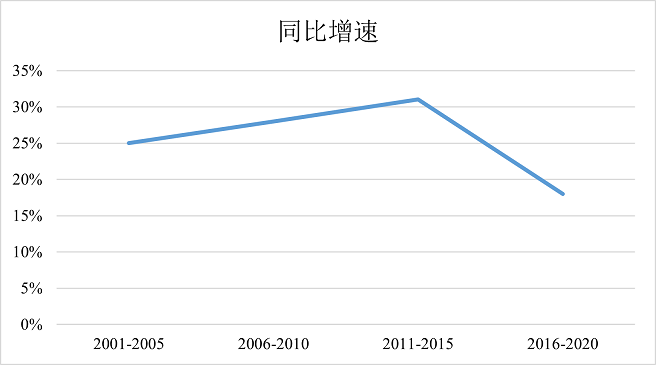
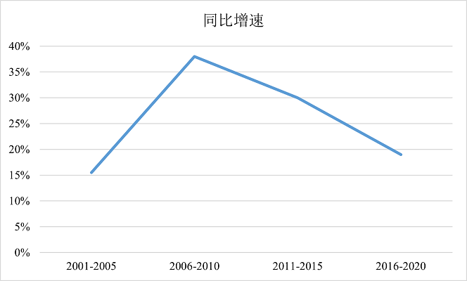
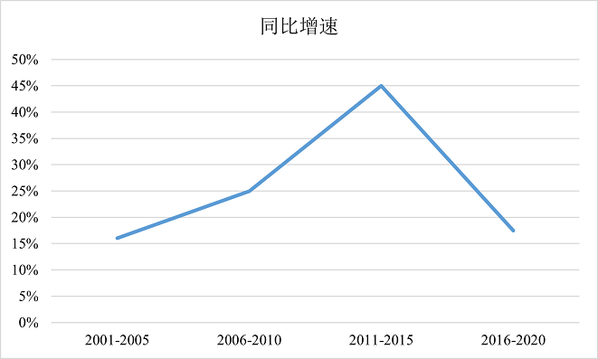

# 同比增长率计算与比较（五年区间增长率、图形匹配）

考点：[[20-考点/资料分析/增长/同比增长率计算与比较（五年区间增长率、图形匹配）|增长 / 同比增长率计算与比较（五年区间增长率、图形匹配）]]
材料：[[15-材料/资料分析/307986 1971—2020年全球脑科学领域论|307986 1971—2020年全球脑科学领域论]]

**问法模型**：题干问'2001-2020年间…同比增长情况'且选项为数据为百分数的图表 → 判定为一般增长率问题，用'增长率=(现期−基期)/基期'对每个五年区间各算一个增长率，再按图形走势与量级匹配选项

## 推理链
1. 第1步：题干限定'2001-2020年间''同比增长情况'，结合选项均为含百分数的图表，判定本题为一般增长率问题
2. 第2步：从柱状图提取相邻区间数值（单位：篇）：1996~2000年198820、2001~2005年226891、2006~2010年290249、2011~2015年378830、2016~2020年451472
3. 第3步：代入公式 增长率=(现期−基期)/基期，2001~2005年为(226891−198820)/198820=28071/198820≈14.1%
4. 第4步：同理，2006~2010年为(290249−226891)/226891=63358/226891≈27.9%；2011~2015年为(378830−290249)/290249=88581/290249≈30.5%；2016~2020年为(451472−378830)/378830=72642/378830≈19.2%
5. 第5步：四个区间增长率依次为14.1%→27.9%→30.5%→19.2%，形态为'先升后降、峰值出现在2011~2015年、量级14%~31%'
6. 第6步：与选项图形对照，只有C项的百分数柱形呈'先升后降、峰值30.5%'的走势，故选C

**最快解法**：⚡ 截位直除+定性看走势：各区间增量截位（约2.8万、6.3万、8.9万、7.3万）除以基期截位（约19.9万、22.7万、29.0万、37.9万），口算得约14%、28%、31%、19%，锁定'先升后降、峰值在2011~2015'的图形特征，直接匹配C项，无需精算全部数值

## 易错点
- ⚠ 柱状图每根柱是五年累计发文量，'同比增长'是本区间相对上一五年区间的增长率，一个区间只产出一个增长率数据，2001~2005年的基期是1996~2000年（198820），基期取错首点即错
- ⚠ 误把'同比增长情况'当作增长量作差（增量28071/63358/88581/72642虽同为先升后降，但选项图中数据均为百分数，口径不符）；且增量与增长率的排序可能不同区间出现差异，须按增长率口径匹配
- ⚠ 表格（2016-2020年国家数据）与本题无关，且表格中CNS占比、ESI占比等百分数与增长率口径不同，不可混入比较

## 母题抽象
> 🧩 当题干出现'某时间段……同比增长情况'且选项为含百分数的图形时，用'增长率=(现期−基期)/基期'对每个区间各算一个增长率，再按'整体走势+峰值位置+数值量级'三要素匹配选项图形

**同类特征**：同比增长情况、2001-2020年间、选项为图表且数据为百分数、柱状图为五年一个区间的累计值、相邻区间两两作增长率、按图形走势匹配答案

## 相关题
（暂无）

---

### 题干
下列选项中，图（    ）展示了2001-2020年间全球脑科学领域发表论文数量的同比增长情况。

### 选项
- A. 

- B. 

- C. 

　✅
- D. 

### 官方解析
根据题干“2001-2020年间······同比增长情况”，结合选项为图表且数据都为百分数，可判定本题为一般增长率问题。定位统计图，可知各时间段全球脑科学领域发表论文的数量。代入公式：增长率，则2001-2005年、2006-2010年、2011-2015年、2016-2020年全球脑科学领域发表论文数量的同比增长率分别为
2001-2005年：；
2006-2010年：；
2011-2015年：；
2016-2020年：。
结合选项，只有C项符合。
故正确答案为C。

### 给定材料

