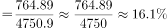
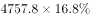
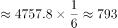
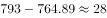

# 增长量计算（由比重变化反推基期部分量再作差）

考点：[[20-考点/资料分析/增长/增长量计算（由比重变化反推基期部分量再作差）|增长 / 增长量计算（由比重变化反推基期部分量再作差）]]
材料：[[15-材料/资料分析/308028 2016—2020年末S省就业人口总|308028 2016—2020年末S省就业人口总]]

**问法模型**：题干只给'2020年末第一产业就业人口同比'＋选项为'增加/减少＋量级区间'→ 需由现期部分量、比重变化和两期整体量反推基期部分量，再求增长量并判断增减方向与量级

## 推理链
1. 第1步：从文字材料提取：2020年末一产就业764.89万人，一产就业比重较2019年末下降0.7个百分点；从柱状图提取：2019年末就业人口总量4757.8万人、2020年末4750.9万人
2. 第2步：现期比重＝部分÷整体：764.89/4750.9≈16.1%（一产占2020年就业人口比重）
3. 第3步：比重'下降'0.7个百分点，说明2019年末比重更高，基期比重＝16.1%+0.7%=16.8%（方向不能搞反）
4. 第4步：基期部分量＝整体×比重：4757.8×16.8%≈799.3万人（即2019年末一产就业人数）
5. 第5步：增长量＝现期−基期＝764.89−799.3≈−34.4万人，即同比减少约34万人
6. 第6步：对照选项：方向为减少、量级不到50万人，故选A

**最快解法**：⚡ 公式法＋百化分速算：764.89/4750.9≈16.1%（截位直除），基期比重16.8%≈1/6，故2019年一产≈4757.8×1/6≈793万人，增长量≈764.89−793≈−28万人（更精确约−34万人），无论粗精口径均为'减少且不到50万'，直接锁定A

## 易错点
- ⚠ 把'比重下降0.7个百分点'误当'数量下降'或直接拿0.7当万人做差，须先还原基期比重再乘基期总量
- ⚠ 基期比重方向搞反：比重是'下降'的，基期比重应比现期高，需加0.7个百分点而非减
- ⚠ 分母口径错误：产业占比的分母是当年就业人口总量（2019年用4757.8、2020年用4750.9），不能统一用4750.9，更不能误用占常住人口的59.01%这一口径；另注意柱状图纵轴非零起点造成的'大幅下降'视觉误导

## 母题抽象
> 🧩 当题干出现'现期部分量＋比重较基期变化X个百分点＋两期整体量'时，用'现期比重=部分/整体→反向还原基期比重→基期部分量=基期整体×基期比重→作差'，验证同比增减方向与量级区间

**同类特征**：同比、增加/减少＋量级区间选项、比重下降（上升）X个百分点、第一产业就业人口、增长量计算、基期部分量反推

## 相关题
- [[10-真题/资料分析/增长/7159 增长量计算|7159]]（北京 2009，相关度1）
- [[10-真题/资料分析/增长/2571729 增长量计算——每增长1个百分点对应的增量（基期量×1%）|2571729]]（山东 2020，相关度1）
- [[10-真题/资料分析/增长/3018839 增长量计算（负增长情形：基期减少量）|3018839]]（广东 2021，相关度1）
- [[10-真题/资料分析/增长/10204654 增长量计算（已知现期与同比下降率求下降量）|10204654]]（安徽 2024，相关度1）
- [[10-真题/资料分析/增长/10718183 名义增速与实际增速之差（百分点计算）|10718183]]（深圳市考 2024，相关度1）

---

### 题干
2020年末S省第一产业就业人口同比：

### 选项
- A. 减少了不到50万人　✅
- B. 减少了50万人以上
- C. 增加了不到50万人
- D. 增加了50万人以上

### 官方解析

根据题干“2020年末······同比”，结合选项为增加/减少+单位，可判定本题为增长量计算问题。定位文字材料第二段可知：2020年末S省第一产业的就业人口数量为764.89万人，与2019年末相比，就业人口比重下降0.7个百分点；定位图形材料可知：2019年末、2020年末S省就业人口数量分别为4757.8万人、4750.9万人。根据公式：比重，可得2020年末S省第一产业的就业人口数量占就业人口的比重，则2019年末S省第一产业的就业人口数量占就业人口的比重＝16.1%+0.7%=16.8%。根据公式：部分＝整体×比重，可得2019年末S省第一产业的就业人口数量为万人。则2020年末S省第一产业就业人口同比减少万人，即减少了不到50万人。

故正确答案为A。

### 给定材料

        2020年末S省就业人口4750.9万人，占常住人口总数的59.01%，与2019年末相比，就业人口占常住人口总数的比重下降0.24个百分点。

        2020年末S省第一产业、第二产业和第三产业的就业人口数量分别为764.89万人、2033.39万人、1952.62万人，与2019年末相比，第一、第二产业就业人口比重分别下降0.7个、0.1个百分点，第三产业就业人口比重上升0.8个百分点。

