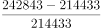
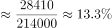
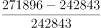
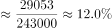
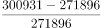
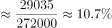
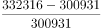
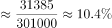

# 同比增长率比较（现期÷基期−1，多年连续比较）

考点：[[20-考点/资料分析/增长/同比增长率比较（现期÷基期−1，多年连续比较）|增长 / 同比增长率比较（现期÷基期−1，多年连续比较）]]
材料：[[15-材料/资料分析/308285 2016年我国社会消费品零售总额的总|308285 2016年我国社会消费品零售总额的总]]

**问法模型**：题干问'2013-2016年同比增速最快的年份是'→ 从柱状图取相邻两年数据，用增长率=（现期−基期）÷基期逐年计算并比较取最大

## 推理链
1. 第1步：从柱状图读出2012—2016年社会消费品零售总额：214433、242843、271896、300931、332316亿元；2013—2016年各年的基期即前一年数值（2013年基期为2012年的214433）
2. 第2步：所用公式：同比增速=（现期−基期）÷基期×100%，即增长量÷基期
3. 第3步：逐年求增长量：2013年242843−214433=28410，2014年271896−242843=29053，2015年300931−271896=29035，2016年332316−300931=31385亿元
4. 第4步：截位直除比较增长量÷基期：2013年28410/214433≈13.2%，2014年29053/242843≈12.0%，2015年29035/271896≈10.7%，2016年31385/300931≈10.4%
5. 第5步：13.2%＞12.0%＞10.7%＞10.4%，增速最快为2013年，与选项A对照一致，故正确答案为A

**最快解法**：⚡ 截位直除（增长量÷基期）：四年增长量都在2.84万~3.14万亿元、差距不大，而基期从214433逐年增大到300931，故分子接近、分母最小者增速最大；先直除2013年28410/214433≈13.2%，再粗验2014年29053/242843≈12.0%已明显更小，即可锁定2013年，无须算满四年（等价技巧：比较现期÷基期比值，比值最大即增速最大）

## 易错点
- ⚠ 基期取值陷阱：比较2013—2016年增速，各年基期须取前一年数据（如2013年基期是2012年214433），勿把文字段中2016年同比10.4%等现期增速直接搬来排序而漏算2013、2014年
- ⚠ 增长量与增长率混淆：2016年增长量31385亿元最大，但其基期300931也最大，增速10.4%反而最低；不能以'增量最大'误判'增速最快'
- ⚠ 数据来源口径：图中2016年柱值332316与文字首段重复出现，属同一数据，勿当成两个来源产生矛盾而犹豫；图中读数单位为亿元，刻度到350000，勿看错量级

## 母题抽象
> 🧩 当题干出现'某连续几年中同比增速最快（最大）的年份'且材料给出逐年总量柱状图时，用增长量÷基期（或现期÷基期−1）逐年截位直除比较，取比值最大者；若各年增量接近而基期差异明显，可直接锁定基期最小且直除验证的年份

**同类特征**：同比增速最快、2013-2016年连续多年区间、柱状图相邻两年读数、增长率比较、现期÷基期−1

## 相关题
- [[10-真题/资料分析/增长/5802088 增长率比较（基期需由现期−增量还原）|5802088]]（浙江 2023，相关度2）
- [[10-真题/资料分析/增长/10297450 增长率比较（条形图逐年同比增速）|10297450]]（四川 2025，相关度2）
- [[10-真题/资料分析/增长/5509782 一般增长率比较（直接给%与给增量两种口径混合换算）|5509782]]（四川 2023，相关度2）
- [[10-真题/资料分析/增长/5894968 同比增长率比较（逐年增速找最大）|5894968]]（国考 2024，相关度2）
- [[10-真题/资料分析/增长/2385097 增长率比较（同比增速最快年份）|2385097]]（深圳市考 2019，相关度2）

---

### 题干
2013-2016年，社会消费品零售总额同比增速最快的年份是：

### 选项
- A. 2013年　✅
- B. 2014年
- C. 2015年
- D. 2016年

### 官方解析

根据题干“2013-2016年······同比增速最快的年份是”，可判定本题为一般增长率问题。定位统计图可得：2012-2016年社会消费品零售总额分别为214433亿元、242843亿元、271896亿元、300931亿元、332316亿元。根据公式：增长率，可得2013-2016年社会消费品零售总额同比增速分别为：

2013年：；

2014年：；

2015年：；

2016年：。

则2013-2016年，社会消费品零售总额同比增速最快的年份是2013年。

故正确答案为A。

### 给定材料

        2016年，我国全年社会消费品零售总额332316亿元。按经营地统计，城镇消费品零售额285814亿元，增长10.4%；乡村消费品零售额46503亿元，增长10.9%。按消费类型统计，商品零售额296518亿元，增长10.4%；餐饮收入额35799亿元，增长10.8%。

        在限额以上企业商品零售额中，粮油、食品、饮料、烟酒类零售额比上年增长10.5%，服装、鞋帽、针纺织品类增长7.0%，化妆品类增长8.3%，金银珠宝类与上年持平，日用品类增长11.4%，家用电器和音像器材类增长8.7%，中西药品类增长12.0%，文化办公用品类增长11.2%，家具类增长12.7%，通讯器材类增长11.9%，建筑及装潢材料类增长14.0%，汽车类增长10.1%，石油及制品类增长1.2%。

        全年网上零售额51556亿元，比上年增长26.2%。其中，网上商品零售额41944亿元，增长25.6%，占社会消费品零售总额的比重为12.6%。在网上商品零售额中，吃类商品增长28.5%，穿类商品增长18.1%，用类商品增长28.8%。

