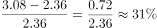
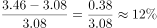
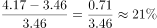
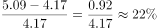
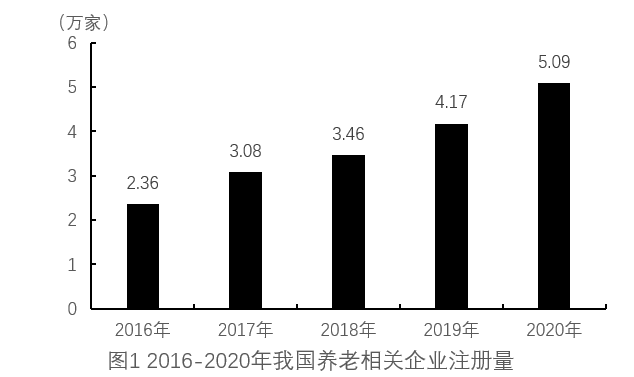
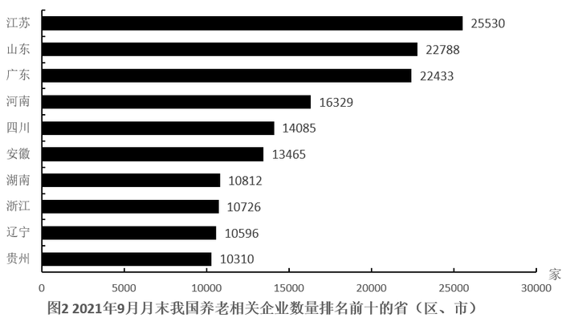
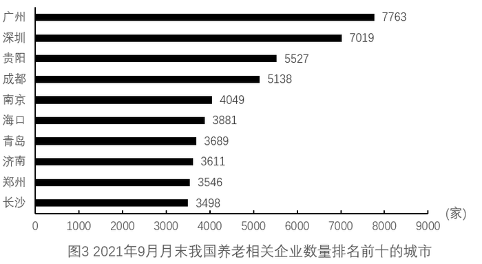

# 增长率比较（逐年同比增速比较）

考点：[[20-考点/资料分析/增长/增长率比较（逐年同比增速比较）|增长 / 增长率比较（逐年同比增速比较）]]
材料：[[15-材料/资料分析/308437 我国养老相关企业的发展情况：2016|308437 我国养老相关企业的发展情况：2016]]

**问法模型**：题干问'2017-2020年增速最快的年份是'→ 定位图1逐年注册量，用增长率=(现期-基期)/基期逐年计算后比较大小。

## 推理链
1. 第1步：题干限定比较2017-2020年注册量同比增速，只用图1（流量口径，单位万家），得2016-2020年注册量分别为2.36、3.08、3.46、4.17、5.09万家。
2. 第2步：增长率公式：增速=(现期值-基期值)/基期值=现期值/基期值-1，逐年以上一年为基期。
3. 第3步：代入计算：2017年(3.08-2.36)/2.36=0.72/2.36≈30.5%；2018年(3.46-3.08)/3.08=0.38/3.08≈12.3%；2019年(4.17-3.46)/3.46=0.71/3.46≈20.5%；2020年(5.09-4.17)/4.17=0.92/4.17≈22.1%。
4. 第4步：比较四年增速：30.5%＞22.1%＞20.5%＞12.3%，2017年增速最快，对应A选项。

**最快解法**：⚡ 截位直除+先排明显小项：2018年0.38/3.08不足13%直接排除；2019年0.71/3.46与2017年0.72/2.36分子几乎相同但2017年分母小得多，故2017＞2019；2020年0.92/4.17≈22%（0.92/4.17＜0.92/4=23%，而0.72/2.36＞0.72/2.4=30%），故2017年最快，秒选A。

## 易错点
- ⚠ 混淆增长量与增长率：2020年增量0.92万家为四年最大，但基期4.17也最大，增速22.1%并非最快；只看柱子高度差会误选D（2020）。
- ⚠ 增长率分母用错：必须以上一年（基期）为分母，如2017年增速分母是2.36而非3.08，误用现期作分母会压低所有增速且改变排序判断。
- ⚠ 口径与范围陷阱：本题只比较2017-2020四年，2016年作为基期不参与比较；且只用图1注册量（流量），勿被图2图3的存量数据（单位'家'）干扰。

## 母题抽象
> 🧩 当题干出现'某几年中增速最快（最慢）的年份是'时，从图中取逐年数据，用(现期-基期)/基期逐年求增速再比较；速算时先排除增长量明显小的年份，再用'分子相近比分母、分母相近比分子'快速定序，牢记增量最大≠增速最快。

**同类特征**：增速最快的年份、2017-2020年连续区间比较、注册量（流量数据）、图1柱状图逐年读数、增长率大小比较、逐年同比

## 相关题
- [[10-真题/资料分析/增长/10204589 增长率比较（逐年同比增速比较）|10204589]]（河北 2024，相关度2）
- [[10-真题/资料分析/增长/4673212 同比增长率（同比增幅）大小比较|4673212]]（广东 2022，相关度1）
- [[10-真题/资料分析/增长/14403675 同比增长率比较（逐年增速取最大）|14403675]]（山东 2025，相关度1）
- [[10-真题/资料分析/增长/17097815 同比增速（增长率）大小比较|17097815]]（山西 2024，相关度1）
- [[10-真题/资料分析/增长/18385420 同比增速比较（增长快慢）|18385420]]（浙江 2024，相关度1）

---

### 题干
2017-2020年，我国养老相关企业注册量增速最快的年份是：

### 选项
- A. 2017　✅
- B. 2018
- C. 2019
- D. 2020

### 官方解析

根据题干“2017-2020年······增速最快的年份是”，可判定本题为一般增长率比较问题。定位图1可得：2016-2020年我国养老相关企业注册量分别为2.36万家、3.08万家、3.46万家、4.17万家、5.09万家。根据公式：增长率，可得2017-2020年我国养老相关企业注册量增速分别为：

2017年：；

2018年：；

2019年：；

2020年：。

则2017-2020年，我国养老相关企业注册量增速最快的年份是2017年。

故正确答案为A。

### 给定材料

        数据显示，我国近10年养老相关企业注册量逐年攀升。2020年注册量达5.09万家，同比增长22%。2021年1-3季度共注册3.92万家养老相关企业，同比增长16%。

        从地区来看，2021年9月月末，江苏省是我国养老相关企业数量最多的省份，占全国总量的9%，山东、广东排名第二、第三位。

        从城市分布来看，2021年9月月末，广州市拥有的养老相关企业数量最多，共7763家，占广东省总量的34.6%。

