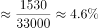

# 一般增长率计算（已知增长量与现期量）

考点：[[20-考点/资料分析/增长/一般增长率计算（已知增长量与现期量）|增长 / 一般增长率计算（已知增长量与现期量）]]
材料：[[15-材料/资料分析/308750 2020年全国职工基本医疗保险的参保|308750 2020年全国职工基本医疗保险的参保]]

**问法模型**：题干'2020年……同比增长约（ ）'且选项为百分数 → 一般增长率模型：增长率=增长量÷基期量，其中基期量=现期量−增长量

## 推理链
1. 第1步：材料第一段给出2020年参加职工医保34455万人、比上年同比增加1530万人，即现期量34455万人、增长量1530万人
2. 第2步：由'同比增加'可知增长量对应上年基数，基期量=现期量−增长量=34455−1530=32925万人
3. 第3步：代入增长率公式：1530÷32925≈4.6%（截位直除：1530/32925，首位商4、次位商6）
4. 第4步：与选项对照，4.6%对应A项，排除B(5.4%)、C(6.2%)、D(7.1%)，故正确答案为A

**最快解法**：⚡ 截位直除：基期量=34455−1530=32925万人，1530/32925≈153/3293≈4.6%，首位商4直接锁定A；亦可百化分：1530约为32925的1/21.5≈4.6%

## 易错点
- ⚠ 分母误用现期量：错算成1530÷34455≈4.4%，增长率分母应为基期量32925万人（现期量−增长量）
- ⚠ '同比增加1530万人'是增长量，勿误当作基期量或现期量使用
- ⚠ 口径混淆：本题只涉及参保人数，勿把基金收支数据（收入-0.7%、减征1649亿元等第2段数据）混入计算

## 母题抽象
> 🧩 当题干同时给出现期量和'同比增加X'的增长量求增长率时，用增长率=增长量÷(现期量−增长量)，截位直除对照选项即可

**同类特征**：同比增长约、参保人数34455万人、同比增加1530万人、选项为百分数、现期量与增长量同时给出、求一般增长率

## 相关题
- [[10-真题/资料分析/增长/10204500 差值（进口=总值-出口）的同比增长率·基期差值法|10204500]]（云南 2024，相关度2）
- [[10-真题/资料分析/增长/12881991 同比增长率计算（增长量÷基期量）|12881991]]（广东 2025，相关度2）
- [[10-真题/资料分析/增长/13432356 衍生指标（换乘量）同比增长率计算|13432356]]（深圳市考 2025，相关度2）
- [[10-真题/资料分析/增长/4673205 已知增长量与基期量求同比增长率|4673205]]（广东 2022，相关度2）
- [[10-真题/资料分析/增长/16540255 分类数据加总后求同比增长率|16540255]]（上海 2021，相关度2）

---

### 题干
2020年，全国参加职工医保人数同比增长约（    ）。

### 选项
- A. 4.6%　✅
- B. 5.4%
- C. 6.2%
- D. 7.1%

### 官方解析

根据题干“2020年······同比增长约······”，结合选项为百分数，可判定本题为一般增长率问题。定位文字材料第一段可得：“（2020年）参加职工医保34455万人，比上年同比增加1530万人。”根据公式：增长率，则2020年，全国参加职工医保人数同比增速。

故正确答案为A。

### 给定材料

        2020年，全国职工基本医疗保险（以下简称职工医保）参保人数持续增加，基金收支规模基本稳定。参加职工医保34455万人，比上年同比增加1530万人。其中在职职工25429万人，比上年增长5.0%；退休职工9026万人，比上年增长3.7%。企业、机关事业、灵活就业等其他人员三类参保人员（包括在职职工和退休人员）分别为23317万人、6387万人、4751万人，分别比上年增加1050万人、155万人、325万人。

        受新冠肺炎疫情影响，2020年2-7月全国多地实施阶段性减半征收职工医保单位缴费，累计减征约1649亿元，全年职工医保基金（含生育保险）收入15732亿元，比上年减少0.7%；支出12867亿元，比上年增长1.6%。2020年，职工医保统筹基金（含生育保险）收入9145亿元，比上年减少8.6%；支出7931亿元，比上年减少0.1%；当期结存1214亿元，累计结存15327亿元。

        2020年，职工医保个人账户收入6587亿元，比上年增长12.8%；支出4936亿元，比上年增长4.5%；当期结存1650亿元，累计结存10096亿元。

        2020年就诊量同比有所减少。参加职工医保人员享受待遇17.9亿人次，比上年减少15.6%。职工医保参保人员住院率15.9%，比上年下降2.8个百分点。其中：在职职工住院率为8.6%，比上年下降1.5个百分点；退休职工住院率为36.0%，比上年下降6.5个百分点。

