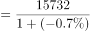
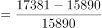

# 反事实假设下的一般增长率计算（减征额加回+负增速反推基期）

考点：[[20-考点/资料分析/增长/反事实假设下的一般增长率计算（减征额加回+负增速反推基期）|增长 / 反事实假设下的一般增长率计算（减征额加回+负增速反推基期）]]
材料：[[15-材料/资料分析/308750 2020年全国职工基本医疗保险的参保|308750 2020年全国职工基本医疗保险的参保]]

**问法模型**：题干出现'若未实施减征……则2020年同比增长'的反事实假设问法 → 先将减征额加回现期收入得假想现期，再用'-0.7%'除以(1-0.7%)反推基期，最后套增长率=(现期-基期)/基期

## 推理链
1. 第1步：从材料第二段跨句拼合三处数据：2-7月累计减征约1649亿元、2020年全年职工医保基金（含生育保险）收入15732亿元、比上年减少0.7%
2. 第2步：假想现期量=实际收入+减征额，即15732+1649=17381亿元（题干默认基期收入不受减征影响）
3. 第3步：材料'减少0.7%'即增速为-0.7%，基期(2019年)收入=15732÷(1-0.7%)=15732÷0.993≈15843亿元
4. 第4步：假想同比增长率=(17381-15843)÷15843=1538÷15843≈9.7%
5. 第5步：9.7%与C项10%最接近（A为4%、B为7%、D为13%均不符），故选C

**最快解法**：⚡ 截位直除+估算：1538/15843截位为1538/15800≈9.7%（或分子分母同放大按1538/16000≈9.6%估），略低于10%但远高于7%，直接锁定C

## 易错点
- ⚠ 漏加减征额：不把1649亿元加回现期，直接用15732算会误认为仍为-0.7%而错选
- ⚠ 基期反推方向搞反：材料写'减少0.7%'，增速为-0.7%，须除以(1-0.7%)；误除以(1+0.7%)会得约15722亿元，结果偏差
- ⚠ 口径嵌套陷阱：误用统筹基金收入9145亿元或把个人账户/累计结存10096亿元掺入，本题必须用全基金（含生育保险）口径15732亿元

## 母题抽象
> 🧩 当题干出现'若未实施某减收（减征/免税）政策，则同比增长'特征时，用'假想现期=实际值+减征额、基期=实际值÷(1-实际增速)'模型，代入增长率公式后与选项对照验证

**同类特征**：若……未实施减半征收/减征、基金总收入（含生育保险）、同比增长、反事实假设条件、累计减征额加回现期、负增速反推基期量

## 相关题
- [[10-真题/资料分析/增长/2050996 同比增长率计算（一般增长率）|2050996]]（江西 2017，相关度1）
- [[10-真题/资料分析/增长/2742301 整体同比增长率计算（整体=私有云+公有云加总后求增速）|2742301]]（北京 2021，相关度1）
- [[10-真题/资料分析/增长/5509648 同比增长率计算（柱状图直接给基期、现期）|5509648]]（吉林 2023，相关度1）
- [[10-真题/资料分析/增长/14096274 增长率计算与比较（进出口总额同比增速判断）|14096274]]（选调 2025，相关度1）
- [[10-真题/资料分析/增长/2452581 增长率计算（已知现期量与基期量求同比增速）|2452581]]（江苏 2020，相关度1）

---

### 题干
若2-7月未实施阶段性减半征收职工医保单位缴费，则2020年职工医保基金总收入（含生育保险）同比增长（    ）。

### 选项
- A. 4%
- B. 7%
- C. 10%　✅
- D. 13%

### 官方解析

根据题干“······2020年······同比增长”，结合选项为百分数，可判定本题为一般增长率问题。定位文字材料第二段：“2020年2-7月全国多地实施阶段性减半征收职工医保单位缴费，累计减征约1649亿元，全年职工医保基金（含生育保险）收入15732亿元，比上年减少0.7%。”根据公式：基期量，可得2019年职工医保基金（含生育保险）收入亿元；若2-7月未实施阶段性减半征收职工医保单位缴费，则2020年职工医保基金（含生育保险）收入=15732+1649=17381亿元；又根据公式：增长率，可得2020年职工医保基金总收入（含生育保险）同比增长率，与C项最接近。

故正确答案为C。

### 给定材料

        2020年，全国职工基本医疗保险（以下简称职工医保）参保人数持续增加，基金收支规模基本稳定。参加职工医保34455万人，比上年同比增加1530万人。其中在职职工25429万人，比上年增长5.0%；退休职工9026万人，比上年增长3.7%。企业、机关事业、灵活就业等其他人员三类参保人员（包括在职职工和退休人员）分别为23317万人、6387万人、4751万人，分别比上年增加1050万人、155万人、325万人。

        受新冠肺炎疫情影响，2020年2-7月全国多地实施阶段性减半征收职工医保单位缴费，累计减征约1649亿元，全年职工医保基金（含生育保险）收入15732亿元，比上年减少0.7%；支出12867亿元，比上年增长1.6%。2020年，职工医保统筹基金（含生育保险）收入9145亿元，比上年减少8.6%；支出7931亿元，比上年减少0.1%；当期结存1214亿元，累计结存15327亿元。

        2020年，职工医保个人账户收入6587亿元，比上年增长12.8%；支出4936亿元，比上年增长4.5%；当期结存1650亿元，累计结存10096亿元。

        2020年就诊量同比有所减少。参加职工医保人员享受待遇17.9亿人次，比上年减少15.6%。职工医保参保人员住院率15.9%，比上年下降2.8个百分点。其中：在职职工住院率为8.6%，比上年下降1.5个百分点；退休职工住院率为36.0%，比上年下降6.5个百分点。

