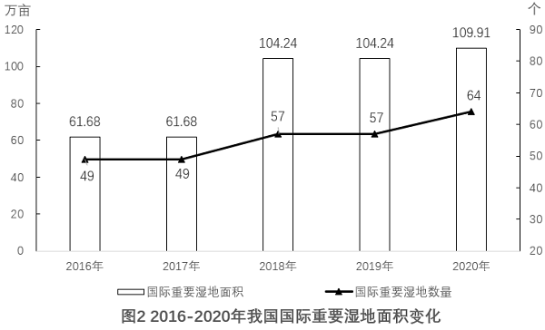

# 年均增长率

考点：[[20-考点/资料分析/增长/年均增长率|增长 / 年均增长率]]
材料：[[15-材料/资料分析/308752 以'双碳'为背景介绍我国森林资源状况|308752 以'双碳'为背景介绍我国森林资源状况]]

**问法模型**：题干出现'2016-2018年……年均增长率约为'→用年均增长率公式(1+r)^n=现期值/基期值（n=年份差=2），开平方求r

## 推理链
1. 第1步：题干限定'2016-2018年'与'国际重要湿地面积'，定位图2：基期2016年面积为61.68万亩，现期2018年面积为104.24万亩（注意2017年与2016年同为61.68，不参与本题计算）
2. 第2步：年均增长率公式为(1+r)^n=现期值/基期值，n取年份差，n=2018-2016=2，即开2次方
3. 第3步：代入计算：(1+r)^2=104.24/61.68≈1.690，故1+r=√1.690≈1.30（因1.3²=1.69恰好为完全平方）
4. 第4步：解得r≈1.30-1=30%，与选项B（30%）一致，故选B

**最快解法**：⚡ 公式法+完全平方凑整：先截位算比值104.24/61.68≈1.69，联想1.3²=1.69恰为完全平方，立得r=1.3-1=30%，秒选B；若不凑整也可代选项验证：1.3²=1.69与1.69吻合

## 易错点
- ⚠ 年份差陷阱：n=现期年-基期年=2018-2016=2，若误按年份个数取n=3去开立方，会算得约19%，选错方向
- ⚠ 取数陷阱：图2中2017年与2016年（同为61.68）、2019年与2018年（同为104.24）数值相同，必须严格按题干锁定2016为基期、2018为现期，勿取错年份或跨图取图1数据
- ⚠ 单位陷阱：图2面积单位为'万亩'，与图1'亿亩'量级差1万倍；本题算比值时单位自动约掉不受影响，但基期、现期必须同源取自图2

## 母题抽象
> 🧩 当题干出现'某年-某年……年均增长率约为'时，用(1+r)^n=现期/基期（n=年份差），先求比值再开n次方，选项差距大时优先凑完全平方或代选项验证

**同类特征**：年均增长率约为、2016-2018年（间隔两年）、国际重要湿地面积、图2柱形取数、选项为25%~40%整数百分比、n=2开平方

## 相关题
- [[10-真题/资料分析/综合/5514932 综合分析（年均增长率+部分=整体×比重+比重变化比较，四选项逐项验证）|5514932]]（广东 2023，相关度1）
- [[10-真题/资料分析/增长/2049374 年均增长率（基期需自算，n=5次方）|2049374]]（河南 2017，相关度1）
- [[10-真题/资料分析/增长/3018816 年均增长率计算|3018816]]（广东 2021，相关度1）

---

### 题干
2016-2018年，我国国际重要湿地面积的年均增长率约为（    ）。

### 选项
- A. 25%
- B. 30%　✅
- C. 35%
- D. 40%

### 官方解析
根据题干“2016-2018年······年均增长率约为”，可判定本题为年均增长率问题。定位图2可得：2016年与2018年我国国际重要湿地面积分别为61.68万亩、104.24万亩。根据年均增长率公式：（n为年份差），则，解得。
故正确答案为B。

### 给定材料

        增加森林面积、提高森林质量、提升生态系统碳汇增量，将为我国实现碳达峰、碳中和目标、维护全球生态安全做出巨大贡献。1973年，我国开展了第一次森林资源清查。目前已完成第9次森林资源清查，我国森林面积和森林蓄积量连续30年保持“双增长”。“十三五”时期，我国累计造林5.45亿亩，森林覆盖率达到23.04%，森林蓄积量为175.6亿立方米，森林面积达到2.2亿公顷（1公顷为15亩）。湿地保护率达到52%，治理沙化土地1.5亿亩。

