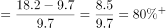
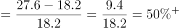

# 同比增长率（同比增幅）大小比较

考点：[[20-考点/资料分析/增长/同比增长率（同比增幅）大小比较|增长 / 同比增长率（同比增幅）大小比较]]
材料：[[15-材料/资料分析/308754 2015—2020年全国基层群众性自|308754 2015—2020年全国基层群众性自]]

**问法模型**：题干出现'以下年份中……同比增幅最大的是'且给出各年当期值序列 → 对每个候选年份套用增长率=(现期−基期)/基期逐一计算并比较，负增长年份先排除

## 推理链
1. 第1步：题干要求比较的是'村(居)委会完成选举数'的同比增幅，该指标只在文字材料第二段，与统计图中的组织个数无关，数据为2016—2020年：9.7、18.2、27.6、8.8、6.1万个（2015年未给，2016年同比无法算，只能比较2017—2020年）
2. 第2步：公式：同比增长率=(现期−基期)/基期，只需对2017、2018、2019、2020四个年份计算
3. 第3步：先判符号排除：2019年8.8<27.6、2020年6.1<8.8，两年均同比减少，增长率小于0，直接排除，与官方解析一致
4. 第4步：正增长年份代入计算：2017年=(18.2−9.7)/9.7=8.5/9.7≈+87.6%；2018年=(27.6−18.2)/18.2=9.4/18.2≈+51.6%
5. 第5步：比较得+87.6%＞+51.6%＞0＞负增长，2017年同比增幅最大，对照选项选A（2017年）

**最快解法**：⚡ 符号排除+截位倍数速比：先用'现期<基期'排除2019、2020两个负增长年份；再比2017与2018——2017年增量8.5相对基期9.7接近1倍（增幅近九成），2018年增量9.4相对基期18.2约一半（增幅约五成），分子/基期倍数一比即锁定2017年，全程无需精算百分数

## 易错点
- ⚠ 指标错位：'完成选举数'（9.7/18.2/27.6/8.8/6.1万个，有大小起伏）不是统计图中的'组织个数'（逐年缓降），本题只能用文字数据，误用图中50.2/11.3等数据必错
- ⚠ 比较范围：2015年选举数材料未给，2016年同比无法计算，实际只需比较2017—2020年，勿试图给2016年算增速
- ⚠ 符号与年份对应：'增幅最大'比较中负增长（2019年−68.1%、2020年−30.7%）不能参选；且实算对应关系为2017年≈+87.6%、2018年≈+51.6%、2019年≈−68.1%、2020年≈−30.7%，勿把2018年的+51.6%错记到2017年名下（结论不变，仍2017最大）

## 母题抽象
> 🧩 当题干出现'以下年份中，某指标同比增幅（增速）最大的是'且材料只给各年当期值序列时，先用现期与基期的大小关系剔除负增长年份，再对正增长年份比较'增量/基期'的倍数关系，基期最小的正增长年份通常增幅最大。

**同类特征**：同比增幅最大、以下年份中、完成选举数（逐年当期序列值）、增长率大小比较、存在负增长年份需排除

## 相关题
- [[10-真题/资料分析/增长/17097815 同比增速（增长率）大小比较|17097815]]（山西 2024，相关度2）
- [[10-真题/资料分析/增长/10297321 同比增速计算与比较（增长率比较）|10297321]]（浙江 2025，相关度1）
- [[10-真题/资料分析/增长/14403675 同比增长率比较（逐年增速取最大）|14403675]]（山东 2025，相关度1）
- [[10-真题/资料分析/增长/18385420 同比增速比较（增长快慢）|18385420]]（浙江 2024，相关度1）
- [[10-真题/资料分析/增长/19283744 同比增速（增长率）逐年比较|19283744]]（国考 2025，相关度1）

---

### 题干
以下年份中，我国村(居)委会完成选举数同比增幅最大的是（    ）。

### 选项
- A. 2017年　✅
- B. 2018年
- C. 2019年
- D. 2020年

### 官方解析

根据题干“以下年份中，······同比增幅最大的是”，可判定本题为一般增长率问题。定位文字材料第二段可知，2016-2020年，我国村(居)委会完成选举数分别为9.7万个、18.2万个、27.6万个、8.8万个、6.1万个。2019年和2020年我国村(居)委会完成选举数较上年均同比减少，即增长率均小于0，2017年同比增幅，2018年同比增幅，则2017年同比增幅最大。

故正确答案为A。

### 给定材料

        基层群众性自治组织是我国在城市和农村按居民的居住地区建立起来的居民委员会或村民委员会，是城市居民或农村村民自我管理、自我教育、自我服务的组织。

        截止2020年底，全国基层群众性自治组织共计61.5万个，同比减少4.35%。其中，村委会50.2万个，占基层群众性自治组织的81.63%，村民小组376.1万个，村委会成员207.3万人；居委会11.3万个，占基层群众性自治组织的18.37%，居民小组123.6万个，居委会成员61.6万人。2016-2020年，我国村（居）委会完成选举数分别为9.7万个、18.2万个、27.6万个、8.8万个、6.1万个，其中，2020年村（居）委会登记选民数为1.1亿人，参与投票人数为0.65亿人。

> [!warning] 疑点（官方解析可能有误，待人工复核）
> 官方解析中2017、2018年的增幅算式位置空缺（原式缺失），但'2019、2020年负增长、2017年最大'的结论与实算一致，答案A无误；另材料导读将+51.6%标注为2017年属年份错位，实算该值对应2018年，2017年应为+87.6%，不影响答案
