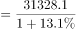
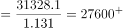

# 基期量计算（已知现期值与同比增速求基期）

考点：[[20-考点/资料分析/增长/基期量计算（已知现期值与同比增速求基期）|增长 / 基期量计算（已知现期值与同比增速求基期）]]
材料：[[15-材料/资料分析/308817 2017年M省固定资产投资（不含农户|308817 2017年M省固定资产投资（不含农户]]

**问法模型**：题干问'2016年……约为……亿元'而材料只给2017年现期值31328.1亿元与同比增速+13.1% → 用基期量=现期量/(1+增长率)一步直除求解。

## 推理链
1. 第1步：题干求2016年固定资产投资（不含农户），材料时间为2017年，给出现期值31328.1亿元、同比增速13.1%，判定为基期计算问题。
2. 第2步：套用基期量公式：基期量=现期量/(1+增长率)=31328.1/(1+13.1%)。
3. 第3步：代入计算31328.1/1.131，截位直除得≈27699.5（验算：27699.5×1.131≈31328.1，吻合）。
4. 第4步：与选项对照，A项27699.5与计算结果一致；B项31328.1恰为2017年现期值，是时间口径陷阱项，排除后确认选A。

**最快解法**：⚡ 截位直除：31328.1/1.131，分母保留1.13，31328.1/1.13≈27724，与A项27699.5最接近（亦可百化分13.1%≈1/7.6，基期≈31328.1×0.884≈27700）；直接锁定A，无需精算。

## 易错点
- ⚠ 时间口径混淆：B项31328.1就是2017年现期值，看到材料原数就选B是最典型陷阱。
- ⚠ 公式误用：误把基期算成'现期−现期×r'即31328.1−31328.1×13.1%≈27224（把增量按现期计算），正确须除以(1+r)。
- ⚠ 主体口径混淆：应抓总量'固定资产投资（不含农户）'对应增速13.1%，误用民间投资增速14.5%或非国有投资增速13.6%代入即错。

## 母题抽象
> 🧩 当题干出现'基期年份+约为+金额单位'且材料只给'现期值+同比增长r%'时，直接用基期量=现期/(1+r)截位直除，并警惕选项中现期值本身作为干扰项。

**同类特征**：问2016年（上年）数值而材料给2017年数据、仅提供现期值+同比增速，无基期绝对值、'约为'估算口吻，选项差距可用截位区分、主体是固定资产投资（不含农户）总量、选项含现期值31328.1作时间口径干扰

## 相关题
（暂无）

---

### 题干
2016年M省固定资产投资（不含农户）约为（    ）亿元。

### 选项
- A. 27699.5　✅
- B. 31328.1
- C. 27712.2
- D. 28233.6

### 官方解析

根据题干“2016年······约为······亿元”，结合材料时间为2017年，可判定本题为基期计算问题。定位文字材料可得：2017年，M省固定资产投资（不含农户）31328.1亿元，比上年增长13.1%。根据公式：基期量，则2016年M省固定资产投资（不含农户）亿元，对应A项。

故正确答案为A。

### 给定材料

        2017年，M省固定资产投资（不含农户）31328.1亿元，比上年增长13.1%。其中，民间投资18759.6亿元，增长14.5%，占固定资产投资的比重为59.9%。分经济类型看，国有投资10395.0亿元，增长12.3%；非国有投资20933.0亿元，增长13.6%。分投资方向看，民生投资3015.9亿元，增长12.8%；生态投资1402.5亿元，增长12.5%；基础设施投资8517.4亿元，增长15.9%；高新技术产业投资2213.0亿元，增长24.7%；工业技改投资6130.2亿元，增长3.9%；战略性新兴产业投资7258.4亿元，增长13.5%。分区域看，A地区投资12395.3亿元，增长13.2%；B地区投资7110.4亿元，增长13.5%；C地区投资5232.7亿元，增长13.8%；D地区投资6429.4亿元，增长14.0%。施工项目共有58178个，比上年增长16.4%。其中，新开工项目43966个，增长7.5%。投产项目42862个，增长28.4%。2017年，M省房地产开发投资3426.1亿元，比上年增长15.9%，其中，住宅投资2194.4亿元，增长17.3%。商品房销售面积8532.3万平方米，增长5.5%，其中，住宅销售面积7368.3万平方米，增长2.5%。商品房销售额4460.7亿元，增长18.9%，其中，住宅销售额3570.8亿元，增长14.7%。年末商品房待售面积2015.5万平方米，下降30.5%，比上年末减少886.0万平方米。

