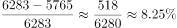

# 减少率计算（'A比B少百分之几'：差值÷'比'字后基准量）

考点：[[20-考点/资料分析/增长/减少率计算（'A比B少百分之几'：差值÷'比'字后基准量）|增长 / 减少率计算（'A比B少百分之几'：差值÷'比'字后基准量）]]
材料：[[15-材料/资料分析/308818 某市2019年各级各类教育（普通高校|308818 某市2019年各级各类教育（普通高校]]

**问法模型**：题干为'毕业生数比招生数少____'且选项人数与百分数混排→先求差值（招生−毕业）排除人数选项，再以'比'字后的量（招生数）为分母求百分比。

## 推理链
1. 第1步：由选项A、B为人数、C、D为百分数，判定本题先算差值再转百分比，定位表格'普通本专科'行：招生数6283人、毕业生数5765人（在校生22555人本题不用）。
2. 第2步：差值=6283−5765=518人，与A(508)、B(627)均不符（B的627恰为中职行5424−4797的干扰差值），排除人数选项。
3. 第3步：转求百分比，'比招生数少'的基准量是'比'字后的招生数6283人。
4. 第4步：截位直除518÷6283：6283×8%≈503，余约15，15/6283≈0.24%，合计约8.24%。
5. 第5步：若误以毕业生数5765为分母，518÷5765≈8.99%恰为D项陷阱；C项8.24%与计算一致，故选C。

**最快解法**：⚡ 截位直除+基准判定：先心算6283−5765=518排除A、B；按'比后为基准'锁定分母6283，518/6283首位商8、次位近似0.24，得8.24%选C；顺带验证518/5765≈8.99%对应D以确认排除。

## 易错点
- ⚠ 基准量颠倒：'比招生数少'分母应为招生数6283（得8.24%），误用毕业生数5765得8.99%而错选D。
- ⚠ 看错行取数：B项627恰为'中等职业教育'行差值5424−4797，必须锁定'普通本专科'行；在校生22555人与本题无关。
- ⚠ 单位混排陷阱：差值518人不在任何人数选项中，勿硬凑'最接近'的508或627，应意识到本题考的是百分比。

## 母题抽象
> 🧩 当题干出现'A比B少/多（多少）'且选项人数与百分数混排时，先求差值排除人数选项，再以'比'字后的量为分母作商，截位直除验证首两位即可锁定答案。

**同类特征**：毕业生数比招生数少、选项人数与百分数混排、同表相邻两列相减、'比'字后基准量作分母、普通本专科（高校）行定位、差值不直接出现在选项中

## 相关题
（暂无）

---

### 题干
该市高校毕业生数比招生数少：

### 选项
- A. 508人
- B. 627人
- C. 8.24%　✅
- D. 8.99%

### 官方解析

根据题干“······毕业生数比招生数少”，结合选项为多少人及百分数，可判定本题为简单加减计算及增长率计算问题。定位表格材料可得，2019年该市普通本专科（高校）招生数6283人，毕业生数5765人，则毕业生数比招生数少6283-5765=518人，排除A、B两项；毕业生数比招生数少，与C项最接近。

故正确答案为C。

### 给定材料

        某市学生招生毕业均在9月份，2019年末有普通高校2所，普通本专科（不含成人）在校生22555人。高考文理本科达线率为50.14%。各类中等职业教育（不含技工学校）16所，在校生16079人。普通高中19所，在校生20387人，高中阶段毛入学率108.51%。普通初中101所，在校生33552人，初中阶段适龄人口入学率100%。小学129所，在校生68523人，小学学龄儿童入学率100%。幼儿园176所，在校生36719人，学前三年毛入园率102.01%。特殊教育学校2所，在校生112人。

