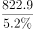
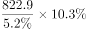
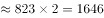
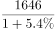
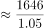
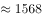

# 基期量计算（借比重链式换算：部分→总量→另一部分→基期）

考点：[[20-考点/资料分析/增长/基期量计算（借比重链式换算：部分→总量→另一部分→基期）|增长 / 基期量计算（借比重链式换算：部分→总量→另一部分→基期）]]
材料：[[15-材料/资料分析/309617 2016年我国研发（R&D）经费投入|309617 2016年我国研发（R&D）经费投入]]

**问法模型**：题干求'2015年（基期）应用研究经费'→ 先由基础研究现期值÷其占比反推2016年总量，乘应用研究占比得2016年值，再÷(1+应用研究增速)得基期量

## 推理链
1. 第1步：材料第一段：2016年基础研究经费822.9亿元（占科技经费总投入5.2%），应用研究无绝对额，仅有增速5.4%和占比10.3%
2. 第2步：整体量=部分量÷比重：2016年科技经费总投入=822.9÷5.2%=15825亿元
3. 第3步：2016年应用研究经费=15825×10.3%≈1630亿元
4. 第4步：基期量=现期量÷(1+增速)：2015年应用研究经费=1630÷(1+5.4%)=1630÷1.054≈1546亿元
5. 第5步：与选项对照：1546亿元与A项完全吻合，故选A

**最快解法**：⚡ 链式合并一步式+截位直除：822.9÷5.2%×10.3%÷1.054，先算822.9/0.052≈15825，×0.103≈1630，再除以1.054≈1546，直接锁定A（也可先算10.3%÷5.2%≈1.98，822.9×1.98≈1630再÷1.054）

## 易错点
- ⚠ 应用研究只有增速5.4%和占比10.3%、无绝对额，不能直接在材料找数，必须先借基础研究822.9÷5.2%反推总量，属两步链式换算
- ⚠ 基期/现期混淆：算出2016年值约1630后忘记÷(1+5.4%)；或错用基础研究增速14.9%去除，应除应用研究自身增速5.4%
- ⚠ 分母口径陷阱：第一段是占'科技经费总投入'，与第二、三段'全社会研发经费'表述不同，勿跨段误用企业12144亿元或东部10689.4亿元充当分母

## 母题抽象
> 🧩 当所求部分只有'占比+增速'而无绝对额，但同段另一部分给出'现期值+占比'时，用'已知部分÷其占比=总量→总量×所求占比→÷(1+增速)'三步链式求基期量

**同类特征**：2015年…约为多少亿元、基期计算、材料时间2016年、所求对象仅有占比与增速、无直接数据、需先反推总量（链式换算）、选项数值差距较大可估算

## 相关题
- [[10-真题/资料分析/增长/20303 基期量计算|20303]]（贵州 2010，相关度1）
- [[10-真题/资料分析/增长/13504434 隔年基期量计算（由增速变化百分点倒推上年增速）|13504434]]（新疆 2025，相关度1）
- [[10-真题/资料分析/增长/2172271 基期量计算（时点值差法：基期时点值=现期时点值-期间新增量）|2172271]]（江苏 2018，相关度1）
- [[10-真题/资料分析/增长/13504448 基期量计算（已知现期量与同比增速）|13504448]]（新疆 2025，相关度1）
- [[10-真题/资料分析/增长/15833742 基期量计算|15833742]]（辽宁 2026，相关度1）

---

### 题干
2015年我国应用研究经费约为多少亿元？

### 选项
- A. 1546　✅
- B. 1683
- C. 833
- D. 1142

### 官方解析

根据题干“2015年······约为多少亿元”，结合材料时间为2016年，可判定本题为基期计算问题。定位材料第一段可得：2016年我国基础研究经费为822.9亿元，比上年增长14.9%，明显高于应用研究经费（5.4%）······基础研究、应用研究和试验发展经费所占科技经费总投入比重分别为5.2%、10.3%和84.5%。根据公式：整体量，则2016年我国科技经费总投入为亿元，则2016年我国应用研究经费投入为亿元。根据公式：基期量，则2015年我国应用研究经费投入为亿元，与A项最接近。

故正确答案为A。

### 给定材料

        2016年我国基础研究经费为822.9亿元，比上年增长14.9%，明显高于应用研究经费（5.4%）和试验发展经费（11.1%）的增速。基础研究、应用研究和试验发展经费所占科技经费总投入比重分别为5.2%、10.3%和84.5%。

        2016年各类企业研发经费支出12144亿元，比上年增长11.6%；政府属研究机构经费支出2260.2亿元，比上年增长5.8%；高等学校科研经费支出1072.2亿元，比上年增长7.4%。企业研发、政府属研究机构、高等学校科研经费支出所占比重分别为77.5%，14.4%和6.8%。

        2016年我国东部地区研发经费为10689.4亿元，首次迈上万亿台阶，比上年增长11%，占全社会研发经费的比重为68.2%；中部、西部和东北地区研发经费分别为2378.1亿元、1944.3亿元和664.9亿元，分别比上年增长10.8%、12.3%和0.4%，所占全社会研发经费的比重分别为15.2%、12.4%和4.2%。

