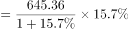
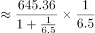
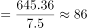

# 增长量计算（现期×g-(1+g)）

考点：[[20-考点/资料分析/增长/增长量计算（现期×g-(1+g)）|增长 / 增长量计算（现期×g/(1+g)）]]
材料：[[15-材料/资料分析/309962 F省2012年社会消费品零售总额的总|309962 F省2012年社会消费品零售总额的总]]

**问法模型**：题干为'某月同比增量约为'的跨材料增长量计算 → 增量=现期值×g/(1+g)，量从文字取、速从折线图取

## 推理链
1. 第1步：题干锁定'2012年12月份同比增量'，需同时拿到12月的现期值与同比增速
2. 第2步：文字材料第一句给出12月当月值645.36亿元（注意是当月值，非全年累计7149.54亿元）
3. 第3步：图1横轴'12月'点给出同比增速15.7%（文字段未直接给12月增速，必须到图上取）
4. 第4步：套用增量公式：增量=现期×g/(1+g)=645.36×15.7%/(1+15.7%)
5. 第5步：645.36×15.7%≈101.3，101.3/1.157≈87.6亿元
6. 第6步：与选项对照，87.6亿元对应C项；B项101.3是漏除(1+g)的干扰，D项557.8≈645.36-87.6为基期值干扰

**最快解法**：⚡ 百化分+截位直除：15.7%≈1/6.4，增量≈645.36/(1+6.4)=645.36/7.4≈87（首两位即可锁定C）；或直算645.36×0.157≈101.3，再除以1.157得87.6

## 易错点
- ⚠ 量与速分离：12月的值645.36亿元在文字、增速15.7%在图1，漏看图1就无法作答
- ⚠ 误用全年累计值7149.54亿元或误用全年增速15.9%计算，须锁定'12月当月'口径
- ⚠ 忘记除以(1+g)：直接算645.36×15.7%≈101.3亿元会误选B项
- ⚠ D项557.8亿元实为基期值（645.36-87.6），警惕基期与增量混淆

## 母题抽象
> 🧩 当题干出现'某月/某期同比增量约为'且量的速分藏于文字与图表时，先拼齐'现期值+该期增速'，再用增量=现期×g/(1+g)（百化分转1/n后除以n+1）验证选项；若选项中出现'现期×g'与'现期-增量'两个数，恰是漏除(1+g)与基期两个陷阱

**同类特征**：12月份（当月口径，非全年累计）、同比增量、文字给量、图给速的跨材料拼接、选项含'现期×g'干扰值（101.3）、选项含基期值干扰（557.8）、增长率需从折线图横轴末点读取

## 相关题
- [[10-真题/资料分析/增长/10297067 由同比增速求同比增量（现期×r-(1+r)）并比较多月变化趋势|10297067]]（天津 2025，相关度1）
- [[10-真题/资料分析/增长/12536399 增长量计算与增长量倍数比较（增长量=现期×r-(1+r)）|12536399]]（四川 2024，相关度1）
- [[10-真题/资料分析/平均数/12881912 平均数增长量（两期平均数作差求同比增量）|12881912]]（河北 2025，相关度1）
- [[10-真题/资料分析/增长/15419182 由同比增速求增长量并作倍数比较（增长量作比）|15419182]]（湖北 2025，相关度1）
- [[10-真题/资料分析/增长/15833796 增长量计算与两年增量差值比较|15833796]]（贵州 2026，相关度1）

---

### 题干
2012年12月份，F省社会消费品零售总额同比增量约为：

### 选项
- A. 120.2亿元
- B. 101.3亿元
- C. 87.6亿元　✅
- D. 557.8亿元

### 官方解析

根据题干“2012年12月份······同比增量约为”，可判定本题为增长量计算问题。定位文字材料第一段可得：（2012年）12月份，F省社会消费品零售总额645.36亿元；定位统计图可得：（2012年）12月份，F省社会消费品零售总额同比增长15.7%。根据公式：增长量，则2012年12月份，F省社会消费品零售总额同比增量亿元，与C项最接近。

故正确答案为C。

### 给定材料

        2012年F省社会消费品零售总额7149.54亿元，比上年增长15.9％，其中12月份的社会消费品零售总额645.36亿元。按经营地统计，城镇消费品零售额6563.57亿元，增长16.0％；乡村消费品零售额585.97亿元，增长14.6％。按消费形态统计，商品零售额6276.04亿元，增长15.7％；餐饮收入额873.50亿元，增长17.6％。

        在限额以上企业商品零售额中，家具类零售额比上年增长47.8％，金银珠宝类增长47.4％，服装鞋帽针织纺织品类增长32.5％，食品饮料烟酒类增长24.9％，其中食品类增长24.4％，日用品类增长22.8％，化妆品类增长18.6％，汽车类增长14.7％，石油及制品类增长13.8％，通讯器材类增长8.1％，家用电器和音响器材类增长6.1％，体育、娱乐用品类下降6.1％。

