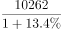
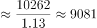

# 基期量计算（现期值与增长率反推基期）

考点：[[20-考点/资料分析/增长/基期量计算（现期值与增长率反推基期）|增长 / 基期量计算（现期值与增长率反推基期）]]
材料：[[15-材料/资料分析/309963 2015年全国环境与安全状况统计公报|309963 2015年全国环境与安全状况统计公报]]

**问法模型**：题干问'2014年年末…为多少'而材料只给2015年年末现期值10262万立方米和同比增速13.4% → 采用基期量=现期量÷(1+增长率)模型

## 推理链
1. 第1步：定位材料第三段：2015年年末城市污水处理厂日处理能力达10262万立方米，比上年末增长13.4%
2. 第2步：题干求2014年年末（即'上年末'）数值，判定为基期计算，公式为基期量=现期量÷(1+增长率)
3. 第3步：代入数据：10262÷(1+13.4%)=10262÷1.134≈9049.4万立方米
4. 第4步：与选项对照：A.11849.9（约10262÷0.866的陷阱值）、B.9049.4、C.8862.5、D.8863.6附近，计算结果9049.4与B项完全吻合，故选B

**最快解法**：⚡ 截位直除：10262÷1.134，先估1.134×9000=10206，余56，56÷1.134≈49，得9049.4，直选B；若选项差距大可只算首位'9xxx'即可排除A/C/D

## 易错点
- ⚠ 增长率符号处理错：误把'增长13.4%'当作下降，用10262÷(1-13.4%)≈11850万立方米，正中A选项陷阱
- ⚠ 基期现期混淆：直接用10262×(1+13.4%)≈11637，把现期当基期去乘
- ⚠ 时间口径：材料为'年末'时点数据（比上年末增长），基期是2014年年末而非2014年全年均值，且勿与材料中'全年'数据段混用

## 母题抽象
> 🧩 当题干出现'上年/基期某量为多少'且材料给'现期值+同比增长r%'时，用基期量=现期÷(1+r%)直除求解，并警惕选项中÷(1-r%)的符号陷阱（现÷(1-r%)的值必大于现期本身，可直接排除）

**同类特征**：求2014年（上一年）数值、材料给2015年现期值+同比增长率、基期量计算、比上年末增长13.4%、选项含除以(1-13.4%)的陷阱值

## 相关题
- [[10-真题/资料分析/增长/12019697 基期量计算（现期累计值−当期新增值）|12019697]]（广东 2026，相关度1）
- [[10-真题/资料分析/增长/2033794 基期量计算|2033794]]（江苏 2016，相关度1）
- [[10-真题/资料分析/增长/2166218 基期量计算（同比下降型）|2166218]]（深圳市考 2018，相关度1）
- [[10-真题/资料分析/增长/2187625 基期量计算（现期−增长量还原基期）|2187625]]（选调 2018，相关度1）
- [[10-真题/资料分析/增长/2187798 基期量计算（现期÷(1+同比增速)）＋单位换算（亿元→万亿元）|2187798]]（天津 2018，相关度1）

---

### 题干
2014年年末城市污水处理厂日处理能力为（    ）万立方米。

### 选项
- A. 11849.9
- B. 9049.4　✅
- C. 8862.5
- D. 8563.6

### 官方解析

根据题干“2014年年末······为······万立方米”，结合材料时间2015年，可判定本题为基期计算问题。定位文字材料第三段可知：2015年年末城市污水处理厂日处理能力达10262万立方米，比上年末增长13.4％。根据公式：基期量，代入数据可得，2014年年末城市污水处理厂日处理能力为万立方米，与B项最接近。

故正确答案为B。

### 给定材料

        近岸海域298个海水水质监测点，在2015年监测中，达到国家一、二类海水水质标准的监测点占62.8%，比上年下降10.1个百分点；三类海水占14.1％，上升8.1个百分点；四类、劣四类海水占23.1％，上升2.1个百分点。

        在监测的330个城市中，有273个城市空气质量达到二级以上(含二级)标准，占监测城市数的82.7％；有53个城市为三级，占16.1％；有4个城市为劣三级，占1.2％。在监测的331个城市中，城市区域声环境质量好的城市占6.3％，较好的占67.4％，轻度污染的占25%，中度污染的占0.9％。

        2015年年末城市污水处理厂日处理能力达10262万立方米，比上年末增长13.4％；城市污水处理率达到76.9％，提高1.6个百分点。集中供热面积39.1亿平方米，增长3.0％。建成区绿地率达到34.5％，提高0.3个百分点。

        2015年全年各类自然灾害造成直接经济损失5340亿元，比上年增加1.1倍，占国内生产总值的1.31％。全年农作物受灾面积3743万公顷，减少20.7％。其中，绝收486万公顷，减少1.1％。全年因洪涝、滑坡和泥石流灾害造成直接经济损失3505亿元，增加4.4倍；死亡3101人。全年因旱灾造成直接经济损失757亿元，下降31.2％。全年因低温冷冻和雪灾造成直接经济损失318亿元，死亡51人。全年因海洋灾害造成直接经济损失149.4亿元，增加49.1％。全年累计发生赤潮面积10892平方公里，减少22.8％。全年大陆地区共发生5级以上地震17次，成灾10次，造成直接经济损失235.7亿元，死亡2705人。全年共发生森林火灾7723起，下降12.8％。

        2015年全年各类生产安全事故共死亡79552人，比上年下降4.4％。亿元国内生产总值生产安全事故死亡人数为0.201人，下降19.0％；工矿商贸企业就业人员10万人生产安全事故死亡人数为2.13人，下降11.3％；道路交通万车死亡人数为3.2人，下降11.1％；煤矿百万吨死亡人数为0.749人，下降16.0％。

