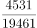
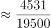
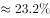
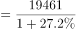

# 隔年基期量计算（增量+增速百分点差倒推）

考点：[[20-考点/资料分析/增长/隔年基期量计算（增量+增速百分点差倒推）|增长 / 隔年基期量计算（增量+增速百分点差倒推）]]
材料：[[15-材料/资料分析/310209 2014年国民经济和社会发展统计公报|310209 2014年国民经济和社会发展统计公报]]

**问法模型**：题干求'2012年末'这一隔年基期量，且材料只给'比上年末增加4531亿美元'和'增速减慢4个百分点'→先由现期减增量得2013年末量，再算2014年增速并加4个百分点还原2013年增速，用基期量=中间年量/(1+中间年增速)倒推。

## 推理链
1. 第1步：定位第三段：2014年末外汇储备23992亿美元，比上年末增加4531亿美元，增速减慢4个百分点（其余指标GDP、财政收入、就业、投资为干扰数据）。
2. 第2步：先求中间年（2013年末）量：23992-4531=19461亿美元。
3. 第3步：用增量÷基期求2014年同比增速：4531/19461≈23.3%（截位直除）。
4. 第4步：'增速减慢4个百分点'指2014年增速比2013年低4个百分点，故2013年增速≈23.3%+4%=27.3%。
5. 第5步：隔年基期公式：2012年末=2013年末量/(1+2013年增速)=19461/(1+27.3%)≈19461/1.273≈15288亿美元。
6. 第6步：与选项对照：A、B单位为'亿元'量纲错误（外汇储备单位是亿美元），先排除；C为15288亿美元，与计算值一致，故选C。

**最快解法**：⚡ 截位直除+隔年基期公式法：先减法得19461亿美元；直除4531/19461≈23.3%，加4个百分点得27.3%；再直除19461/1.273≈15300上下，选项中只有C（15288亿美元）接近且单位为'亿美元'，秒选C（A/B'亿元'单位直接排除）。

## 易错点
- ⚠ 单位陷阱：选项A、B用'亿元'，而外汇储备单位是'亿美元'，币种/量纲不同，A、B直接排除，不看清单位极易误选A。
- ⚠ 百分点≠百分数：'增速减慢4个百分点'是2014年与2013年增速之差，不能把4%当作某一年的增速直接代入计算。
- ⚠ 基期方向混淆：求2012年末应以2013年末19461为现期除以(1+27.3%)，不能用23992连续两年倒推，也不能拿2014年增速23.3%直接套用。

## 母题抽象
> 🧩 当题干出现'隔年基期量、材料只给现期/中间年增量与增速变化若干个百分点'特征时，先现期−增量得中间年量，再用'中间年增速=当年增速±百分点差'，最后基期=中间年量/(1+中间年增速)，并务必核对单位量纲。

**同类特征**：隔年基期（2014年末倒推至2012年末）、比上年末增加4531亿美元（给增量非增速）、增速减慢4个百分点（百分点差还原上年增速）、单位为亿美元（选项混排亿元）、基期量=现期/(1+增长率)、干扰数据多（GDP、财政收入、就业、投资并存）

## 相关题
- [[10-真题/资料分析/综合/2050552 综合分析（基期计算＋增速趋势判断＋口径辨析）|2050552]]（吉林 2017，相关度1）
- [[10-真题/资料分析/综合/12019694 综合分析选非题（基期量+人均反推人口+比重临界判断）|12019694]]（广东 2026，相关度1）
- [[10-真题/资料分析/综合/2456379 综合分析·选非题（混合增长率定性判断＋基期量＋直接读数排序）|2456379]]（浙江 2020，相关度1）

---

### 题干
2012年末我国国家外汇储备是：

### 选项
- A. 15288亿元
- B. 15676亿元
- C. 15288亿美元　✅
- D. 15676亿美元

### 官方解析

根据题干“2012年末我国国家外汇储备是”，结合材料时间为2014年末，可判定本题为基期计算问题。定位文字材料第三段可得：2014年末，国家外汇储备23992亿美元，比上年末增加4531亿美元，增速减慢4个百分点。2013年末国家外汇储备=23992-4531=19461亿美元，根据公式：增长率，可得2014年末国家外汇储备同比增长率：，2013年末国家外汇储备同比增长率=23.2%+4%=27.2%。根据公式：基期量，可得2012年末国家外汇储备亿美元，与C项最接近。

故正确答案为C。

### 给定材料

        国家统计局2015年2月25日发布2014年国民经济和社会发展统计公报，各项社会事业取得新的进展。初步核算，全年国内生产总值335353亿元，比上年增长8.7%。

        统计公报分综合、农业、工业和建筑业、固定资产投资、国内贸易、对外经济、交通邮电和旅游、金融、教育和科学技术、文化卫生和体育、人口、人民生活和社会保障，以及资源、环境和安全生产等十二部分，展示了2014年中国国民经济和社会发展状况。

        公报显示，截至2014年年末，国家外汇储备23992亿美元，比上年末增加4531亿美元，增速减慢4个百分点；全年财政收入68477亿元，比上年增加7147亿元，增长11.7%；全国就业人员77995万人，比2013年末增加515万人，比2012年末增加1005万人。

        中国政府2014年推出四万亿元的剌激计划。公报显示，2014年全年全社会固定资产投资224846亿元，比上年增长30.1%。其中，中西部投资增长高于东部和东北地区。

> [!warning] 疑点（官方解析可能有误，待人工复核）
> 官方解析将4531/19461≈23.28%截位为23.2%，得2013年增速27.2%，对应19461/1.272≈15303亿美元；若按四舍五入取23.3%+4%=27.3%，则19461/1.273≈15288亿美元与C项精确吻合。两种口径下均以C最接近，不影响正确答案，仅为解析中舍入精度的细微差异。

<!-- CODEX-ANSWER-REVIEW:BEGIN -->
### 本次独立复核

**复核状态：** `confirmed`（独立复算确认答案）

**计分答案：** C（可计分）

**复核解析：**

2014外储23992亿美元，较上年增加4531，故2013为19461；2014增速约23.3%，前一年增速约27.3%，2012约19461/1.273≈15288亿美元，选C。

**相关信息：**

以现期和增量反推同比率，再按增速百分点差还原前期。

**题源依据：** [固定版本原题](https://github.com/Mentat-Uran/kaogongzhentizhengliu/blob/84ab93d4b64b61d897bece8a1c0a5bab06b4feb2/10-%E7%9C%9F%E9%A2%98/%E8%B5%84%E6%96%99%E5%88%86%E6%9E%90/%E5%A2%9E%E9%95%BF/4714068%20%E9%9A%94%E5%B9%B4%E5%9F%BA%E6%9C%9F%E9%87%8F%E8%AE%A1%E7%AE%97%EF%BC%88%E5%A2%9E%E9%87%8F%2B%E5%A2%9E%E9%80%9F%E7%99%BE%E5%88%86%E7%82%B9%E5%B7%AE%E5%80%92%E6%8E%A8%EF%BC%89.md)；固定内容 commit `84ab93d4b64b61d897bece8a1c0a5bab06b4feb2`，Markdown blob `43b8587ac37fa1178ef0a8cffbdd3803f6b49668`。
<!-- CODEX-ANSWER-REVIEW:END -->
