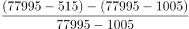
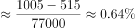

# 基期量倒推+一般增长率计算（隔年增量连环相减）

考点：[[20-考点/资料分析/增长/基期量倒推+一般增长率计算（隔年增量连环相减）|增长 / 基期量倒推+一般增长率计算（隔年增量连环相减）]]
材料：[[15-材料/资料分析/310209 2014年国民经济和社会发展统计公报|310209 2014年国民经济和社会发展统计公报]]

**问法模型**：题干问'2013年末就业人员比上年增长了'而2013、2012年末数据未直接给出 → 先用同一句话中的两个增量倒推两个基期量，再按'增长率=增长量÷基期量'计算

## 推理链
1. 第1步：定位材料第三段：2014年末全国就业人员77995万人，比2013年末增加515万人，比2012年末增加1005万人（GDP、外汇储备、财政收入、投资均为干扰数据）
2. 第2步：倒推基期量：2013年末=77995-515=77480万人；2012年末=77995-1005=76990万人
3. 第3步：2013年末比2012年末的增长量=77480-76990=490万人（等价于1005-515=490万人，无需分别算出两个基期）
4. 第4步：代入增长率公式：增长率=增长量÷基期量=490÷76990≈0.64%
5. 第5步：与选项对照：0.64%与D项最接近，故选D

**最快解法**：⚡ 隔年增量相减+截位直除：增长量=1005-515=490万人（一步得分子），基期约77000万人（77995-1005截位），490/77000首位商6，即0.6%量级，直除得0.64%，直接锁定D

## 易错点
- ⚠ 连环倒推陷阱：'比2012年末增加1005万人'的基期是2012年末而非2013年末，2013年对2012年的增量必须用1005-515=490万人，若误把1005或515当增长量代入会选错
- ⚠ 基期现期混淆：增长率分母是2012年末的76990万人（基期），不是2013年末77480万或2014年末77995万，分母用错会偏离0.64%
- ⚠ 干扰数据与口径陷阱：材料中'增速减慢4个百分点'是百分点变化且不能当外汇储备增速用，GDP、财政收入、投资均为亿元口径的无关数据，本题一概不用

## 母题抽象
> 🧩 当题干求'某期量比上期增长率'而基期量只能通过'现期-增量'连环倒推获得时，先用隔年增量之差（1005-515）直接得增长量，再除以最早基期量截位直除，验证选项小百分数

**同类特征**：隔年基期倒推、同一句话连环给两个增量、年末存量比较、增长率=增长量/基期量、选项为小百分数（1%量级）、单位为万人

## 相关题
- [[10-真题/资料分析/其他/2031608 跨期'至少'极值推断（同队列最大留任模型）|2031608]]（广东 2016，相关度1）
- [[10-真题/资料分析/增长/2374697 增长量（减少量）计算——首尾两点作差|2374697]]（广东 2019，相关度1）
- [[10-真题/资料分析/增长/5102172 增长率计算与同比增速排序比较（选非题）|5102172]]（浙江 2022，相关度1）
- [[10-真题/资料分析/增长/5893728 增长率比较（增长量已知、基期量需反推）|5893728]]（国考 2024，相关度1）
- [[10-真题/资料分析/比重/16070312 老年人口抚养比公式逆推（比值逆推求0-14岁人口）|16070312]]（湖北 2026，相关度1）

---

### 题干
2013年末就业人员比上年增长了：

### 选项
- A. 2.53%
- B. 1.97%
- C. 1.26%
- D. 0.64%　✅

### 官方解析

根据题干“2013年末······比上年增长了”，结合选项为百分数，可判定本题为一般增长率计算问题。定位文字材料第三段可得：2014年末，全国就业人员77995万人，比2013年末增加515万人，比2012年末增加1005万人。根据公式：增长率，可得2013年末就业人员比上年增长了，与D项最接近。

故正确答案为D。

### 给定材料

        国家统计局2015年2月25日发布2014年国民经济和社会发展统计公报，各项社会事业取得新的进展。初步核算，全年国内生产总值335353亿元，比上年增长8.7%。

        统计公报分综合、农业、工业和建筑业、固定资产投资、国内贸易、对外经济、交通邮电和旅游、金融、教育和科学技术、文化卫生和体育、人口、人民生活和社会保障，以及资源、环境和安全生产等十二部分，展示了2014年中国国民经济和社会发展状况。

        公报显示，截至2014年年末，国家外汇储备23992亿美元，比上年末增加4531亿美元，增速减慢4个百分点；全年财政收入68477亿元，比上年增加7147亿元，增长11.7%；全国就业人员77995万人，比2013年末增加515万人，比2012年末增加1005万人。

        中国政府2014年推出四万亿元的剌激计划。公报显示，2014年全年全社会固定资产投资224846亿元，比上年增长30.1%。其中，中西部投资增长高于东部和东北地区。

