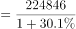
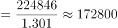

# 基期量计算（现期量与同比增长率已知）

考点：[[20-考点/资料分析/增长/基期量计算（现期量与同比增长率已知）|增长 / 基期量计算（现期量与同比增长率已知）]]
材料：[[15-材料/资料分析/310209 2014年国民经济和社会发展统计公报|310209 2014年国民经济和社会发展统计公报]]

**问法模型**：题干问上一期（2013年）'约为'多少，材料给出现期（2014年）总量224846亿元和同比增长率30.1% → 直接套基期量=现期量/(1+增长率)做一步除法

## 推理链
1. 第1步：题干求'2013年全年全社会固定资产投资'，材料时间为2014年，判定为基期计算问题
2. 第2步：定位材料第四段：2014年全年全社会固定资产投资224846亿元，比上年增长30.1%，即现期量A=224846亿元、增长率r=30.1%，基期为2013年全年（流量口径）
3. 第3步：套用基期量公式：基期量=A/(1+r)=224846/(1+30.1%)=224846/1.301
4. 第4步：截位直除：224846/1.301，先用1.3估出约172960，再因分母1.301略大微调向下，约172825
5. 第5步：精确验证：172826×1.301≈224847，与224846几乎完全吻合；对照选项，A(172475)、C(173056)、D(173217)均偏离数百亿元，仅B=172826亿元最接近
6. 第6步：故选B（本题GDP、财政收入、外汇储备、就业人员及'四万亿'均为干扰数据，全部不用）

**最快解法**：⚡ 截位直除+选项精验：基期量=224846/1.301，因四个选项相邻差仅约200~500亿元，先除1.3得约172960锁定172xxx量级，再用172826×1.301≈224847反向验证恰好吻合，秒选B

## 易错点
- ⚠ 基期现期混淆：求基期要用除法224846/(1+30.1%)，若误用224846×(1-30.1%)或224846/(1-30.1%)将完全偏离选项
- ⚠ 选项数值非常接近（相邻差仅数百亿元），首位截位估到'17万'量级不够，必须算到千位以下精度或用乘法回验
- ⚠ 干扰数据陷阱：同段'四万亿元刺激计划'是政策概念不可当作投资额或增量；各指标口径混排（全年流量'比上年增长'与年末存量'比上年末增加'），本题分母必须对应2013年全年

## 母题抽象
> 🧩 当题干出现'基期年份+约为'且材料给出现期总量A和同比增长率r时，用基期量=A/(1+r)一步除法，选项接近时用'选项值×(1+r)≈A'反向验证

**同类特征**：问上一年/基期具体数值、约为（估算取最接近）、现期总量+同比增长率均已给出、全社会固定资产投资、单位亿元、选项差距小需精算

## 相关题
- [[10-真题/资料分析/增长/2050996 同比增长率计算（一般增长率）|2050996]]（江西 2017，相关度1）
- [[10-真题/资料分析/增长/2616100 基期量计算（同比减少型-负增长基期还原）|2616100]]（云南 2020，相关度1）
- [[10-真题/资料分析/增长/18643961 基期量计算（同比基期）|18643961]]（浙江 2026，相关度1）
- [[10-真题/资料分析/增长/2050974 基期量计算|2050974]]（江西 2017，相关度1）
- [[10-真题/资料分析/增长/2050998 逐期（同比）增长量比较|2050998]]（江西 2017，相关度1）

---

### 题干
2013年全年全社会固定资产投资约为：

### 选项
- A. 172475亿元
- B. 172826亿元　✅
- C. 173056亿元
- D. 173217亿元

### 官方解析

根据题干“2013年全年······约为”，结合材料时间为2014年，可判定本题为基期计算问题。定位文字材料第四段可得：2014年全年全社会固定资产投资224846亿元，比上年增长30.1%。根据公式：基期量，则2013年全年全社会固定资产投资亿元，与B项最接近。

故正确答案为B。

### 给定材料

        国家统计局2015年2月25日发布2014年国民经济和社会发展统计公报，各项社会事业取得新的进展。初步核算，全年国内生产总值335353亿元，比上年增长8.7%。

        统计公报分综合、农业、工业和建筑业、固定资产投资、国内贸易、对外经济、交通邮电和旅游、金融、教育和科学技术、文化卫生和体育、人口、人民生活和社会保障，以及资源、环境和安全生产等十二部分，展示了2014年中国国民经济和社会发展状况。

        公报显示，截至2014年年末，国家外汇储备23992亿美元，比上年末增加4531亿美元，增速减慢4个百分点；全年财政收入68477亿元，比上年增加7147亿元，增长11.7%；全国就业人员77995万人，比2013年末增加515万人，比2012年末增加1005万人。

        中国政府2014年推出四万亿元的剌激计划。公报显示，2014年全年全社会固定资产投资224846亿元，比上年增长30.1%。其中，中西部投资增长高于东部和东北地区。

