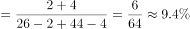

# 增长率计算（跨句合并结构后的个体数量口径）

考点：[[20-考点/资料分析/增长/增长率计算（跨句合并结构后的个体数量口径）|增长 / 增长率计算（跨句合并结构后的个体数量口径）]]
材料：[[15-材料/资料分析/310770 2015年全国民航运输机场旅客吞吐量|310770 2015年全国民航运输机场旅客吞吐量]]

**问法模型**：『吞吐量在100万人次以上的运输机场同比增长了』且选项为百分数 → 先把两个规模档机场个数跨句合并出本期与上年个数，套增长率=（本期−上年）/上年

## 推理链
1. 第1步：从文字材料提取条件：1000万人次以上机场26个、比上年增加2个；100-1000万人次机场44个、比上年增加4个
2. 第2步：『100万人次以上』需跨句拼接两档：本期机场数=26+44=70个，上年机场数=(26−2)+(44−4)=24+40=64个
3. 第3步：题干主语是『运输机场』，指机场个数口径，套公式：增长率=(本期−上年)/上年=(70−64)/64
4. 第4步：代入计算：6/64=9.375%
5. 第5步：与选项对照：9.375%与B项9%最接近（A为0.8%、C为1%、D为2%，量级均不符），故选B

**最快解法**：⚡ 合并后增量6个、基期64个，增长率=6/64，截位速判：6/64略小于6/60=10%且远大于2%，故约9%秒选B，无需精算

## 易错点
- ⚠ 结构合并陷阱：『100万人次以上』必须把1000万以上与100-1000万两档跨句相加（26+44=70个，对应占比77.9%+17.6%=95.5%），只看单一档位必错
- ⚠ 基期口径陷阱：上年个数要用『增加2个/增加4个』反推为24+40=64个，误用本期70个作分母得6/70≈8.6%，或误把吞吐量占比当机场数（95.5%≠增长率）
- ⚠ 主体混淆：本题问的是机场个数增长，与『9.15亿人次』吞吐量无关，若按吞吐量口径找基期数据会因材料未给2014年分档占比而无法求解

## 母题抽象
> 🧩 当题干出现『某门槛以上/某区间的个体数（个数口径）同比增长了』特征时，先把跨句给出的各档数量合并为本期值、各减增量得上期值，用（本期−上期）/上期速算，并用选项量级反验证

**同类特征**：100万人次以上、运输机场同比增长、比上年增加2个/4个、选项为百分数、跨句合并两档规模、机场个数口径

## 相关题
- [[10-真题/资料分析/增长/9629 一般增长率计算（现期需由增量倒推）|9629]]（安徽 2009，相关度1）
- [[10-真题/资料分析/比重/2604234 现期比重计算|2604234]]（广东 2020，相关度1）
- [[10-真题/资料分析/增长/27835 一般增长率计算（已知现期量与增长量求增长率）|27835]]（河北 2012，相关度1）
- [[10-真题/资料分析/平均数/10204497 平均数增长率（均价=值-量的比值增长率）|10204497]]（海南 2024，相关度1）
- [[10-真题/资料分析/增长/12536395 隔年（间隔）增长率|12536395]]（四川 2024，相关度1）

---

### 题干
2015年，全国民航运输机场完成旅客吞吐量在100万人次以上的运输机场同比增长了：

### 选项
- A. 0.8%
- B. 9%　✅
- C. 1%
- D. 2%

### 官方解析

根据题干“2015年······同比增长了”，结合选项为百分数，可判定本题为一般增长率问题。定位文字材料可得：“2015年······全国民航年吞吐量1000万人次以上的运输机场26个，比上年增加2个······100-1000万人次的运输机场44个，比上年增加4个”。根据公式：增长率，则所求，与B项最接近。

故正确答案为B。

### 给定材料

        2015年，全国民航运输机场完成旅客吞吐量9.15亿人次，比上年增长10.0%，增速较上年回落了0.4个百分点。西部增长13.5%；中部增长8.5%；东北增长8.2%；东部增长8.8%。全国民航年吞吐量1000万人次以上的运输机场26个，比上年增加2个，吞吐量占全国的77.9%，100-1000万人次的运输机场44个，比上年增加4个，吞吐量占全国的17.6%。2015年，民航基本建设和技术改造投资769.3亿元，比上年增长4.8%。其中：机场系统完成固定资产投资总额656.1亿元，比上年增长17.0%；空管系统完成固定资产投资17.7亿元，比上年减少6.2亿元；民航其他系统完成固定资产投资总额95.5亿元，比上年减少54亿元。

