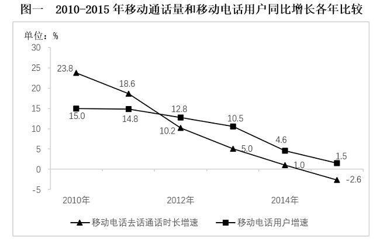
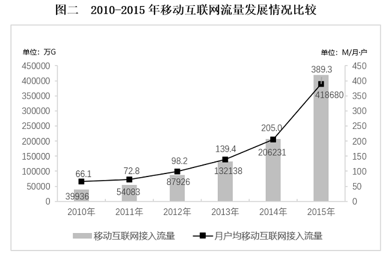

# 隐含净增量回推基期后求下降率（增长率计算）

考点：[[20-考点/资料分析/增长/隐含净增量回推基期后求下降率（增长率计算）|增长 / 隐含净增量回推基期后求下降率（增长率计算）]]
材料：[[15-材料/资料分析/310781 2015年全国电话用户发展情况：电话|310781 2015年全国电话用户发展情况：电话]]

**问法模型**：题干'与上年相比，2015年……约下降了'+选项为百分数 → 一般下降率模型：先由总净增−移动净增得固话净减量，回推2014年基期值，再算净减量/基期量

## 推理链
1. 第1步：从文字材料第一段提取：2015年全国电话用户净增121.1万户、总数15.37亿户；移动电话用户净增1964.5万户；固定电话用户总数2.31亿户（未直接给固话净增量）
2. 第2步：规则：全国电话用户净增=移动净增+固定净增，故2015年固话净增=121.1−1964.5=−1843.4万户，即净减1843.4万户
3. 第3步：回推基期：2014年固话用户数=2015年现期值+净减量=2.31亿+1843.4万=23100+1843.4=24943.4万户（约2.49亿户）
4. 第4步：公式：下降率=净减量/基期量=1843.4/24943.4
5. 第5步：截位直除：1843.4/24943.4≈184/2494≈7.4%（验证：24943.4×7.4%≈1845.8，与1843.4吻合）
6. 第6步：对照选项，7.4%对应A，故正确答案为A

**最快解法**：⚡ 截位直除+隐含净增量回推：一步式'下降率=净减量/(现期+净减量)'，净减量=1964.5−121.1=1843.4万，分母=23100+1843.4≈24900万，1843.4/24900≈184/2490≈7.4%，直选A；考场可先估算24943.4×7.4%≈1846≈1843速验

## 易错点
- ⚠ 基期现期混淆：下降率分母是2014年基期量24943.4万户，若误用2015年现期2.31亿=23100万户作分母得约8.0%，易误选B（8.7%）
- ⚠ 固话净减量是隐含量：材料未直接给出，必须由'总净增121.1万−移动净增1964.5万=−1843.4万'推出，直接拿2.31亿无从下手或漏掉负号
- ⚠ 单位换算：2.31亿户需换算为23100万户，与1843.4万户统一单位（1亿=10000万）后再运算，混用亿与万会算错量级

## 母题抽象
> 🧩 当题干问'与上年相比某量下降/增长了多少'而材料只给现期总量与各分项净增量时，用'总净增−分项净增'求出隐含净增量，回推基期=现期±净增量，再以'净增量/基期量'计算并对照选项

**同类特征**：与上年相比……约下降了、固定电话用户数、净增量未直接给出需作差、基期值需回推、选项为百分数、下降率为负增长表述

## 相关题
- [[10-真题/资料分析/增长/9629 一般增长率计算（现期需由增量倒推）|9629]]（安徽 2009，相关度1）
- [[10-真题/资料分析/比重/2604234 现期比重计算|2604234]]（广东 2020，相关度1）
- [[10-真题/资料分析/增长/27835 一般增长率计算（已知现期量与增长量求增长率）|27835]]（河北 2012，相关度1）
- [[10-真题/资料分析/平均数/10204497 平均数增长率（均价=值-量的比值增长率）|10204497]]（海南 2024，相关度1）
- [[10-真题/资料分析/增长/10297101 增长量计算与比较（环比减少量逐行计数）|10297101]]（天津 2025，相关度1）

---

### 题干
与上年相比，2015年固定电话用户数约下降了：

### 选项
- A. 7.4%　✅
- B. 8.7%
- C. 10.7%
- D. 17.6%

### 官方解析
根据题干“与上年相比······约下降了”，结合选项为百分数，可判定本题为一般增长率问题。定位文字材料第一段可得：2015年，全国电话用户净增121.1万户······移动电话用户净增1964.5万户······固定电话用户总数2.31亿户。因全国电话用户净增量=移动电话用户净增量+固定电话用户净增量，故2015年固定电话用户净增量=121.1-1964.5=-1843.4万户。代入公式：增长率，即约下降了7.4%。
故正确答案为A。

### 给定材料

        2015年，全国电话用户净增121.1万户，总数达到15.37亿户，增长0.1%，比上年回落2.5个百分点。其中，移动电话用户净增1964.5万户，总数达13.06亿户，移动电话用户普及率达95.5部／百人。固定电话用户总数2.31亿户。

        2015年，2G移动电话用户减少1.83亿户，是上年净减数的1.5倍，占移动电话用户的比重由上年的54.7%下降至39.9%。4G移动电话用户新增28894.1万户，总数达38622.5万户。

