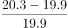
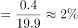
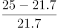
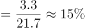
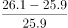
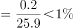
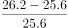
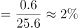

# 增长率比较（相邻半年时点环比增速）

考点：[[20-考点/资料分析/增长/增长率比较（相邻半年时点环比增速）|增长 / 增长率比较（相邻半年时点环比增速）]]
材料：[[15-材料/资料分析/311706 2011–2015年我国网民平均每周|311706 2011–2015年我国网民平均每周]]

**问法模型**：题干'与半年前相比……增长速度最快的时间'→ 对各年底(12月)时点求相对同年6月时点的增长率 r=(现期-基期)/基期，再比较四个增速大小

## 推理链
1. 第1步：题干限定'与半年前相比'，横轴为半年一个点，故各年底对同年6月的相邻点比较；从柱状图读取2012.6=19.9、2012.12=20.3、2013.6=21.7、2013.12=25、2014.6=25.9、2014.12=26.1、2015.6=25.6、2015.12=26.2（小时）
2. 第2步：套用增长率公式 r=(现期-基期)/基期，四个候选时点的基期分别是同年6月值19.9、21.7、25.9、25.6
3. 第3步：代入计算：2012年底 (20.3-19.9)/19.9=0.4/19.9≈2.0%；2013年底 (25-21.7)/21.7=3.3/21.7≈15.2%；2014年底 (26.1-25.9)/25.9=0.2/25.9≈0.8%；2015年底 (26.2-25.6)/25.6=0.6/25.6≈2.3%
4. 第4步：比较四个增速，15.2%远大于其余（2.3%、2.0%、0.8%），对应时点为2013年底，与选项B对照一致，故选B

**最快解法**：⚡ 增长量+基期粗判法（免精算）：四个年底时点中，2013年底的增长量3.3小时远超其余（0.4、0.2、0.6小时），且其基期21.7在四个基期中偏小（分母小、分子大），增速必最大，直接锁定B，其余三项无需计算；若需验证再用截位直除：3.3/21.7≈15%，0.6/25.6≈2.3%

## 易错点
- ⚠ 半年环比误当同比：横轴6月/12月交替，'与半年前相比'须取相邻点（12月对同年6月），若隔两个点取上一年12月（同比）则全部算错，如2013年底同比应为(25-20.3)/20.3≈23%
- ⚠ 增长量大≠增速大：2015年底增长量0.6大于2012年底的0.4，但基期25.6大于19.9，须以'增长量/基期'为准而非只看增量（本题2.3%>2.0%，恰为反例警示）
- ⚠ 序列非单调与'半年前'取点：2015.6=25.6低于2014.12=26.1，粗心易把2015年底的基期误读为2014.12（算出0.1/26.1≈0.4%）；且题干只比较四个'年底'时点，不必对9个点两两全算

## 母题抽象
> 🧩 当题干出现'与某时间跨度前相比，增长（速度）最快的是'且图表为等间隔时点序列时，只对选项所涉时点套 r=(现期-基期)/基期 并比较，先用'增长量最大且基期不大'的组合快速锁定目标再验证

**同类特征**：与半年前相比、增长速度最快的时间、网民平均每周上网时长、年底时点对同年6月时点、柱状图时间序列读数、增长率比较

## 相关题
- [[10-真题/资料分析/增长/2187792 同比增长率比较（增速最快年份判断）|2187792]]（黑龙江 2018，相关度1）
- [[10-真题/资料分析/增长/4658521 增长率（同比降幅）大小比较|4658521]]（四川 2021，相关度1）
- [[10-真题/资料分析/增长/18643713 跨期增长率比较（2024年对2020年4年总增速，先合并价位档再比较）|18643713]]（天津 2026，相关度1）
- [[10-真题/资料分析/增长/2049328 增长率比较（跨指标增幅最大）|2049328]]（河南 2017，相关度1）
- [[10-真题/资料分析/增长/2374732 增长率比较（同比增幅大小排序）|2374732]]（广东 2019，相关度1）

---

### 题干
与半年前相比，网民平均每周上网时长增长速度最快的时间是：

### 选项
- A. 2012年底
- B. 2013年底　✅
- C. 2014年底
- D. 2015年底

### 官方解析

根据题干“与半年前相比······增长速度最快的时间是”，可判定本题为一般增长率比较问题。定位柱状图可得2012-2015年6月及12月网民平均每周上网时长。根据公式：增长率，则与半年前相比，各年底网民平均每周上网时长的增长速度为：2012年底，；2013年底，；2014年底，；2015年底，。则与半年前相比，网民平均每周上网时长增长速度最快的时间是2013年底。

故正确答案为B。

### 给定材料

        截至2015年12月，我国网民规模达6.88亿，全年共计新增网民3951万人。互联网普及率为50.3%，较2014年底提升了2.4个百分点。

