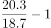
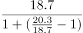
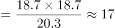
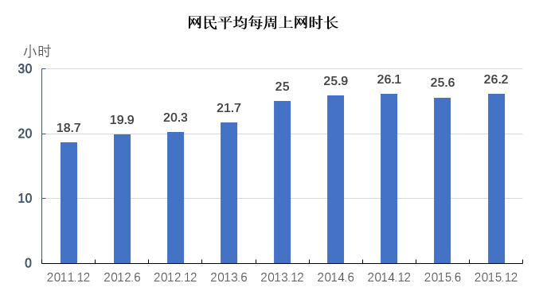

# 基期量计算（同比增速逆推基期）

考点：[[20-考点/资料分析/增长/基期量计算（同比增速逆推基期）|增长 / 基期量计算（同比增速逆推基期）]]
材料：[[15-材料/资料分析/311706 2011–2015年我国网民平均每周|311706 2011–2015年我国网民平均每周]]

**问法模型**：题干出现'按照某年底的同比增速测算，更早某年底的值可能为'且图中无该早期时点数据 → 先用相邻两期求同比增速r，再用基期量=现期/(1+r)逆推

## 推理链
1. 第1步：题干要求测算2010年底值，但柱状图最早只到2011.12，图中无2010年数据，需逆推；定位取2011.12=18.7小时、2012.12=20.3小时
2. 第2步：横轴为半年一个点，'2012年底的同比'须隔两个点取2012.12对2011.12；同比增速r=(现期-基期)/基期=(20.3-18.7)/18.7
3. 第3步：r=1.6/18.7≈8.6%
4. 第4步：由基期量=现期/(1+r)，2010年底=18.7/(1+8.6%)≈18.7/1.086≈17.2小时
5. 第5步：与选项对照，17.2与B项17小时最接近（A差2.2、C差1.8、D差3.8），故选B

**最快解法**：⚡ 公式法+百化分/截位直除：r=1.6/18.7≈8.6%（1.6/18.7≈1/11.7），18.7/1.086≈18.7×0.92≈17.2，秒选17小时（B）；考场亦可直接估算'18.7比20.3小约8%'，故前一年再缩约8%得17上下

## 易错点
- ⚠ 半年时点陷阱：横轴每半年一个点，'同比'必须隔两个点（2012.12对2011.12），若误用2012.6的19.9作现期或基期，r会算成(20.3-19.9)/19.9≈2%或(19.9-18.7)/18.7≈6.4%，结果偏离17
- ⚠ 基期/现期方向混淆：求更早的2010年应'除以(1+r)'做缩，若误乘(1+r)得18.7×1.086≈20.3，会错选D方向（21小时）
- ⚠ '可能为'为测算值口径：无需精算，取与17.2最接近的选项即可；另注意解析中'提升了2.4个百分点'等百分点表述（本题未用）不可当增速率使用

## 母题抽象
> 🧩 当题干出现'按某期同比增速测算、图中不存在的更早期数据'时，先由相邻两年同期值求同比增速r，再用基期量=现期/(1+r)逆推，对照选项取最接近值

**同类特征**：按照…同比增速测算、2010年底（图中不存在的早期时点）、基期逆推、网民平均每周上网时长、可能为、半年时点序列取同比

## 相关题
- [[10-真题/资料分析/增长/4769887 增长量计算（现期−基期直接作差）|4769887]]（四川 2017，相关度1）
- [[10-真题/资料分析/增长/4769893 增长率比较（相邻半年时点环比增速）|4769893]]（四川 2017，相关度1）

---

### 题干
按照2012年底的同比增速测算，2010年底的网民平均每周上网时长可能为：

### 选项
- A. 15小时
- B. 17小时　✅
- C. 19小时
- D. 21小时

### 官方解析

根据题干“······2010年底的网民平均每周上网时长可能为”，结合材料时间为2011~2015年，可判定本题为基期计算问题。定位柱状图可得：2011年12月、2012年12月网民平均每周上网时长分别为18.7小时、20.3小时。根据公式：增长率，则2012年底的同比增速为；根据公式：基期量，则2010年底的网民平均每周上网时长可能为小时。

故正确答案为B。

### 给定材料

        截至2015年12月，我国网民规模达6.88亿，全年共计新增网民3951万人。互联网普及率为50.3%，较2014年底提升了2.4个百分点。

> [!warning] 疑点（官方解析可能有误，待人工复核）
> 官方解析文本中'增长率''基期量'两处公式显示为空缺，但取数（18.7、20.3）、算法（先求r≈8.6%再18.7/(1+r)≈17.2）与答案B（17小时）自洽，不影响结论

<!-- CODEX-ANSWER-REVIEW:BEGIN -->
### 本次独立复核

**复核状态：** `confirmed`（独立复算确认答案）

**计分答案：** B（可计分）

**复核解析：**

2012年互联网周均上网时长为20.3小时，2011年为18.7小时，增幅=(20.3÷18.7−1)×100%≈8.56%。题目要求按这一相对增长率外推2010年，则2010年假设值=18.7÷(20.3÷18.7)≈17.23小时，约17小时，选B。这个2010值是题设外推，不是图表直接公布的实际值。

**相关信息：**

资料分析—增长率与等速外推；“按同一增速外推”应先求年度比值，再从2011年反推，区别推算值与实际观测值。

**题源依据：** [固定版本原题](https://github.com/Mentat-Uran/kaogongzhentizhengliu/blob/84ab93d4b64b61d897bece8a1c0a5bab06b4feb2/10-%E7%9C%9F%E9%A2%98/%E8%B5%84%E6%96%99%E5%88%86%E6%9E%90/%E5%A2%9E%E9%95%BF/4769896%20%E5%9F%BA%E6%9C%9F%E9%87%8F%E8%AE%A1%E7%AE%97%EF%BC%88%E5%90%8C%E6%AF%94%E5%A2%9E%E9%80%9F%E9%80%86%E6%8E%A8%E5%9F%BA%E6%9C%9F%EF%BC%89.md)；固定内容 commit `84ab93d4b64b61d897bece8a1c0a5bab06b4feb2`，Markdown blob `cab74c26f754664bd2294a4a75fdb96d46b64a63`。
<!-- CODEX-ANSWER-REVIEW:END -->
