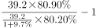
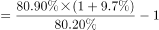
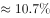
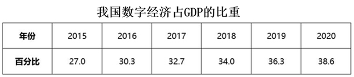
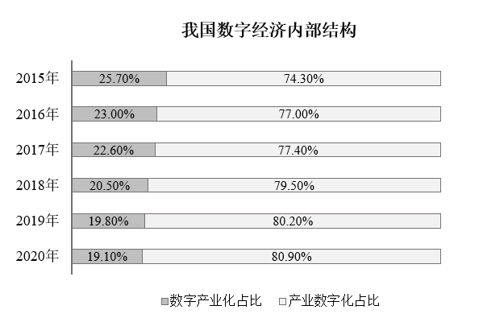
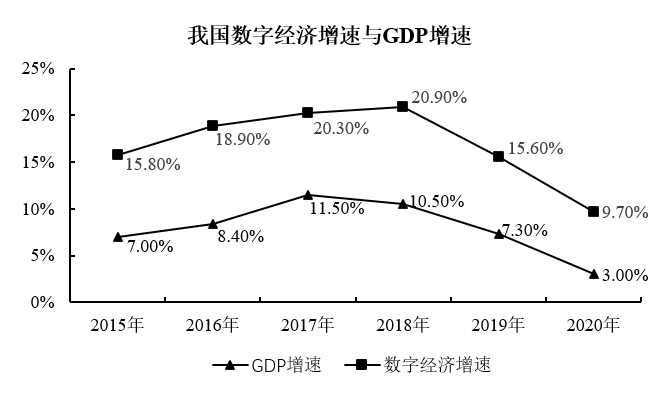

# 部分量增长率（整体现期值+整体增速+两期结构占比的链式拼接，含基期反推）

考点：[[20-考点/资料分析/增长/部分量增长率（整体现期值+整体增速+两期结构占比的链式拼接，含基期反推）|增长 / 部分量增长率（整体现期值+整体增速+两期结构占比的链式拼接，含基期反推）]]
材料：[[15-材料/资料分析/312957 2015-2020年我国数字经济：2|312957 2015-2020年我国数字经济：2]]

**问法模型**：题干问'2020年产业数字化规模同比增长约'，材料未直接给出该部分两年规模，只给整体现期值39.2万亿、整体增速9.7%及图2两年占比 → 用'部分增速=(1+整体增速)×(现期占比/基期占比)−1'模型，须以39.2÷(1+9.7%)反推基期整体

## 推理链
1. 第1步：文字段提取：2020年数字经济总量39.2万亿元，同比增速9.7%；图2提取：产业数字化占比2019年为80.20%、2020年为80.90%
2. 第2步：规则一'部分=整体×比重'；规则二'基期量=现期量÷(1+增长率)'，故2019年数字经济总量=39.2÷1.097万亿元
3. 第3步：代入：2020年产业数字化规模=39.2×80.90%，2019年产业数字化规模=(39.2÷1.097)×80.20%
4. 第4步：增长率=(39.2×80.90%)÷[(39.2÷1.097)×80.20%]−1=(80.90/80.20)×1.097−1≈1.0087×1.097−1≈10.66%
5. 第5步：与选项对照，10.66%最接近10.7%，故选D

**最快解法**：⚡ 链式公式+线性拆分：部分增速≈整体增速+占比相对变化=9.7%+(80.9−80.2)/80.2≈9.7%+0.87%≈10.57%，再补交叉项9.7%×0.87%≈0.08%，合计≈10.66%，最接近D(10.7%)；无需算出两年规模具体数值

## 易错点
- ⚠ 直接把整体增速9.7%当作产业数字化增速，误选最接近的B(9.8%)，忽视占比由80.20%升至80.90%带来的额外增长
- ⚠ 漏反推基期：若直接用39.2×80.20%充当2019年规模，算得增速仅约0.87%，落入'占比的百分点差(0.7个点)≠增速'陷阱；0.7个百分点须除以基数80.2%化为相对变化0.87%才能参与计算
- ⚠ 数据为'文字给现期总量与增速+图2给两年结构占比'的三源拼接，误以为图内或文字内有现成的产业数字化规模可直接读数

## 母题抽象
> 🧩 当题干问'某部分规模同比增长率'而材料只给'整体现期值+整体增速+两期部分占比'时，用部分增速=(1+整体增速)×(现期占比/基期占比)−1≈整体增速+占比相对变化，再与选项对照验证

**同类特征**：部分规模同比增长约、产业数字化、整体增速与现期总量在文字段、两期结构占比在图2、跨源拼接+基期反推、选项为百分数且数值接近

## 相关题
（暂无）

---

### 题干
2020年，产业数字化规模同比增长约：

### 选项
- A. 9.2%
- B. 9.8%
- C. 10%
- D. 10.7%　✅

### 官方解析

根据题干“2020年······同比增长约”，结合选项为百分数，可判定本题为一般增长率问题。定位文字材料第一段可得：2020年我国数字经济规模达到39.2万亿元，保持9.7%的高位增长。定位统计图1可得：我国数字经济内部结构中，2019年产业数字化占比为80.20%，2020年产业数字化占比为80.90%。根据公式：部分=整体×比重、增长率，可得2020年产业数字化规模同比增长。

故正确答案为D。

### 给定材料

        2020年我国数字经济规模达到39.2万亿元，保持9.7%的高位增长，占GDP比重为38.6%，同比提升2.4个百分点。

        产业数字化发展深入推进，2020年我国服务业、工业、农业数字经济占行业增加值比重分别为40.7%、21.0%和8.9%。

        2020年，数字经济规模超过1万亿元的省份有广东、江苏、山东、浙江、上海、北京、福建、湖北、四川、河南、河北、湖南和安徽；另有8个省份超过5000亿元；从GDP占比看，北京、上海领先，分别达到55.9%和55.1%；从增速上看，贵州、重庆、福建数字经济增速位列前三，增速超过15%。

> [!warning] 疑点（官方解析可能有误，待人工复核）
> 官方解析称'定位统计图1可得2019/2020年产业数字化占比80.20%/80.90%'，该数据实际出自图2（内部结构堆叠图），图1为占GDP比重表，图号引用笔误，但数值与计算无误，不影响答案D

<!-- CODEX-ANSWER-REVIEW:BEGIN -->
### 本次独立复核

**复核状态：** `resolved`（答案与解析已核定）

**计分答案：** D（可计分）

**复核解析：**

数字经济总规模2020年增长9.7%；产业数字化占数字经济的内部比重由2019年80.2%升至2020年80.9%。故产业数字化规模增长率=(1+9.7%)×80.9%/80.2%−1≈10.66%，约10.7%，选D。

**相关信息：**

部分量增长率=(总体增长倍数×现期比重/基期比重)−1。80.2%与80.9%来自数字经济内部结构图，不能误读成数字经济占GDP比重。

**题源依据：** [固定版本原题](https://github.com/Mentat-Uran/kaogongzhentizhengliu/blob/84ab93d4b64b61d897bece8a1c0a5bab06b4feb2/10-%E7%9C%9F%E9%A2%98/%E8%B5%84%E6%96%99%E5%88%86%E6%9E%90/%E5%A2%9E%E9%95%BF/4817783%20%E9%83%A8%E5%88%86%E9%87%8F%E5%A2%9E%E9%95%BF%E7%8E%87%EF%BC%88%E6%95%B4%E4%BD%93%E7%8E%B0%E6%9C%9F%E5%80%BC%2B%E6%95%B4%E4%BD%93%E5%A2%9E%E9%80%9F%2B%E4%B8%A4%E6%9C%9F%E7%BB%93%E6%9E%84%E5%8D%A0%E6%AF%94%E7%9A%84%E9%93%BE%E5%BC%8F%E6%8B%BC%E6%8E%A5%EF%BC%8C%E5%90%AB%E5%9F%BA%E6%9C%9F%E5%8F%8D%E6%8E%A8%EF%BC%89.md)；固定内容 commit `84ab93d4b64b61d897bece8a1c0a5bab06b4feb2`，Markdown blob `c57df58b1cb618c3ecd290af2ef7dfadedea7bc1`。
<!-- CODEX-ANSWER-REVIEW:END -->
