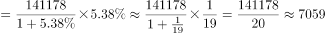

# 增长量计算（r-(1+r)模型）与区间落位

考点：[[20-考点/资料分析/增长/增长量计算（r-(1+r)模型）与区间落位|增长 / 增长量计算（r/(1+r)模型）与区间落位]]
材料：[[15-材料/资料分析/312967 2020年第七次全国人口普查数据：全|312967 2020年第七次全国人口普查数据：全]]

**问法模型**：题干出现'2020年比2010年增加的数量位于哪个区间'→ 求增长量：增长量=现期×r/(1+r)，或用材料已给部分增量（城镇增-乡村减）做加减替代，再对照区间选答案

## 推理链
1. 第1步：题干判定为增长量计算，材料第一段给出2020年（现期）全国人口141178万人，比2010年（基期）增长约5.38%（十年累计增长率，非年均、非增量）
2. 第2步：公式：增长量=现期×r/(1+r)=141178×5.38%/105.38%
3. 第3步：代入计算：141178×0.0538≈7595万，7595÷1.0538≈7206万人；或百化分5.38%≈1/18.6，增长量≈141178÷(1+18.6)=141178÷19.6≈7200万人
4. 第4步：交叉验证（材料第二段）：与2010年相比城镇人口增加23642万人、乡村人口减少16436万人，全国增量=城镇增量+乡村增量=23642-16436=7206万人，与公式结果一致
5. 第5步：7206万人落在7000万人-8000万人区间，对照选项锁定C

**最快解法**：⚡ 加减替代法（考场最快）：直接用第二段口算 23642-16436=7206万人，落7000万-8000万区间选C，完全不碰公式；若只用第一段数据，则百化分5.38%≈1/18.6，增长量≈141178÷19.6≈7200万人，同选C

## 易错点
- ⚠ 把增长率当增量：直接算141178×5.38%≈7595万人，模型错误（本题7595恰好也在C区间属侥幸，但正确值须除以1+r得7206万）
- ⚠ 增减符号搞反：乡村人口是'减少'16436万，全国增量应为23642-16436=7206万；误做成23642+16436=40078万则量级全错
- ⚠ 时间与量级口径：5.38%是2010-2020十年累计增长率，误按年均处理（除以10得约760万）会错选A；全材料单位为'万人'，注意选项量级

## 母题抽象
> 🧩 当题干出现'现期比基期增加的数量+区间落位'特征时，先扫材料找已给出的部分增量做加减替代（增项减减项）最快，找不到再用增长量=现期×r/(1+r)（百化分速算），绝不能直接用现期×r

**同类特征**：增加的数量位于哪个区间、给增长率（约5.38%）而不给增量、现期-基期差值模型、十年累计变化口径（2010-2020）、以'万人'为单位的粗颗粒区间选项

## 相关题
（暂无）

---

### 题干
2020年全国人口比2010年全国人口增加的数量位于以下哪个区间：

### 选项
- A. 5000万人-6000万人
- B. 6000万人-7000万人
- C. 7000万人-8000万人　✅
- D. 8000万人-9000万人

### 官方解析

根据题干“2020年······比2010年······增加的数量······”，可判定本题为增长量计算问题。

方法一：定位文字材料第一段可得：2020年全国人口共141178万人，比2010年增长了约5.38%。根据公式：增长量，则2020年全国人口比2010年全国人口增加的数量万人，在7000万人-8000万人区间。

方法二：定位文字第二段可知：（2020年）与2010年相比，城镇人口增加23642万人，乡村人口减少16436万人。因为全国人口数=城镇人口数+乡村人口数，则2020年全国人口比2010年全国人口增加的数量=城镇人口增加数量-乡村人口减少数量=23642-16436=7206万人，在7000万人-8000万人区间。

故正确答案为C。

### 给定材料

        2020年全国人口共141178万人，比2010年增长了约5.38%。从地区分布上看，2020年东部地区人口占39.93%，中部地区占25.83%，西部地区占27.12%，东北地区占6.98%。与2010年相比，东部地区人口所占比重上升2.15个百分点，中部地区下降0.79个百分点，西部地区上升0.22个百分点，东北地区下降1.20个百分点。

        从性别构成上看，2020年男性人口为72334万人，女性人口为68844万人。从年龄构成上看，2020年0-14岁人口为25338万人，15-59岁人口为89438万人，60岁及以上人口为26402万人（其中，65岁及以上人口为19064万人）。从城乡分布上看，2020年居住在城镇的人口为90199万人，居住在乡村的人口为50979万人，与2010年相比，城镇人口增加23642万人，乡村人口减少16436万人。从民族构成上看，2020年汉族人口为128631万人，各少数民族人口为12547万人，与2010年相比，汉族人口增长4.93%，各少数民族人口增长10.26%，少数民族人口比重上升0.40个百分点。

> [!warning] 疑点（官方解析可能有误，待人工复核）
> 官方解析方法一文字中公式与计算结果存在排版缺失（'增长量……增加的数量万人'中间断开），经复算141178×5.38%/105.38%≈7206万人无误，与答案C一致，不影响结论

<!-- CODEX-ANSWER-REVIEW:BEGIN -->
### 本次独立复核

**复核状态：** `confirmed`（独立复算确认答案）

**计分答案：** C（可计分）

**复核解析：**

按城乡人口变化直接计算，全国人口增加=城镇增加23642−乡村减少16436=7206万人，位于7000万—8000万区间，选C。

**相关信息：**

总量的净增量是各组成部分变化量带符号相加。

**题源依据：** [固定版本原题](https://github.com/Mentat-Uran/kaogongzhentizhengliu/blob/84ab93d4b64b61d897bece8a1c0a5bab06b4feb2/10-%E7%9C%9F%E9%A2%98/%E8%B5%84%E6%96%99%E5%88%86%E6%9E%90/%E5%A2%9E%E9%95%BF/4818011%20%E5%A2%9E%E9%95%BF%E9%87%8F%E8%AE%A1%E7%AE%97%EF%BC%88r-(1%2Br)%E6%A8%A1%E5%9E%8B%EF%BC%89%E4%B8%8E%E5%8C%BA%E9%97%B4%E8%90%BD%E4%BD%8D.md)；固定内容 commit `84ab93d4b64b61d897bece8a1c0a5bab06b4feb2`，Markdown blob `ddaf8735b65d3e55c26cda36a8185f757b4361cd`。
<!-- CODEX-ANSWER-REVIEW:END -->
