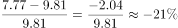
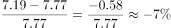
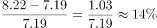
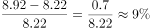
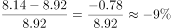
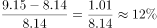

# 同比增长率计算与±10%阈值比较计数

考点：[[20-考点/资料分析/增长/同比增长率计算与±10%阈值比较计数|增长 / 同比增长率计算与±10%阈值比较计数]]
材料：[[15-材料/资料分析/317195 全国铝电容器出口状况：以柱状图给出2|317195 全国铝电容器出口状况：以柱状图给出2]]

**问法模型**：题干问'同比增幅超过10%的年份比同比降幅超过10%的年份多/少几个'→逐年计算同比增长率r=(当年−上年)/上年，与±10%阈值比较后分别计数再作差

## 推理链
1. 第1步：从图1提取2014-2020年全国铝电容器出口额：9.81、7.77、7.19、8.22、8.92、8.14、9.15亿美元（各年当期值）
2. 第2步：增长率公式 r=(当年值−上年值)/上年值，2015-2020年共6对逐年计算，2015年的基期须用图中最左侧2014年的9.81
3. 第3步：2015年=(7.77−9.81)/9.81≈−20.8%，降幅超10%；2016年=(7.19−7.77)/7.77≈−7.5%，降幅未超10%
4. 第4步：2017年=(8.22−7.19)/7.19≈+14.3%，增幅超10%；2018年=(8.92−8.22)/8.22≈+8.5%，增幅未超10%
5. 第5步：2019年=(8.14−8.92)/8.92≈−8.7%，降幅未超10%；2020年=(9.15−8.14)/8.14≈+12.4%，增幅超10%
6. 第6步：增幅超10%的年份有2017年、2020年共2个，降幅超10%的年份仅2015年1个，2−1=1，多1个，对照选项选A

**最快解法**：⚡ 阈值判定法（避免完整除法）：'超过10%'只需比较|当年−上年|是否大于上年/10——2015年减2.04>0.98超；2016年减0.58<0.78未超；2017年增1.03>0.72超；2018年增0.70<0.82未超；2019年减0.78<0.89未超；2020年增1.01>0.81超。逐一标记后计数：增幅超10%有2个（2017、2020），降幅超10%有1个（2015），2−1=1，多1个

## 易错点
- ⚠ 忽略图1最左侧2014年数据9.81，误以为2015年同比无法计算而漏掉唯一的降幅超10%年份
- ⚠ 阈值误判：2016年约−7.5%、2019年约−8.7%、2018年约+8.5%均接近但未超10%，粗略估算或看错柱高会数错年份个数
- ⚠ 口径混淆：把'降幅'未超过10%的2016、2019年也计入降幅超10%，或把'增幅超过10%'误解为'只要增长'，导致计数错误

## 母题抽象
> 🧩 当题干出现'同比增幅/降幅超过X%的年份有几个、比谁多/少'时，用r=(当年−上年)/上年逐年计算，速判可比较|当年−上年|与上年×X%，分别计数后作差

**同类特征**：2015-2020年六年、同比增幅超过10%、同比降幅超过10%、年份计数比较（多/少几个）、柱状图逐年当期值、需用首年作基期

## 相关题
- [[10-真题/资料分析/增长/2050944 增长率计算与比较（逐年同比增速找最小）|2050944]]（江西 2017，相关度1）
- [[10-真题/资料分析/增长/2730991 增长率计算与比较（同比增幅超过10%的年份计数）|2730991]]（深圳市考 2020，相关度1）
- [[10-真题/资料分析/增长/4924293 两段区间累计求和后的增长率计算|4924293]]（选调 2022，相关度1）

---

### 题干
2015-2020年六年间，全国铝电容器出口额同比增幅超过10%的年份比同比降幅超过10%的年份：

### 选项
- A. 多1个　✅
- B. 多2个
- C. 少1个
- D. 少2个

### 官方解析

根据题干“······同比增幅超过10%······同比降幅超过10%······”，可判定本题为一般增长率问题。定位柱形图可知2014-2020年全国铝电容器出口额。根据公式：增长率，则2015-2020年六年间，全国铝电容器出口额的同比增长率分别为：

2015年，；

2016年，；

2017年，；

2018年，；

2019年，；

2020年，。

综上可知，2015-2020年六年间，全国铝电容器出口额同比增幅超过10%的年份有2017年、2020年，共2个；同比降幅超过10%的年份只有2015年1个。则同比增幅超过10%的年份（2个）比同比降幅超过10%的年份（1个）多1个。

故正确答案为A。

### 给定材料

