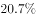
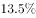
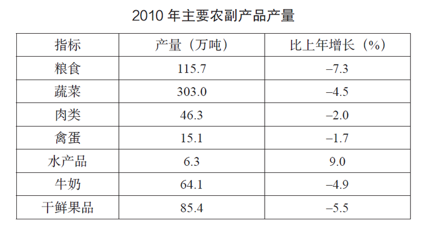

# 增长量（变化绝对值）比较

考点：[[20-考点/资料分析/增长/增长量（变化绝对值）比较|增长 / 增长量（变化绝对值）比较]]

**问法模型**：题干问'与上年相比产量变化绝对值最小'→对四个产品分别求|增长量|=|现期×r/(1+r)|后比较大小

## 推理链
1. 第1步：题干要求比较主要农副产品产量'变化绝对值'，即同比增长量的绝对值，判定为增长量比较问题
2. 第2步：定位表格提取数据：2010年肉类产量46.3万吨、禽蛋产量15.1万吨、水产品产量6.3万吨（增速9%）、牛奶产量64.1万吨，并查得各自同比增速
3. 第3步：写出增长量公式：增长量=现期×r/(1+r)，下降项为负值、比较时取绝对值
4. 第4步：代入水产品：6.3×9%÷(1+9%)≈0.52万吨（9%≈1/11，百化分速算6.3÷12≈0.52）
5. 第5步：将肉类、禽蛋、牛奶的现期值与表格中各自增速代入同一公式，算得各增长量绝对值
6. 第6步：对照四个结果，禽蛋增长量绝对值最小，对应选项B

**最快解法**：⚡ 公式法+百化分：统一用|现期×r/(1+r)|估算，r较小时≈现期×|r|；水产品9%≈1/11得6.3÷12≈0.52万吨，其余三项代入表格增速估算，禽蛋的变化量绝对值最小，直接锁定B

## 易错点
- ⚠ 把'变化绝对值'误当成'产量'或'增长率'来比较，见基数最小的水产品（6.3万吨）就想直选C
- ⚠ 下降项增长量为负，忘记取绝对值导致排序出错
- ⚠ 增长量与增长率概念混淆；注意四项单位均为万吨，但勿因基数小而跳过增速代入

## 母题抽象
> 🧩 当题干出现'与上年相比变化（增长）绝对值最小/最大'且各项现期值与增速均已给出时，用|现期×r/(1+r)|（百化分速算）逐项计算比较，而不是直接比产量或比增速

**同类特征**：与上年相比、变化绝对值最小、产量比较、多个产品选项、表格数据+增速、增长量比较

## 相关题
- [[10-真题/资料分析/增长/2144598 增长量比较|2144598]]（选调 2018，相关度1）
- [[10-真题/资料分析/增长/23447 增长量比较（现期量×r-(1+r)）|23447]]（云南 2011，相关度1）
- [[10-真题/资料分析/增长/465283 增长量比较|465283]]（江苏 2014，相关度1）
- [[10-真题/资料分析/增长/12881989 增长量比较（部分=整体×比重跨图还原后逐年作差）|12881989]]（广东 2025，相关度1）
- [[10-真题/资料分析/增长/15121335 增长量比较|15121335]]（江苏 2024，相关度1）

---

### 题干
该市主要农副产品与上年相比，产量变化绝对值最小的是：

### 选项
- A. 肉类
- B. 禽蛋　✅
- C. 水产品
- D. 牛奶

### 官方解析

根据题干“与上年相比，······变化绝对值最小”，判定本题为增长量比较问题。定位表格材料：2010年肉类产量46.3万吨，增速；2010年禽蛋产量15.1万吨，增速；2010年水产品产量6.3万吨，增速9%；2010年牛奶产量64.1万吨，增速。代入增长量公式：。

肉类增长量绝对值；

禽蛋增长量绝对值=；

水产品增长量绝对值=；

牛奶增长量绝对值。

禽蛋增长量绝对值最小。

故正确答案为B。

### 给定材料

根据所给图表、文字资料回答问题。

        某市2010年全年实现农业增加值124.3亿元，比上年下降。粮食播种面积22.3万公顷，比上年减少0.3万公顷；粮食产量115.7万吨，比上年下降。

        全市农业观光园1303个，比上年增加9个；观光园总收入17.8亿元，比上年增长。民俗旅游实际经营户7979户，比上年减少726户；民俗旅游总收入7.3亿元，增长。种业收入14.6亿元，比上年增长。设施农业总面积18323公顷，比上年下降；实现收入40.7亿元，增长。

> [!warning] 疑点（官方解析可能有误，待人工复核）
> 官方解析中的各产品增速与计算式以图片呈现、文字被截断，具体增速数值无法从文本核验，但比较结论与正确答案B一致，无实质矛盾
