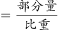
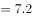

# 基期量计算（由部分现期量与现期比重先反推现期整体量，再除以(1+整体增速)）

考点：[[20-考点/资料分析/增长/基期量计算（由部分现期量与现期比重先反推现期整体量，再除以(1+整体增速)）|增长 / 基期量计算（由部分现期量与现期比重先反推现期整体量，再除以(1+整体增速)）]]
材料：[[15-材料/资料分析/323387 2020年我国软件和信息技术服务业四|323387 2020年我国软件和信息技术服务业四]]

**问法模型**：题干问基期年份（2019年）的'全行业实现收入'（整体基期量），而材料只给部分（信息技术服务）现期量及占整体比重→采用'整体现期=部分÷比重，基期=整体现期÷(1+整体增速)'的基期比重复合两步模型

## 推理链
1. 第1步：定位第三段，提取2020年信息技术服务收入49868亿元、同比增15.2%、占全行业比重61.1%，并捕捉派生条件'增速高出全行业平均水平1.9个百分点'。
2. 第2步：推算全行业整体增速=15.2%−1.9%=13.3%（材料未直接给出总增速，此为本题必经派生量）。
3. 第3步：由'整体量=部分量÷比重'求2020年全行业收入=49868÷61.1%≈81617亿元≈8.16万亿元（与四大形态直接加总22758+49868+1498+7492=81616亿元相互印证）。
4. 第4步：由基期量公式'基期=现期÷(1+增速)'，2019年全行业收入=81617÷(1+13.3%)=81617÷1.133。
5. 第5步：截位直除/百化分：13.3%≈1/7.5，81617×7.5/8.5≈72000亿元；或验算1.133×7.2=8.158≈8.16，即约72037亿元≈7.2万亿元。
6. 第6步：与选项对照：A为7.2万亿元，B的7.4、D的8.4均明显偏离；C的8.2万亿元恰为现期（2020年）量级，系'漏除(1+增速)'的现期陷阱，故锁定A。

**最快解法**：⚡ 公式法+截位直除（百化分辅助）：先秒算整体增速13.3%=15.2%−1.9%；再49868÷61.1%≈8.16万亿（选项量级直接锁定8.16万亿量级）；最后81617÷1.133，用1.133×7.2=8.158≈8.16反推商为7.2，秒选A；亦可百化分13.3%≈1/7.5，81617×7.5/8.5≈7.2万亿。

## 易错点
- ⚠ 现期当基期：算出2020年总量81617亿≈8.16万亿后直接选C（8.2万亿），漏除(1+13.3%)；C/D选项就是按现期量级设置的迷惑项。
- ⚠ 增速派生陷阱：材料不给总增速，须由'高出1.9个百分点'推出13.3%；误用信息技术服务自身增速15.2%作整体增速会得81617÷1.152≈7.09万亿；且'个百分点'是增速差，2019年增速换算时不能写成负值。
- ⚠ 单位与口径陷阱：结果单位为亿元（约72037亿），需换算成'万亿元'再对选项；反推总量（49868÷61.1%≈81617）与四项加总（81616）有约1亿舍入差，不影响7.2万亿的结论，按选项量级取舍即可。

## 母题抽象
> 🧩 当题干出现'基期年份+整体量'而材料只给'部分现期量+部分占整体比重+部分与整体增速的百分点关系'时，用两步模型：整体现期=部分÷比重，基期=整体现期÷(1+整体增速)，最后按选项单位换算并用量级验证选项。

**同类特征**：问法为材料年份之前的年份（2019年）+'约为'（基期估算）、主语是'全行业'整体收入而非某一部分、材料只给部分量及其占比，须先反推整体现期量、整体增速以'高出/低…个百分点'隐含派生、选项带'万亿元'单位且量级分层（7.x与8.x并设，8.x为现期迷惑项）

## 相关题
（暂无）

---

### 题干
2019年全行业实现收入约为：

### 选项
- A. 7.2万亿元　✅
- B. 7.4万亿元
- C. 8.2万亿元
- D. 8.4万亿元

### 官方解析

根据题干“2019年······约为”，结合材料时间为2020年，可判定本题为基期计算问题。定位文字材料第三段可得：2020年，信息技术服务实现收入49868亿元，同比增长15.2%，增速高出全行业平均水平1.9个百分点，占全行业收入比重为61.1%。根据公式：整体量，则2020年全行业实现收入亿元，同比增速=15.2%-1.9%=13.3%。根据公式：基期量，则2019年全行业实现收入亿元万亿元。

故正确答案为A。

### 给定材料

        2020年，由软件产品、信息技术服务、信息安全产品和服务、嵌入式系统软件四大业务形态构成的我国软件和信息技术服务业持续恢复，收入保持较快增长，信息技术服务加快云化发展，软件应用服务化、平台化趋势明显。

        2020年，软件产品实现收入22758亿元，同比增长10.1%，占全行业比重为27.9%。其中，工业软件产品实现收入1974亿元，增长11.2%，为支撑工业领域的自主可控发展发挥重要作用。

        2020年，信息技术服务实现收入49868亿元，同比增长15.2%，增速高出全行业平均水平1.9个百分点，占全行业收入比重为61.1%。其中，电子商务平台技术服务收入9095亿元，同比增长10.5%；云服务、大数据服务共实现收入4116亿元，同比增长11.1%。

        2020年，信息安全产品和服务实现收入1498亿元，同比增长10.0%，增速较上年回落2.4个百分点。

        2020年嵌入式系统软件实现收入7492亿元，同比增长12.0%，增速较上年提高4.2个百分点，占全行业收入比重为9.2%。嵌入式系统软件已成为产品和装备数字化改造、各领域智能化增值的关键性带动技术。

