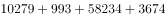
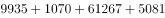
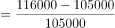
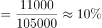

# 增长率计算（进出口总额加总后求同比增速）

考点：[[20-考点/资料分析/增长/增长率计算（进出口总额加总后求同比增速）|增长 / 增长率计算（进出口总额加总后求同比增速）]]
材料：[[15-材料/资料分析/323388 2014-2020年中国钓鱼钩、钓鱼|323388 2014-2020年中国钓鱼钩、钓鱼]]

**问法模型**：题干问2020年三类钓具进出口贸易总额'同比'增长/减少幅度，选项以5%为界 → 将2019、2020两年各6项（3类钓具×进出口）分别加总，用增长率=（现期-基期）/基期判定方向与幅度

## 推理链
1. 第1步：由统计表提取2019年数据：钓鱼钩出口10279、进口993，钓鱼竿出口58234、进口3674，钓线轮出口27426、进口5323（万美元）
2. 第2步：提取2020年数据：钓鱼钩出口9935、进口1070，钓鱼竿出口61267、进口5081，钓线轮出口31215、进口7623（万美元）
3. 第3步：分项加总：2019年出口合计95939、进口合计9990，总额=95939+9990=105929万美元；2020年出口合计102417、进口合计13774，总额=102417+13774=116191万美元
4. 第4步：同比增长量=116191-105929=10262万美元，方向为增长
5. 第5步：增长率=10262/105929≈9.7%（或用粗判：5%×105929≈5300<10262，增速必超5%）
6. 第6步：增速约9.7%＞5%且为增长，对照选项锁定B（增长了5%以上）

**最快解法**：⚡ 加总+粗判法：只需先定方向（2020总额116191＞2019总额105929，为增长），再用'5%×基期≈5300'与增量10262粗比，10262明显大于5300，无需精算9.7%即锁定B；加总时按出口三数一串、进口三数一串分两次加，减少串行错误

## 易错点
- ⚠ 总额需自行加总：三钓具×进/出口共6项，漏加任一项（尤其钓线轮进口7623这类跳升值）会显著拉低增速，可能误选A
- ⚠ 勿把出口额或单一钓具总额当作'钓、竿、轮进出口贸易总额'；表中无总额列，进口+出口需自行相加
- ⚠ 选项按'增长/减少×5%内外'四象限设置，必须先判方向再判幅度；基期为2019年（同比的上一期），勿误用2020年或其他年份作分母

## 母题抽象
> 🧩 当题干出现'多主体进出口贸易总额同比'且选项以百分比区间（如5%）分界时，先分别加总现期与基期各分项，再用'分界百分比×基期'与增量粗比即可锁定选项，无需精算增速

**同类特征**：进出口贸易总额（进口+出口自行加总）、多类别合并（钓鱼钩、竿、轮三类）、同比（现期2020、基期2019）、选项以5%为界且区分增长/减少方向、万美元单位、现期当期值

## 相关题
（暂无）

---

### 题干
2020年中国钓鱼钩、竿、轮进出口贸易总额同比：

### 选项
- A. 增长了不到5%
- B. 增长了5%以上　✅
- C. 减少了不到5%
- D. 减少了5%以上

### 官方解析

根据题干“2020年······同比”，结合选项为“增长/减少+%”，可判定本题为一般增长率问题。定位统计表可得2019年、2020年中国钓鱼钩、竿、轮的进口贸易额和出口贸易额。则2019年中国钓鱼钩、竿、轮进出口贸易总额为万美元，2020年为万美元。根据公式：增长率，则2020年中国钓鱼钩、竿、轮进出口贸易总额同比增长率，属于B项范围。

故正确答案为B。

### 给定材料

