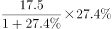
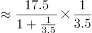
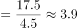

# 增长量计算（已知现期值与同比增长率，求同比增长量）

考点：[[20-考点/资料分析/增长/增长量计算（已知现期值与同比增长率，求同比增长量）|增长 / 增长量计算（已知现期值与同比增长率，求同比增长量）]]
材料：[[15-材料/资料分析/323432 2021年1～9月我国机床工具进出口|323432 2021年1～9月我国机床工具进出口]]

**问法模型**：题干出现'同比约增长多少亿美元'且材料给出'现期值+同比增速'→ 采用增长量公式：增长量=现期×r/(1+r)，配合百化分速算

## 推理链
1. 第1步：题干锁定'对美国出口额同比增量'，定位文字段第三段（出口去向）：2021年1～9月对美出口17.5亿美元，同比增长27.4%
2. 第2步：判定为增长量计算问题，使用公式：增长量=现期×r/(1+r)=17.5×27.4%/127.4%
3. 第3步：代入计算：17.5×0.274≈4.8，再除以1.274，得4.8/1.274≈3.76亿美元（或将27.4%百化分为约1/3.65，直接算17.5/4.65≈3.76）
4. 第4步：与选项对照：3.76与D项3.8最接近，A项1.9、B项2.3、C项3.1均明显偏小，故选D

**最快解法**：⚡ 百化分：27.4%≈1/3.65，增长量=现期/(n+1)=17.5/(3.65+1)=17.5/4.65≈3.76→直接锁定D（粗放取1/3.6得17.5/4.6≈3.8更快）

## 易错点
- ⚠ 漏除(1+r)：误算为现期×r=17.5×27.4%≈4.8亿美元，虽无对应选项但会浪费时间二次检查；牢记'增长量=现期×r/(1+r)'
- ⚠ 数据维度混淆：17.5亿美元是国别维度（出口去向前三·美国），不可与图2产品维度的出口额（如磨料磨具29.3、金属切削机床26.2）混用
- ⚠ 选项间距较小（C项3.1与D项3.8），百化分时n的取值不可过度粗糙（如取1/4得17.5/5=3.5仍有风险），建议n取3.6~3.7保证精度

## 母题抽象
> 🧩 当题干出现'现期值+同比增速，求同比约增长多少（亿元/亿美元）'时，判定增长量计算，用增长量=现期×r/(1+r)，将r百化分为1/n后按'现期/(n+1)'截位速算，选最接近选项

**同类特征**：同比约增长多少亿美元、只给现期值和同比增速、国别出口数据（美国17.5）、增长率27.4%接近常见百化分区间、选项为小数且间距不大

## 相关题
- [[10-真题/资料分析/倍数/19591644 基期倍数|19591644]]（选调 2024，相关度1）

---

### 题干
2021年1～9月，我国机床工具对美国出口额同比约增长多少亿美元？

### 选项
- A. 1.9
- B. 2.3
- C. 3.1
- D. 3.8　✅

### 官方解析

根据题干“2021年1～9月，······同比约增长多少亿美元”，可判定本题为增长量计算问题。定位文字材料第三段可得：2021年1～9月，我国机床工具对美国出口额为17.5亿美元，同比增长27.4%。根据公式：增长量，则2021年1～9月，我国机床工具对美国出口额同比增长亿美元，与D项最接近。

故正确答案为D。

### 给定材料

        2021年1～9月，我国机床工具进出口总额242.6亿美元，同比增长32.8%。其中，机床工具商品进口105.2亿美元，同比增长23.7%；出口137.4亿美元，同比增长40.8%。

        从进口来源来看，2021年1～9月进口来源前三位分别是：日本34.5亿美元，同比增长37.8%；德国 22.2亿美元，同比增长11.0%；中国台湾14.3亿美元，同比增长36.1%。

        从出口去向来看，2021年1～9月出口去向前三位分别是：美国17.5亿美元，同比增长27.4%；越南10.5亿美元，同比增长35.4%；印度8.8亿美元，同比增长67.8%。

