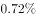
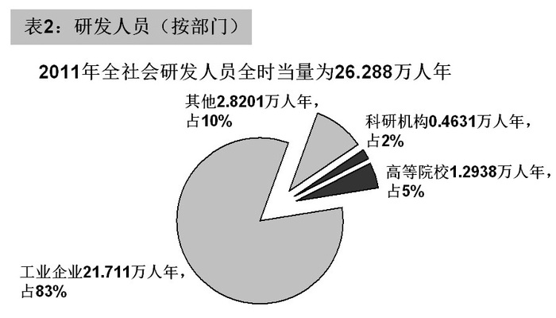
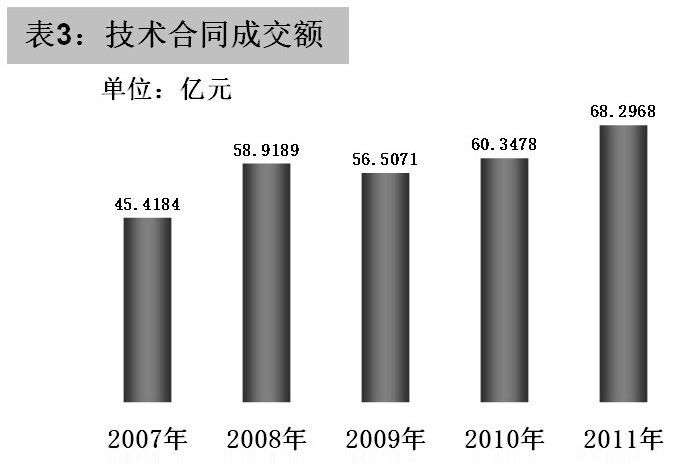

# 现期量计算（按历史最快增长率推算下一年）

考点：[[20-考点/资料分析/增长/现期量计算（按历史最快增长率推算下一年）|增长 / 现期量计算（按历史最快增长率推算下一年）]]

**问法模型**：题干出现'按照某年段增长最快的增长率算，次年……一定超过多少'→ 先在表格中找出最大增长率，套现期量公式 现期=基期×(1+r_max) 求出预测值，再对照'一定超过'的选项分界

## 推理链
1. 第1步：文字材料给出2011年技术合同成交额68.2968亿元（作现期量），表3给出2007—2011各年成交额
2. 第2步：逐年比较增长率，2008年增长最快：2007年45.4184亿元、2008年58.9189亿元，r=(58.9189−45.4184)/45.4184≈29.7%
3. 第3步：代入现期量公式：2012年=68.2968×(1+29.7%)≈68.3×1.3≈88.6亿元
4. 第4步：88.6亿元>80但<90，即'一定超过'的分界只能是80亿元，对照选项选D

**最快解法**：⚡ 截位直除+百化分：增速13.5/45.4≈30%，则2012年≈68.3×1.3≈88.8亿元，落区间(80,90)，故选80

## 易错点
- ⚠ 误把'增长最快'理解为增长量最大，需比较的是增长率（2008年约29.7%为最大）
- ⚠ 算出约88.6后误选C(90)：88.6并未超过90，'一定超过'只能取80
- ⚠ 单位与指标干扰：官方解析文字误写'亿吨'，实际均为'亿元'，看清问的是技术合同成交金额

## 母题抽象
> 🧩 当题干出现'按某时期增长最快/最慢的增长率算，下一年一定超过/不超过多少'时，先从图表锁定最大(或最小)增长率，用 现期量=基期×(1+r) 估值，结果落入哪个选项区间就选该区间的'超过分界值'

**同类特征**：按照…增长最快的增长率算、2012年、一定超过多少亿元、技术合同成交金额、现期预测计算、从表格找最大增速

## 相关题
（暂无）

---

### 题干
按照2007—2011年增长最快的增长率算，2012年技术合同成交金额一定超过多少亿元？

### 选项
- A. 110
- B. 100
- C. 90
- D. 80　✅

### 官方解析

根据题干“按照2007—2011年增长最快的增长率算，2012年······”，可判定本题为现期计算问题。定位文字材料和表3可得：“2011年技术合同成交额为68.2968亿元；表3中增长率最高的显然是2008年，2007年、2008年技术合同成交额分别为45.4184亿吨、58.9189亿吨。”代入现期量公式：，故2012年技术合同成交额亿元，一定超过80亿元。

故正确答案为D。

### 给定材料

        2011年，某省全社会研发经费达612.93亿元，R&amp;D（研发）经费占GDP的比重达，比2010年提高0.12个百分点。2011年，该省R&amp;D人员达26.288万人，每万名就业人员中的研发人员比例达。2011年，该省专利申请量和授权量分别达16.5万件和13万件，同比增长和。2011年，该省技术市场合同成交额68.2968亿元。2011年，该省每万元GDP能耗0.590吨标准煤。

> [!warning] 疑点（官方解析可能有误，待人工复核）
> 官方解析中'45.4184亿吨、58.9189亿吨'单位应为'亿元'，属笔误，不影响计算过程与答案D的判定
