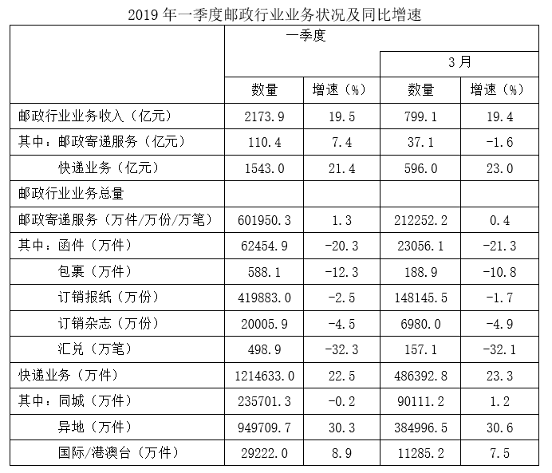

# 基期和差（'一季度−3月'基期拆分求基期量）

考点：[[20-考点/资料分析/增长/基期和差（'一季度−3月'基期拆分求基期量）|增长 / 基期和差（'一季度−3月'基期拆分求基期量）]]
材料：[[15-材料/资料分析/335236 2019年一季度（及其中3月当月）我|335236 2019年一季度（及其中3月当月）我]]

**问法模型**：题干问基期年份（2018年）的非整期时段'1~2月'的收入，而材料只给'一季度累计'与'3月当月'→ 采用基期和差模型：2018年1~2月=110.4/(1+7.4%)−37.1/(1−1.6%)

## 推理链
1. 第1步：题干求2018年1~2月邮政寄递服务收入，材料仅有2019年一季度110.4亿元（同比+7.4%）与2019年3月37.1亿元（同比−1.6%），故需拆分：2018年1~2月=2018年一季度−2018年3月
2. 第2步：基期量=现期量/(1+增速)；注意3月增速为负，分母取1−1.6%=0.984
3. 第3步：2018年一季度收入=110.4/1.074≈102.8亿元
4. 第4步：2018年3月收入=37.1/0.984≈37.7亿元
5. 第5步：2018年1~2月收入≈102.8−37.7=65.1亿元
6. 第6步：与选项对照，65.1与B项65最接近，故选B

**最快解法**：⚡ 基期差值法+截位直除：110.4/1.074≈102.8（可截位为110.4/1.07≈103），37.1/0.984≈37.7，两数相减≈65秒选B；辅助定性排除：2019年1~2月现期=110.4−37.1=73.3，因1~2月增速必高于一季度整体7.4%且为正，基期应明显小于73.3/1.074≈68且远大于44（44对应增速约67%与一季度7.4%矛盾），直接锁定B

## 易错点
- ⚠ 漏做'一季度−3月'拆分：直接把现期110.4或73.3当基期，而73.3不在选项中易误选C/D
- ⚠ 负增速处理错误：3月增速−1.6%应除以0.984，若误按正增速除以1.016得36.5（本题侥幸仍近B，但对汇兑−32.3%等更深负增速会致命）
- ⚠ 同名指标口径混淆：'邮政寄递服务'在表中出现两次——收入行（110.4/37.1亿元）与业务量行（601950.3/212252.2万件/万份/万笔），读错行全盘皆错

## 母题抽象
> 🧩 当题干出现'去年某非整期时段（如1~2月）约为多少'而材料只给'累计期+其中单期'的双层结构时，用基期和差：各段分别按现期/(1+增速)（负增速分母取1−|增速|）求基期再相减，并用'现期差73.3÷(1+略高于累计增速)'快速定位答案邻域

**同类特征**：基期时间'2018年1~2月'（去年的中间月份段）、材料仅给'一季度'与'3月'两段数据、'约为多少亿元'求具体量、收入类指标（亿元）、同比增速一正一负（+7.4%与−1.6%）、基期和差/基期拆分模型

## 相关题
（暂无）

---

### 题干
2018年1~2月，我国邮政寄递服务的收入约为多少亿元？

### 选项
- A. 44
- B. 65　✅
- C. 82
- D. 103

### 官方解析
根据题干“2018年1~2月······收入约为多少亿元”，结合材料时间为2019年一季度和2019年3月，可判定本题为基期和差问题。定位统计表可得：2019年一季度，我国邮政寄递服务110.4亿元，同比增速为7.4%；2019年3月，我国邮政寄递服务37.1亿元，同比增速为-1.6%。根据公式：基期量，可得2018年1~2月我国邮政寄递服务的收入亿元，与B项最接近。
故正确答案为B。

### 给定材料

