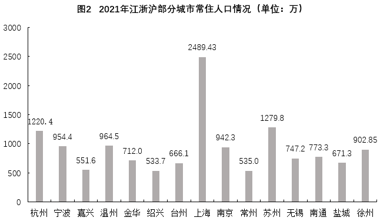

# 增长量比较与增长率比较（双指标同期对比）

考点：[[20-考点/资料分析/增长/增长量比较与增长率比较（双指标同期对比）|增长 / 增长量比较与增长率比较（双指标同期对比）]]
材料：[[15-材料/资料分析/335856 江浙沪地区2014-2020年人均消|335856 江浙沪地区2014-2020年人均消]]

**问法模型**：题干出现'与2015年相比，2020年……增量……，……增长率……'的两空比较问法 → 对两指标分别用'增长量=现期-基期''增长率=增量/基期'计算后逐一比较高低

## 推理链
1. 第1步：定位图1（注意图例：方框线=人均消费支出，菱形点线=人均教育文化娱乐支出），取2015年文娱支出2857元、2020年文娱支出3380元，2015年消费支出30191元、2020年消费支出37303元
2. 第2步：公式一：增长量=现期量-基期量
3. 第3步：文娱增量=3380-2857=523元，消费增量=37303-30191=7112元，523元<7112元，第一空为'低于'，排除A、B
4. 第4步：公式二：增长率=增长量/基期量，文娱增速=523/2857≈18.3%，消费增速=7112/30191≈23.6%
5. 第5步：18.3%<23.6%，第二空为'低于'，两空均'低于'，对照选项选D

**最快解法**：⚡ 公式法+截位直除：增量直接做差（523元 vs 7112元）秒判第一空；增速比较用增量/基期截位直除——523/2857≈18%、7112/30200≈23.5%，亦可先比倍数：消费增量约为文娱增量的13倍多而基期仅约10倍，分子倍数>分母倍数，消费增速必更高，两空均'低于'选D

## 易错点
- ⚠ 双线辨析：两序列共用0-45000纵轴且量级差约10倍（消费3万多vs文娱3千多），取错线（误把消费当文娱）则全盘皆错
- ⚠ 基期现期与回落年陷阱：基期为2015年、现期为2020年，而两条线峰值在2019年（39036元、4022元），若凭'最新最高'直觉取2019年数据则增量、增速全错
- ⚠ 增速直觉陷阱：文娱支出基数小（2857元），易误信'低基数必高增速'而选'低于、高于'(C)；实际消费增速约23.6%高于文娱约18.3%，必须实算

## 母题抽象
> 🧩 当题干出现'与某基期年相比，现期年A指标与B指标的增量、增长率谁高于谁'的两空比较时，先做差比增量，再用'增量/基期'截位直除或'分子倍数vs分母倍数'法比增速，验证两空对应同一选项

**同类特征**：与2015年相比，2020年、增量……增长率（两空比较）、高于/低于选项组合、双指标折线图取数、增长量与增长率混合比较、同图两条时间序列

## 相关题
（暂无）

---

### 题干
与2015年相比，2020年江浙沪地区年人均教育文化娱乐支出增量        年人均消费支出增量，年人均教育文化娱乐支出增长率        年人均消费支出增长率。

### 选项
- A. 高于，高于
- B. 高于，低于
- C. 低于，高于
- D. 低于，低于　✅

### 官方解析

根据题干“与2015年相比，2020年······增量······，······增长率······”，结合选项为高于/低于，可判定本题为增长量比较问题和一般增长率问题。定位图1可得：2015年、2020年江浙沪地区年人均教育文化娱乐支出分别为2857元、3380元，2015年、2020年江浙沪地区年人均消费支出分别为30191元、37303元。根据公式：增长量=现期量-基期量，可得与2015年相比，2020年江浙沪地区年人均教育文化娱乐支出增量=3380-2857=523元，年人均消费支出增量=37303-30191=7112元，前者低于后者，排除A、B两项；根据公式：增长率，可得与2015年相比，2020年江浙沪地区年人均教育文化娱乐支出增长率，年人均消费支出增长率，前者低于后者，D项当选。

故正确答案为D。

### 给定材料

