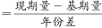

# 年均增长量计算

考点：[[20-考点/资料分析/增长/年均增长量计算|增长 / 年均增长量计算]]
材料：[[15-材料/资料分析/336794 2014～2021年全国零售药店终端|336794 2014～2021年全国零售药店终端]]

**问法模型**：'2014～2021年间……年均销售额增长约多少亿元'→年均增长量模型：年均增长量=(现期值−基期值)/间隔年份，基期直接取起始年2014年当年柱值，间隔=2021−2014=7

## 推理链
1. 第1步：由题干关键词'2014～2021年间''实体药店市场''年均销售额增长''亿元'判定为年均增长量问题，且口径为图2实体药店而非图1终端（两图柱值仅差几十到三百多亿元，先定口径再读数）
2. 第2步：定位图2：基期2014年实体药店销售额2807亿元，现期2021年4405亿元，两值均直接可读，无需倒推
3. 第3步：套用年均增长量公式：年均增长量=(现期−基期)/(现期年份−基期年份)，间隔=2021−2014=7个间隔（不是8年）
4. 第4步：代入计算：(4405−2807)/7=1598/7≈228.3亿元
5. 第5步：与选项对照：228.3与A项228最接近，故选A；误读图1终端（4774−2828=1946）再除以8会得约243对应D项，误用2013年倒推基期2545除以8会得233对应B项，均非官方口径

**最快解法**：⚡ 公式法+截位直除：先锁定图2（实体口径），差值4405−2807=1598，除以间隔7，1598/7≈228.3，直接命中A；全程只需一次减法和一次除法，无需精算

## 易错点
- ⚠ 口径看串：图1终端与图2实体柱值高度接近，本题问'实体药店'必须读图2；若误读图1终端，(4774−2828)/8≈243恰对应D项244，是命题人预设的口径陷阱
- ⚠ 间隔年份取错：2014～2021共8个年份但只有7个增长间隔，公式分母是年份差7而非8；若用2013年倒推基期（2807/1.103≈2545）再除以8得约233，恰为B项干扰，官方采用'基期=2014年柱值、除以7'的口径
- ⚠ 倒推增速拿错（若走2013年路线）：'10.3%'既是图1的2021年终端增速又是图2的2014年实体增速，实体倒推必须用图2的10.3%，不能用图1的10.6%；本题正确口径下无需倒推，避免多余步骤即避开此坑

## 母题抽象
> 🧩 当题干出现'某时段（起点年～现期年）间……年均增长约多少亿元'时，用年均增长量公式（现期值−基期值）/（现期年−起点年），基期直接取起点年当年值、分母取年份差而非年份数，结果对照最接近选项；若选项中出现'年份差+1'或'倒推基期'口径的数值，应识别为干扰项

**同类特征**：2014～2021年间、年均销售额增长、约多少亿元、实体药店市场、年均增长量、双图材料中指定单一口径

## 相关题
- [[10-真题/资料分析/增长/15419190 年均增长量计算|15419190]]（湖北 2025，相关度3）
- [[10-真题/资料分析/增长/2742310 年均增长量计算|2742310]]（北京 2021，相关度3）
- [[10-真题/资料分析/增长/12881983 年均增长量计算|12881983]]（广东 2025，相关度3）
- [[10-真题/资料分析/增长/13319337 年均增长量计算|13319337]]（江苏 2025，相关度3）
- [[10-真题/资料分析/增长/16070255 年均增长量计算|16070255]]（湖北 2026，相关度3）

---

### 题干
2014～2021年间，全国实体药店市场药品年均销售额增长约为多少亿元？

### 选项
- A. 228　✅
- B. 233
- C. 238
- D. 244

### 官方解析

根据题干“2014～2021年间······年均销售额增长······亿元”，可判定本题为年均增长量问题。定位统计图2可得：2014年、2021年全国实体药店市场药品销售额分别为2807亿元、4405亿元。根据公式：年均增长量，则2014～2021年间，全国实体药店市场药品年均销售额增长亿元。

故正确答案为A。

### 给定材料

        零售药店终端包含实体药店和网上药店两大市场。2021年，全国零售药店终端药品销售额4774亿元，同比增长10.3%。其中，实体药店市场药品销售额4405亿元，同比增长7.8%；网上药店市场药品销售额368亿元，同比增长51.5%。

> [!warning] 疑点（官方解析可能有误，待人工复核）
> 官方口径为'基期取2014年2807、间隔取7'得228；选项B(233)对应'严格以倒推的2013年(≈2545)为基期、除以8'的算法，两种口径相差约5亿元，属命题设置的干扰项而非解析错误，以官方答案A为准

<!-- CODEX-ANSWER-REVIEW:BEGIN -->
### 本次独立复核

**复核状态：** `resolved`（答案与解析已核定）

**计分答案：** A（可计分）

**复核解析：**

2014销售额2807亿元，2021为4405亿元，七年年均增量=(4405−2807)/7≈228.3亿元，A。

**相关信息：**

增长量=现期×增长率/(1+增长率)；年均增长量除以年份差；年均增长率在年份间隔相同情况下可比较末值/基期值。

**题源依据：** [固定版本原题](https://github.com/Mentat-Uran/kaogongzhentizhengliu/blob/84ab93d4b64b61d897bece8a1c0a5bab06b4feb2/10-%E7%9C%9F%E9%A2%98/%E8%B5%84%E6%96%99%E5%88%86%E6%9E%90/%E5%A2%9E%E9%95%BF/5430316%20%E5%B9%B4%E5%9D%87%E5%A2%9E%E9%95%BF%E9%87%8F%E8%AE%A1%E7%AE%97.md)；固定内容 commit `84ab93d4b64b61d897bece8a1c0a5bab06b4feb2`，Markdown blob `2666f43485ecefdd3fecef2deddfb94f72261c16`。
<!-- CODEX-ANSWER-REVIEW:END -->
