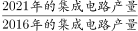

# 年均增长率比较排序（同基期同n型）

考点：[[20-考点/资料分析/增长/年均增长率比较排序（同基期同n型）|增长 / 年均增长率比较排序（同基期同n型）]]
材料：[[15-材料/资料分析/338025 2016—2021年全国及7个省市（|338025 2016—2021年全国及7个省市（]]

**问法模型**：题干出现'按2016~2021年年均增速（以2016年为基期）从高到低排列'→ 四主体年份差n均为5，年均增速=(现期/基期)^(1/n)−1，n相同时直接比较2021年÷2016年的倍数大小即可排序，无需开方

## 推理链
1. 第1步：从统计表提取4省市2016年与2021年产量（亿块）：①甘肃197→643，②广东219→539，③上海238→365，④浙江74→230
2. 第2步：年均增速公式 (现期/基期)^(1/n)−1，2016→2021年份差n=5；四个主体n相同，开方不改变大小顺序，只需比较2021/2016的倍数
3. 第3步：截位直除计算倍数：①甘肃643/197≈3.26，②广东539/219≈2.46，③上海365/238≈1.53，④浙江230/74≈3.11
4. 第4步：①与④倍数接近（3.26 vs 3.11），交叉相乘验证：643×74=47582 > 230×197=45310，故①＞④
5. 第5步：得到从高到低排序：①甘肃＞④浙江＞②广东＞③上海，即①④②③
6. 第6步：对照选项，C为①④②③，与官方答案一致

**最快解法**：⚡ 公式法+截位直除：n相同直接比'现期÷基期'，口算倍数——甘肃643/197≈3.3、浙江230/74≈3.1、广东539/219≈2.5、上海365/238≈1.5；用交叉相乘(643×74>230×197)确认①>④，直接锁C，全程不开5次方

## 易错点
- ⚠ 年份差口径：2016→2021为n=5年（非6年），本题n相同不影响排序，但若题目单独求年均增速数值时按6年计算会出错
- ⚠ 看错行取错数：甘肃197、广东219、上海238三个基期值相近，且表中还混有北京81、四川33等行，四省市必须逐行核对2016与2021两列，勿串行
- ⚠ 不必开方陷阱：很多考生对每个主体都开5次方导致考场耗时，应立即识别'n相同比倍数'的简化规则；另注意排列方向是'从高到低'，勿反向排成③②④①而误选

## 母题抽象
> 🧩 当题干出现'多个主体按同一基期到同一现期的年均增速排序'特征时，先确认年份差n相同，然后用'现期÷基期'的倍数直接比较排序（截位直除+交叉相乘验证相近项），完全不需要开n次方

**同类特征**：年均增速、以2016年为基期计算、从高到低排列、多主体排序、2016~2021年区间、选项为序号组合

## 相关题
- [[10-真题/资料分析/增长/4652203 年均增长率比较（年份差相同，比较末期值-基期值）|4652203]]（北京 2022，相关度2）
- [[10-真题/资料分析/比重/16069815 基期比重倒推与排序（现期比重−提升百分点）|16069815]]（贵州 2026，相关度1）
- [[10-真题/资料分析/综合/2676669 综合判断选非题（增长率-比重的数据可得性判断）|2676669]]（选调 2018，相关度1）
- [[10-真题/资料分析/平均数/19283738 平均数增长率比较（平均每笔金额=金额÷笔数的增长率排序）|19283738]]（国考 2025，相关度1）
- [[10-真题/资料分析/其他/2051194 消费价格分类涨跌幅排序（直接定位+排除法比较）|2051194]]（黑龙江 2017，相关度1）

---

### 题干
将①甘肃、②广东、③上海和④浙江按2016~2021年集成电路产量年均增速（以2016年为基期计算）从高到低排列，以下正确的是：

### 选项
- A. ④①②③
- B. ④①③②
- C. ①④②③　✅
- D. ①④③②

### 官方解析

根据题干“······按2016~2021年······年均增速（以2016年为基期计算）从高到低排列······”，可判定本题为年均增长率问题。定位统计表可知2016年和2021年甘肃、广东、上海、浙江的集成电路产量。根据年均增长率公式：（n为年份差），当年份差n相同时，直接根据的值即可比较年均增长率的大小。计算各省份可得：①甘肃；②广东；③上海；④浙江，则年均增速从高到低排列为：①④②③。

故正确答案为C。

### 给定材料

