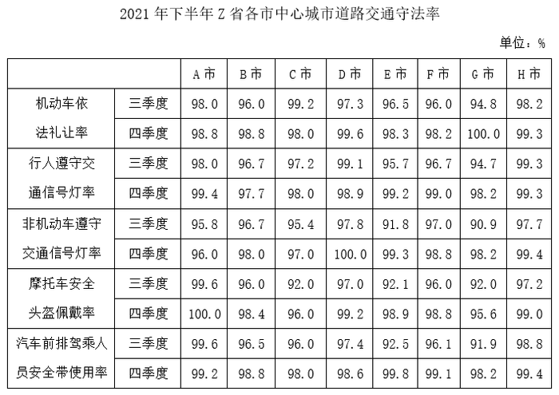

# 提升幅度（两期差值-百分点）比较

考点：[[20-考点/资料分析/增长/提升幅度（两期差值-百分点）比较|增长 / 提升幅度（两期差值/百分点）比较]]
材料：[[15-材料/资料分析/338026 2021年下半年（三、四季度）Z省A|338026 2021年下半年（三、四季度）Z省A]]

**问法模型**：题干问B市'工作相比三季度最有成效'的方面 → 对B市各指标计算'四季度-三季度'的差值（百分点），差值最大者即答案

## 推理链
1. 第1步：锁定B市一列，逐项读取两期数据：机动车依法礼让率96.0→98.8，行人遵守交通信号灯率96.7→97.7，非机动车遵守交通信号灯率96.7→98.0，摩托车安全头盔佩戴率96.0→98.4，汽车前排安全带使用率96.5→98.8
2. 第2步：规则：提升幅度=四季度数值-三季度数值，单位为百分点，直接比较差值大小
3. 第3步：逐项作差：礼让+2.8、行人信号灯+1.0、非机动车信号灯+1.3、头盔+2.4、安全带+2.3（个百分点）
4. 第4步：按选项归并比较：A礼让2.8、B两项中较大者为非机动车1.3、C头盔2.4、D安全带2.3
5. 第5步：差值最大为礼让率2.8个百分点，对应选项A，与官方答案一致

**最快解法**：⚡ 定位+口算差值法：只看B市一列，各指标'下行-上行'心算差值（2.8/1.0/1.3/2.4/2.3），直接取最大2.8，无需截位或复杂速算

## 易错点
- ⚠ 串行取数：表中5项指标的三/四季度两行交替排列，B市列中96.5是安全带三季度而非礼让率，须先锁指标再锁季度行
- ⚠ 百分点与增长率口径混淆：题干'最有成效'指差值（百分点）最大，勿误按相对增长率计算或比较
- ⚠ 选项B为两项指标合并（行人与非机动车），需分别作差取较大者（1.3），不能相加（2.3）或只看其中一项；另注意礼让三季度96.0与头盔三季度96.0并列、礼让四季度98.8与安全带四季度98.8并列，单看'最低/最高'不足以判定，必须比较差值

## 母题抽象
> 🧩 当题干出现'某主体在某方面相比上期最有成效/提升最大/改善最明显'特征时，锁定该主体所在列，对同指标两期数据作差（百分点），比较各差值取最大并对应选项

**同类特征**：单市（B市）列定位、四季度相比三季度、最有成效、提升幅度比较、守法率五项指标、两期成对统计表

## 相关题
（暂无）

---

### 题干
如单纯从统计数据判断，则2021年四季度B市在提升中心城市道路交通守法率方面，工作相比三季度最有成效的是：

### 选项
- A. 机动车依法礼让　✅
- B. 行人、非机动车遵守交通信号灯
- C. 摩托车驾乘人员佩戴安全头盔
- D. 汽车前排驾乘人员使用安全带

### 官方解析
定位表格材料可得2021年三季度、四季度B市在选项四个方面的城市道路交通守法率，具体情况为：

对比可得，B市2021年三季度的机动车依法礼让率最低（96.0%），而四季度最高（98.8%），差值最大，即工作相比三季度最有成效。
故正确答案为A。

### 给定材料

> [!warning] 疑点（官方解析可能有误，待人工复核）
> 官方解析中'B市三季度礼让率最低（96.0%）、四季度最高（98.8%）'的表述为B市五项指标内部比较，且96.0与头盔三季度、98.8与安全带四季度均为并列极值，单凭该表述不足以区分选项，但解析同时明确'差值最大'（2.8个百分点），结论正确，不影响答案
