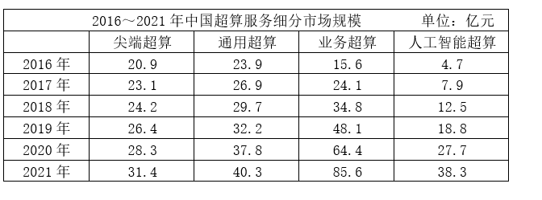

# 同比增长率计算与比较（百分点差）

考点：[[20-考点/资料分析/增长/同比增长率计算与比较（百分点差）|增长 / 同比增长率计算与比较（百分点差）]]
材料：[[15-材料/资料分析/338030 2016～2021年中国超算（高性能|338030 2016～2021年中国超算（高性能]]

**问法模型**：题干问'2018年4类细分市场中同比增速最快和最慢的市场，增速相差约多少个百分点'→ 对4类市场分别以2017年为基期计算2018年同比增长率，锁定最大值与最小值后作差（百分点）

## 推理链
1. 第1步：题干限定期限为2018年同比增速，故基期为2017年；从统计表取数：尖端23.1→24.2、通用26.9→29.7、业务24.1→34.8、人工智能7.9→12.5（亿元）
2. 第2步：增长率公式 g=(现期-基期)/基期，即现期/基期−1；所求为两个增速之差，单位是百分点
3. 第3步：逐类代入：尖端=(24.2−23.1)/23.1=1.1/23.1≈4.8%；通用=(29.7−26.9)/26.9=2.8/26.9≈10.4%；业务=(34.8−24.1)/24.1=10.7/24.1≈44.4%；人工智能=(12.5−7.9)/7.9=4.6/7.9≈58.2%
4. 第4步：比较四个增速，最快为人工智能超算≈58%，最慢为尖端超算≈5%
5. 第5步：作差 58%−5%=53个百分点，与选项C(53)对应，故选C

**最快解法**：⚡ 截位直除（比较现期/基期倍数）：先比2018/2017的倍数——尖端24.2/23.1≈1.05、通用29.7/26.9≈1.10、业务34.8/24.1≈1.44、人工智能12.5/7.9≈1.58，锁定最快为人工智能、最慢为尖端；再用截位直除精算两个端点：4.6/7.9≈58%、1.1/23.1≈5%，58−5=53，选C

## 易错点
- ⚠ 基期混淆：2018年同比增速必须用2017年做基期，若误取2016年数据（尖端20.9、人工智能4.7）则增速全错
- ⚠ 把'增量大小'当'增速快慢'：业务超算增量10.7亿元为四类最大，易误判为最快，实际其增速44%低于人工智能的58%；必须按(现期−基期)/基期计算比较
- ⚠ '百分点'与'%'、'规模之差'混淆：所求是两个增速相减（约53个百分点），不是市场规模之差（12.5−7.9=4.6亿元）也不是增速之比；若直接取规模差无法匹配任何选项

## 母题抽象
> 🧩 当题干出现'某年……同比增速最快和最慢的……相差约多少个百分点'时，对每个类别用(现期−上年)/上年分别求增速（基期是上一年），可先用现期/基期倍数快速锁定最大最小两端再精算，两端增速相减即为百分点差，直接匹配选项

**同类特征**：同比增速最快和最慢、相差约多少个百分点、4类细分市场逐一比较、单一年份（2018年）的增长率、基期为上一年（2017年）、增速作差而非规模作差

## 相关题
（暂无）

---

### 题干
2018年，中国超算服务4类细分市场中，同比增速最快和最慢的市场当年市场规模同比增速相差约多少个百分点？

### 选项
- A. 41
- B. 47
- C. 53　✅
- D. 59

### 官方解析

根据题干“2018年······同比增速······百分点”，可判定本题为一般增长率问题。定位统计表可得2017、2018年中国超算服务4类细分市场的市场规模。根据公式：增长率，可知2018年，中国超算服务4类细分市场的市场规模同比增速分别为：

尖端超算：；

通用超算：；

业务超算：；

人工智能超算：。

则增速最快的市场为人工智能超算，最慢的市场为尖端超算，所求=58%-5%=53%，即相差约53个百分点。

故正确答案为C。

### 给定材料

        超级计算，也被称为高性能计算。从算力资源的需求看，高性能计算可以分为尖端超算、通用超算、业务超算和人工智能超算四大类。

