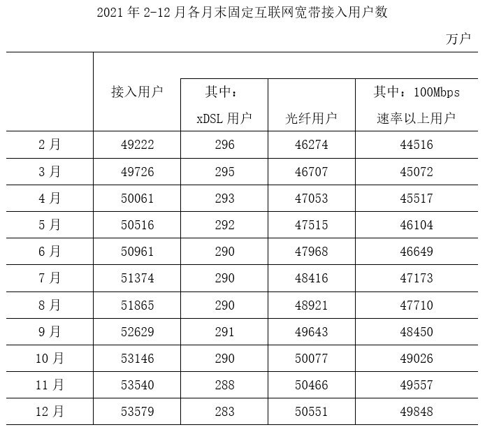

# 增长量计算与比较（相邻月末时点做差计数）

考点：[[20-考点/资料分析/增长/增长量计算与比较（相邻月末时点做差计数）|增长 / 增长量计算与比较（相邻月末时点做差计数）]]
材料：[[15-材料/资料分析/338034 2021年我国固定互联网宽带接入用户|338034 2021年我国固定互联网宽带接入用户]]

**问法模型**：题干问'下半年光纤用户数增量超过500万户的月份有几个'→ 对表格光纤列相邻月末存量逐行做差求各月增长量，再数超过500万户的月份个数

## 推理链
1. 第1步：题干限定2021年下半年（7~12月）且指标为'光纤用户'，表格光纤列为各月末时点存量：6月末47968、7月末48416、8月末48921、9月末49643、10月末50077、11月末50466、12月末50551万户
2. 第2步：表格给的是月末存量而非增量，各月增长量=本月末存量-上月末存量，7月增量须借6月末47968作基期
3. 第3步：逐月做差：7月48416-47968=448万户，8月48921-48416=505万户，9月49643-48921=722万户，10月50077-49643=434万户，11月50466-50077=389万户，12月50551-50466=85万户
4. 第4步：对照'超过500万户'：8月505、9月722达标，7月448、10月434、11月389、12月85均不达标，共2个月份
5. 第5步：与选项对照，2个对应A，故正确答案为A

**最快解法**：⚡ 相邻做差+首位估算法：每行只用心算'本月末-上月末'的首位判断是否过500——48416-47968≈450（4百，排除），48921-48416=505（刚过5百，计入），49643-48921=722（计入），50077-49643≈430、50466-50077≈390、50551-50466≈90（均排除），快速锁定8月、9月共2个，无需精算全部差值

## 易错点
- ⚠ 时间范围陷阱：'下半年'=7~12月，7月增量必须用6月末47968作基期，若误从8月起算或漏掉7月会数错月份
- ⚠ 存量与增量混淆：表格为各月末时点数，不能把某月末数值（如48921）直接当增量，必须相邻行做差
- ⚠ 阈值临界误判：8月增量505万户仅略超500，若截位粗算或把'超过500'误当作'约500'易漏判；另勿误读为xDSL列或100Mbps以上列

## 母题抽象
> 🧩 当题干出现'某时间段内……增量超过X的月份（地区）有几个'且表格给的是时点存量时，用相邻行做差求逐期增长量再数超过阈值的个数，注意区间首月需借用区间前一时点作基期

**同类特征**：下半年、光纤用户数、增量超过500万户、月份有几个、月末存量、计数型增长量比较

## 相关题
- [[10-真题/资料分析/增长/2264400 同比增速逐月比较（直接找数比较）|2264400]]（国考 2019，相关度2）
- [[10-真题/资料分析/增长/3523536 环比比较（逐月与上月比较、正增长月份计数）|3523536]]（甘肃 2021，相关度2）
- [[10-真题/资料分析/增长/4770006 环比升降判断（双指标同时增长计数）|4770006]]（四川 2017，相关度2）
- [[10-真题/资料分析/增长/17764858 环比增长逐月判断与计数（双列同时增长）|17764858]]（湖北 2024，相关度1）
- [[10-真题/资料分析/增长/4628167 增长量计算与比较（日均×当月天数换算+超阈值月份计数）|4628167]]（新疆 2021，相关度1）

---

### 题干
2021年下半年，我国固定互联网宽带接入用户中，光纤用户数增量超过500万户的月份有几个？

### 选项
- A. 2　✅
- B. 3
- C. 4
- D. 5

### 官方解析

根据题干“······光纤用户数增量超过500万户的月份有几个”，可判定本题为增长量计算问题。定位表格材料可知2021年6-12月光纤用户数量。根据公式：增长量=现期量-基期量，可知2021年7月光纤用户数增量为48416-47968万户，8月增长量为48921-48416万户，9月增长量为49643-48921万户，10月增长量为50077-49643万户，11月增长量为50466-50077万户，12月增长量为50551-50466万户。故2021年下半年，我国固定互联网宽带接入用户中，光纤用户数增量超过500万户的月份有8月、9月，共2个月份。

故正确答案为A。

### 给定材料

        截至2021年底，我国固定互联网宽带接入用户数比上年底净增5224万户。其中，100Mbps及以上接入速率的用户比上年底净增6385万户。

        按接入方式划分，固定互联网宽带接入用户可分为xDSL用户、光纤用户和其他用户；按接入速率划分，固定互联网宽带接入用户可分为100Mbps速率以上用户和其他用户。

