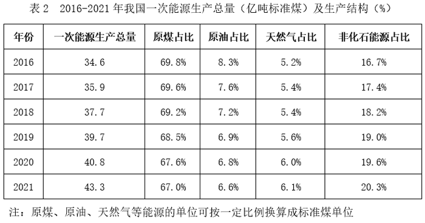

# 增长率计算与比较排序（同比增速从高到低）

考点：[[20-考点/资料分析/增长/增长率计算与比较排序（同比增速从高到低）|增长 / 增长率计算与比较排序（同比增速从高到低）]]
材料：[[15-材料/资料分析/340082 我国2016-2021年主要能源品种|340082 我国2016-2021年主要能源品种]]

**问法模型**：题干要求'按2021年产量的同比增速从高到低排列'→ 对表1四个品种分别用 增长率=(2021年值−2020年值)/2020年值 计算全年增速后排序，不能用文字段12月当月增速

## 推理链
1. 第1步：题干比较对象是'2021年产量'的同比增速，全年数据只能取表1（2020、2021两行），文字段的7.2%、1.7%、2.3%、-2.1%是2021年12月当月增速，属干扰数据
2. 第2步：增长率公式 r=(现期−基期)/基期=2021年值/2020年值−1，四品种2021与2020数据各自同单位，可直接相除
3. 第3步：原煤=(40.7−38.6)/38.6=2.1/38.6≈5.4%；原油=(1.99−1.95)/1.95=0.04/1.95≈2.1%；天然气=(2053−1897)/1897=156/1897≈8.2%；发电量=(8.11−7.50)/7.50=0.61/7.50≈8.1%
4. 第4步：天然气与发电量接近，交叉相乘精判：156×750=117000 > 61×1897≈115717，故天然气＞发电量
5. 第5步：全年增速排序为 天然气(≈8.2%)＞电(≈8.1%)＞原煤(≈5.4%)＞原油(≈2.1%)，与B项'天然气>电>原煤>原油'一致

**最快解法**：⚡ 截位直除+交叉相乘：原油增量0.04/基期1.95明显最小可秒排末位；原煤2.1/38.6≈5%级别排第三；焦点在天然气156/1897与发电量61/750，交叉相乘117000>115717锁定天然气>电，直接选B

## 易错点
- ⚠ 时间口径陷阱：误用文字段2021年12月当月同比增速（原煤7.2%>天然气2.3%>原油1.7%>发电量-2.1%）排序，会错排成原煤居首而掉入干扰项
- ⚠ 精度陷阱：天然气≈8.2%与发电量≈8.1%非常接近，若四舍五入到一位或粗估易把'电>天然气'排反（如误选A方向）
- ⚠ 单位跨段陷阱：原油文字段'1647万吨'与表1'1.99亿吨'、发电量'7234亿千瓦时'与表1'万亿千瓦时'相差量级，本题只需各自与自身2020年值相减相除即可规避，切勿跨段混用数据

## 母题抽象
> 🧩 当题干要求'某年份各指标同比增速排序'，而材料同时给出'当月增速文字段+历年数值表'时，必须取表内连续两年数据算(2021/2020−1)再排序，文字段月度增速仅是干扰项；两项增速接近时用分子分母交叉相乘定序

**同类特征**：同比增速从高到低、2021年产量（全年口径）、主要能源四品种排序、需用表1两期数据计算、文字段月度增速为干扰

## 相关题
- [[10-真题/资料分析/增长/5408651 增长率比较（同比增速排序）|5408651]]（四川 2022，相关度1）

---

### 题干
将我国主要能源按2021年产量的同比增速从高到低排列，正确的是：

### 选项
- A. 电>天然气>原煤>原油
- B. 天然气>电>原煤>原油　✅
- C. 电>原油>天然气>原煤
- D. 天然气>原油>电>原煤

### 官方解析
根据题干“······同比增速从高到低······”，可判定本题为一般增长率问题。定位表1可得：2020年与2021年原煤产量、原油产量、天然气产量、发电量。根据公式：增长率，则2021年四种主要能源产量的同比增速分别为：
原煤：；
原油：；
天然气：；
发电量：。
则从高到低排列正确的是：天然气＞电＞原煤＞原油，B项符合。
故正确答案为B。

### 给定材料

        2021年12月，我国原煤产量3.8亿吨，同比增长7.2%；原油产量1647万吨，同比增长1.7%；天然气产量192亿立方米，同比增长2.3%；发电量7234亿千瓦时，同比下降2.1%。

