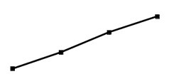
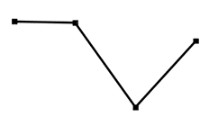

# 逐年增长率计算与变动趋势比较（趋势图匹配）

考点：[[20-考点/资料分析/增长/逐年增长率计算与变动趋势比较（趋势图匹配）|增长 / 逐年增长率计算与变动趋势比较（趋势图匹配）]]
材料：[[15-材料/资料分析/340945 2016-2021年中国母婴商品消费|340945 2016-2021年中国母婴商品消费]]

**问法模型**：题干问'2018-2021年增长率的变动趋势'并配趋势图选项 → 逐年计算同比增速，按'高低起伏顺序'与选项曲线逐点对照

## 推理链
1. 第1步：定位图1，2016-2021年母婴商品消费规模依次为21015、23613、26593、29919、31231、34591亿元；问2018-2021年增速须以2017年23613为首个基期
2. 第2步：用增长率公式 r=(现期-基期)/基期 逐年计算四个同比增速
3. 第3步：2018年(26593-23613)/23613≈12.6%；2019年(29919-26593)/26593≈12.5%；2020年(31231-29919)/29919≈4.4%；2021年(34591-31231)/31231≈10.8%
4. 第4步：增速序列12.6%→12.5%→4.4%→10.8%，前两点微降、第三点（2020年）断崖式下跌为最低、第四点回升
5. 第5步：与选项趋势图对照：第三个点应为最低点，只有C项符合，故选C

**最快解法**：⚡ 截位直除+极值点定位：四个分子差分分别为2980、3326、1312、3360，一眼看出2020年增量骤减至1312而基期最大→增速必为最低（第三点）；再粗算1312/29919≈4.4%、3360/31231≈10.8%确认先深跌后回升，直接锁定C

## 易错点
- ⚠ 基期起算错误：问2018-2021年增速，首年2018的基期是2017年（23613），漏读图1最左柱会导致少算一年
- ⚠ 规模趋势≠增长率趋势：柱状图规模逐年递增，易误选'持续上升'的曲线，实际2020年增速骤降至约4.4%为最低点
- ⚠ 极值点位置看错：是第三个点（2020年）最低而非最后一点，须逐点核对曲线高低顺序再选图

## 母题抽象
> 🧩 当题干出现'某区间内增长率的变动趋势'且选项为趋势曲线时，先用增量差分定性（增量骤减+基期变大→增速骤降）定位极值点位置，再对关键年份截位直除验证升降顺序，匹配曲线

**同类特征**：2018-2021年、消费规模、增长率、变动趋势、趋势图选项、第三个点为最低

## 相关题
- [[10-真题/资料分析/增长/2434297 一般增长率计算与折线图匹配（增长率走势比较）|2434297]]（新疆 2019，相关度1）
- [[10-真题/资料分析/其他/5509527 直接读数与大小比较（定位最大值）|5509527]]（甘肃 2023，相关度1）
- [[10-真题/资料分析/增长/2188118 两期总额之一般增长率计算（多组条形求和后作比）|2188118]]（选调 2018，相关度1）
- [[10-真题/资料分析/增长/5445763 增长量比较（同比增量折线趋势识别）|5445763]]（国考 2023，相关度1）
- [[10-真题/资料分析/增长/13319364 跨期一般增长率（基期为图中最左年份，非相邻年份）|13319364]]（江苏 2025，相关度1）

---

### 题干
2018-2021年，我国母婴商品消费规模增长率的变动趋势是：

### 选项
- A. 

- B. 

- C. 

　✅
- D. 

### 官方解析

根据题干“2018-2021年······增长率的变动趋势”，可判定本题为一般增长率的比较问题。定位图1可知：2017-2021年我国母婴商品消费规模分别为23613亿元、26593亿元、29919亿元、31231亿元、34591亿元，根据公式：增长率，则各年增长率分别为：

2018年：；

2019年：；

2020年：；

2021年：。

图像对应到第三个点应为最低点，只有C项符合。

故正确答案为C。

### 给定材料

