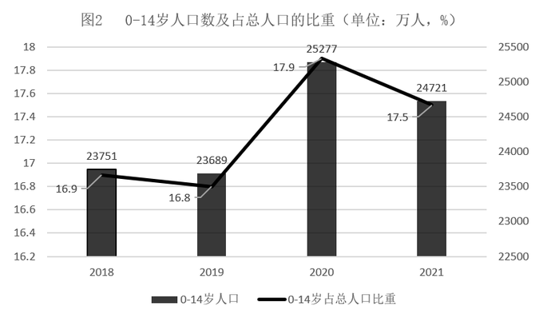

# 增长率计算比较+原因推断（数据验证型归因分析）

考点：[[20-考点/资料分析/增长/增长率计算比较+原因推断（数据验证型归因分析）|增长 / 增长率计算比较+原因推断（数据验证型归因分析）]]
材料：[[15-材料/资料分析/340945 2016-2021年中国母婴商品消费|340945 2016-2021年中国母婴商品消费]]

**问法模型**：'增速最小的年份，原因最可能是'→先逐年计算增长率锁定最小年份，再用材料数据逐项验证各选项表述是否与该年实际数据一致（数据证伪法）

## 推理链
1. 第1步：从图1提取2016-2021年母婴商品消费规模：21015、23613、26593、29919、31231、34591亿元
2. 第2步：用增长率公式g=(现期-基期)/基期逐年计算2017-2021年同比增速
3. 第3步：代入得2017年≈12.4%、2018年≈2980/23613≈12.6%、2019年≈3326/26593≈12.5%、2020年≈1312/29919≈4.4%、2021年≈3360/31231≈10.8%，2020年增速最小（增量1312远小于其他年份2500~3400，且基数非最大，增速必最小）
4. 第4步：验证A：图2中2020年0-14岁人口数为25277万人，是2018-2021年中最高而非最少，排除
5. 第5步：验证B：2020年0-14岁人口占比17.9%为四年最高而非最小，排除；验证C：图3中2020年收入32189元高于2019年30733元，收入水平未下降，排除
6. 第6步：验证D：图3中2019年收入增速≈(30733-28228)/28228≈8.9%，2020年增速≈(32189-30733)/30733≈4.7%，增速确实由升转降，符合'增速下降'，故选D

**最快解法**：⚡ 增量比较法锁定目标年+排除法验证：2020年增量仅1312亿元（其他年份2500以上）且基数29919非最大，无需精算即可锁定2020年增速最小；再逐项对照——A、B看图2（2020年人口25277万与占比17.9%均是最高的）、C看图3（收入32189元仍在涨），只有D'收入增速由8.9%降至4.7%'与数据一致

## 易错点
- ⚠ 把图2双轴图读混：柱体是人口数（万人）、折线是比重（%），2020年两者恰好都是峰值，若读反易误选A或B
- ⚠ 混淆'收入水平下降'与'收入增速下降'：2020年人均可支配收入绝对值仍在上升（30733→32189元），只是增速回落（8.9%→4.7%），C项偷换概念
- ⚠ 归因题必须回到材料数据逐项证伪，不能想当然：2020年为疫情年三个指标走势并不同向（消费增速回落、收入增速回落，但0-14岁人口数与占比反而上升），凭直觉易错选A/B

## 母题抽象
> 🧩 当题干出现'某指标增速最小（最快）的年份，其原最可能是'时，先用增量粗比或截位直除锁定目标年份，再将各选项表述逐一与材料对应指标（水平值/占比/增速）核对，与数据矛盾的全部排除，唯一相符者即答案

**同类特征**：增速最小的年份、原因最可能是、母婴商品消费规模、0-14岁人口数及占比、人均可支配收入、增速下降vs水平下降

## 相关题
- [[10-真题/资料分析/增长/10718183 名义增速与实际增速之差（百分点计算）|10718183]]（深圳市考 2024，相关度1）
- [[10-真题/资料分析/增长/10718184 年均增长率（名义增速）|10718184]]（深圳市考 2024，相关度1）
- [[10-真题/资料分析/增长/13255454 年均增长率计算与作差比较|13255454]]（选调 2023，相关度1）

---

### 题干
根据上述资料，在母婴商品消费规模增速最小的年份，其增速最小的原因最可能是：

### 选项
- A. 当年0-14岁人口数较之其他年份最少
- B. 当年0-14岁人口数占总人口比重最小
- C. 当年人均可支配收入水平下降
- D. 当年人均可支配收入增速下降　✅

### 官方解析
根据题干“······增速最小的年份”，可判定本题为一般增长率问题。需先通过增长率比较，找出我国母婴商品消费规模增速最小的年份，再验证选项。
定位图1可知：2016-2021年各年我国母婴商品消费规模分别为21015亿元、23613亿元、26593亿元、29919亿元、31231亿元、34591亿元。根据公式：增长率，可得2017-2021年各年我国母婴商品消费规模的同比增速，如下：
2017年：增速为；
2018年：增速为；
2019年：增速为；
2020年：增速为；
2021年：增速为。
则2017-2021年，我国母婴商品消费规模增速最小的年份为2020年。
再验证选项，如下：
A项：定位图2可知：2020年0-14岁人口数为25277万人，不符合“较之其他年份最少”，错误；
B项：定位图2可知：2020年0-14岁人口数占总人口比重为17.9%，不符合“比重最小”，错误；
C项：定位图3可知：2020年人均可支配收入为32189元，不符合“水平下降”。错误；
D项：定位图3可知：2019年人均可支配收入增速为，2020年增速为，2020年人均可支配收入增速符合“下降”，正确。
故正确答案为D。

### 给定材料

