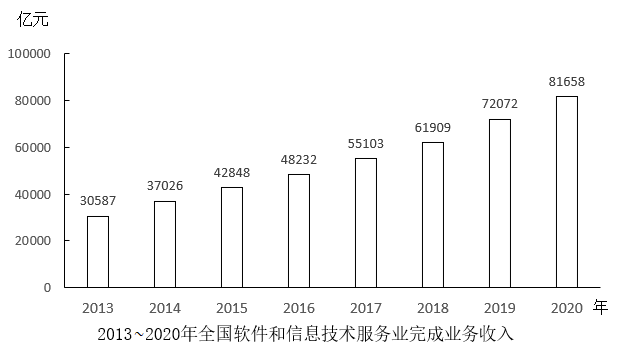

# 增长量比较（折线图趋势匹配）

考点：[[20-考点/资料分析/增长/增长量比较（折线图趋势匹配）|增长 / 增长量比较（折线图趋势匹配）]]
材料：[[15-材料/资料分析/340954 2020年全国软件和信息技术服务业经|340954 2020年全国软件和信息技术服务业经]]

**问法模型**：题干问'折线图反映哪一时间段同比增量的变化趋势'→ 先由柱状图相邻两年相减求各年增量序列，再按选项时间段截取4个增量与折线图升降形状逐一匹配

## 推理链
1. 第1步：从柱状图提取2013~2020年业务收入：30587、37026、42848、48232、55103、61909、72072、81658亿元（2013年为基期年，自身无同比增量）
2. 第2步：用公式'同比增量=现期量-上年量'，逐年相减得2014~2020年增量序列
3. 第3步：代入计算：2014年37026-30587=6439，2015年42848-37026=5822，2016年48232-42848=5384，2017年55103-48232=6871，2018年61909-55103=6806，2019年72072-61909=10163，2020年81658-72072=9586（亿元）
4. 第4步：按选项截段匹配形状：A段2014-2017为6439→5822→5384→6871（降-降-降-升）；B段2015-2018为5822→5384→6871→6806（降-升-降）；C段2016-2019为5384→6871→6806→10163（升-微降-大幅升，末点为全序列最高值10163）；D段2017-2020为6871→6806→10163→9586（降-升-降）
5. 第5步：折线图呈'先升、微降、再大幅升至最高点'形状，只有C段2016-2019吻合（末点10163为2014~2020年增量最大值，且2017年6871比2018年6806仅高65亿元形成微降拐点），故选C

**最快解法**：⚡ 逐年相减+形状匹配法：柱状图标注值直接相邻相减得增量序列（6439、5822、5384、6871、6806、10163、9586），锁定两个特征点即可秒杀——折线图末点若为最高（对应10163，只出现在2019年）且中途有微降拐点（2017→2018年6871→6806），唯一满足'末点最高+中途微降'的时间段是2016-2019，选C

## 易错点
- ⚠ 增量与增速混淆：题干问'同比增量'须相减，若误算同比增速（相除）会得到另一套年份集合，与兄弟小题2的'增速超15%'口径区分开
- ⚠ 基期错位：2014年的增量=2014年-2013年，首年2013年无增量；若把相减方向或年份错位一年，整段平移会误选B或D
- ⚠ 目测失真：纵轴刻度间隔20000亿元，2017年(6871)与2018年(6806)增量仅差65亿元，柱高目测几乎无差别，'微降'拐点必须用标注数值相减才能识别，不能凭柱子高低目测

## 母题抽象
> 🧩 当题干出现'折线图反映×××同比增量的变化趋势'且材料为多年柱状图时，先逐年相减得增量序列，再按选项时间段截取4个增量，用'升降走势+极值点位置'与折线图形状匹配，优先锁定序列最大值所在年份作为锚点

**同类特征**：折线图反映变化趋势、同比增量、多年柱状图标注数值、时间段选项、相邻两年相减、增长量比较

## 相关题
- [[10-真题/资料分析/增长/13504660 增长量计算与比较（同比增量超阈值年份计数）|13504660]]（辽宁 2025，相关度2）
- [[10-真题/资料分析/增长/2730984 增长量计算与比较（同比增量最接近）|2730984]]（深圳市考 2020，相关度2）
- [[10-真题/资料分析/增长/5102404 同比增量（增长量）逐年计算与折线图趋势匹配|5102404]]（河南 2022，相关度2）
- [[10-真题/资料分析/增长/2144598 增长量比较|2144598]]（选调 2018，相关度1）
- [[10-真题/资料分析/增长/23447 增长量比较（现期量×r-(1+r)）|23447]]（云南 2011，相关度1）

---

### 题干

以下折线图反映了哪一时间段内，全国软件和信息技术服务业完成业务收入同比增量的变化趋势？

### 选项
- A. 2014-2017年
- B. 2015-2018年
- C. 2016-2019年　✅
- D. 2017-2020年

### 官方解析

根据题干“以下折线图反映了哪一时间段内······同比增量的变化趋势”，可判定本题为增长量比较问题。定位统计图可得：2013~2020年全国软件和信息技术服务业完成业务收入分别为30587亿元、37026亿元、42848亿元、48232亿元、55103亿元、61909亿元、72072亿元、81658亿元。根据公式：增长量=现期量-基期量，则2014~2020年全国软件和信息技术服务业完成业务收入的同比增量分别为：

2014年，37026-30587=亿元；

2015年，42848-37026=亿元；

2016年，48232-42848=亿元；

2017年，55103-48232=6871亿元；

2018年，61909-55103=6806亿元；

2019年，72072-61909=亿元；

2020年，81658-72072=亿元。

综上可知，满足题干折线图变化趋势的为2016-2019年。

故正确答案为C。

### 给定材料

        2020年，全国软件和信息技术服务业累计完成业务收入81658亿元，同比增长13.3%。实现利润总额10676亿元，同比增长7.8%；人均实现业务收入115.8万元，同比增长8.6%。

        分领域看，2020年，软件产品实现收入22758亿元，同比增长10.1%；其中，工业软件产品实现收入1974亿元，增长11.2%。信息技术服务实现收入49868亿元，比上年同期增加6579亿元；其中，电子商务平台技术服务收入9095亿元，同比增长10.5%；云服务、大数据服务共实现收入4116亿元，同比增长11.1%。信息安全产品和服务实现收入1540亿元，同比增长10.0%，增速较上年回落2.4个百分点。嵌入式系统软件实现收入7492亿元，比上年同期增加803亿元，增速较上年提高4.2个百分点。

