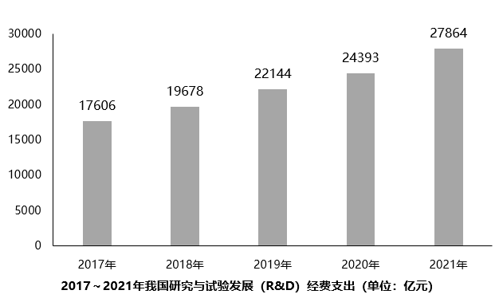

# 同比增速比较（增长率比较）

考点：[[20-考点/资料分析/增长/同比增速比较（增长率比较）|增长 / 同比增速比较（增长率比较）]]
材料：[[15-材料/资料分析/340955 2021年我国科技创新概况：R&D经|340955 2021年我国科技创新概况：R&D经]]

**问法模型**：题干问'2018~2021年间同比增速最高的年份'→ 对柱状图逐年当期值用（现期−上期）÷上期算出四年增速，比较取最大

## 推理链
1. 第1步：从柱状图读取2017~2021年R&D经费支出当期值：17606、19678、22144、24393、27864亿元，各年增速的基期为相邻上一年
2. 第2步：套用增长率公式：增速=（现期−基期）÷基期=增长量÷基期
3. 第3步：2018年=(19678−17606)÷17606=2072/17606≈11.8%；2019年=(22144−19678)÷19678=2466/19678≈12.5%
4. 第4步：2020年=(24393−22144)÷22144=2249/22144≈10.2%；2021年=(27864−24393)÷24393=3471/24393≈14.2%
5. 第5步：四年增速比较：2021年14.2%＞2019年12.5%＞2018年11.8%＞2020年10.2%，最高为2021年
6. 第6步：与文字段'2021年R&D经费支出同比增长14.2%'互验一致，对照选项选D

**最快解法**：⚡ 基准粗核法：文字段已直接给出2021年增速14.2%，只需粗核其余年份是否低于14.2%——2019年2466/19678≈12.5%为次高，2018年≈11.8%、2020年≈10.2%（截位直除留首位即可），全部低于14.2%，直接锁定2021年，免于精确计算

## 易错点
- ⚠ 柱状图只给绝对额不给增速，各年增速必须相邻两年相除自算；若凭柱高差（增长量）比较，2020年增长量2249亿元小于2019年2466亿元，增速排序会与增长量排序不一致，本题比较口径是增长率不是增长量
- ⚠ 时间范围限定'2018~2021年间'，2017年因缺2016年数据本就无法计算增速，勿把2017年纳入比较或把'2017~2021'与'2018~2021'的范围混淆
- ⚠ 文字段14.2%是R&D经费的2021年增速，勿与文字段其他增速（如专利授权26.4%、技术合同32.0%）或表格专利增速张冠李戴

## 母题抽象
> 🧩 当题干出现'某区间内同比增速最高的年份'且柱状图只给逐年当期值时，用（现期−上期）÷上期逐年粗算比较；若文字段已给其中某年增速，可先以其为基准只粗核其余年份，减少计算量

**同类特征**：同比增速最高的年份、2018~2021年间、柱状图仅给逐年当期值、增速需相邻两年相除自算、文字段增速可作互验基准、R&D经费支出

## 相关题
- [[10-真题/资料分析/增长/2444067 增长率比较（逐年环比增速比较）|2444067]]（江西 2019，相关度1）
- [[10-真题/资料分析/增长/2579798 同比增速（增长率）比较|2579798]]（浙江 2020，相关度1）

---

### 题干
2018~2021年间，我国研究与试验发展经费支出同比增速最高的年份是：

### 选项
- A. 2018年
- B. 2019年
- C. 2020年
- D. 2021年　✅

### 官方解析

根据题干“······同比增速最高的年份”，可判定本题为一般增长率问题。定位统计图可得：2017~2021年我国研究与试验发展（R&amp;D）经费支出数据，根据公式：增长率，可得2018年我国研究与试验发展经费支出同比增速；2019年同比增速；2020年同比增速；2021年同比增速。比较可得，2018~2021年间，我国研究与试验发展经费支出同比增速最高的年份是2021年。

故正确答案为D。

### 给定材料

        据国家统计局数据显示，2021年我国研究与试验发展（R&amp;D）经费支出27864亿元，同比增长14.2%，占国内生产总值之比为2.44%，其中基础研究经费1696亿元。国家自然科学基金共资助4.87万个项目。2021年全年授予专利权460.1万件，同比增长26.4%；PCT专利申请受理量7.3万件。截至2021年末，有效专利1542.1万件，其中境内有效发明专利270.4万件。每万人口高价值发明专利拥有量7.5件。全年商标注册773.9万件，同比增长34.3%。全年共签订技术合同67万项，技术合同成交金额37294亿元，同比增长32.0%。

