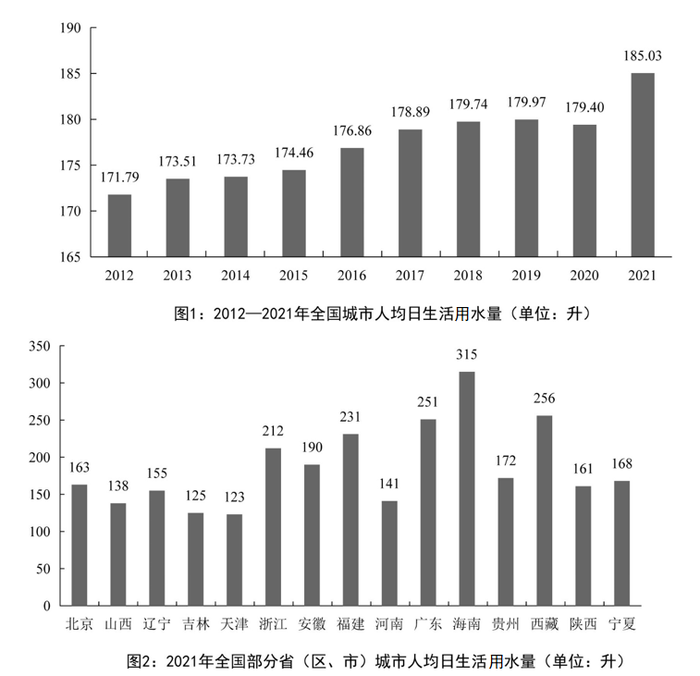

# 同比增长率计算与变化趋势折线图辨析

考点：[[20-考点/资料分析/增长/同比增长率计算与变化趋势折线图辨析|增长 / 同比增长率计算与变化趋势折线图辨析]]
材料：[[15-材料/资料分析/340960 2021年全国城市供水情况：供水总量|340960 2021年全国城市供水情况：供水总量]]

**问法模型**：题干给2013~2021年'同比增长率变化情况'的折线图辨析 → 先用图1水平值逐年求增速（增速=(现期-基期)/基期），再抓关键年份增速的高低与正负特征逐一排除选项

## 推理链
1. 第1步：从图1提取2012—2021年人均日生活用水量（升）：171.79、173.51、173.73、174.46、176.86、178.89、179.74、179.97、179.40、185.03；2013年增速须以2012年171.79为基期
2. 第2步：公式：同比增长率=(现期值-基期值)/基期值，逐年先做差、再做除
3. 第3步：2013年增速=1.72/171.79≈1.0%，2014年增速=0.22/173.51≈0.13%，分子大、分母小，故2013年增速＞2014年增速，排除C项
4. 第4步：2020年179.40＜2019年179.97，同比增速为负（-0.57/179.97≈-0.32%），是九年中唯一负增长，折线上2020年应为最低点，排除B项
5. 第5步：2021年增速=5.63/179.40≈3.1%，2016年增速=2.40/174.46≈1.4%，且2021年增量5.63是其他年份的数倍而基期量相近，故2021年增速＞2016年增速且为全期最大，排除D项
6. 第6步：三个判别点排除C、B、D后仅剩A，故正确答案为A

**最快解法**：⚡ 排除法+关键点速算（截位直除）：不必算全9个增速，只抓三点——①2013年1.72/171.79≈1%＞2014年0.22/173.51≈0.1%，排C；②2020年为唯一负增长点（179.40＜179.97），排B；③2021年增量5.63远超其他年份而基期相近，5.63/179.40≈3.1%为最大且＞2016年2.40/174.46≈1.4%，排D

## 易错点
- ⚠ 图1纵轴从165起步（截断），柱高差异被视觉放大，凭柱形目测增速会失真，必须用图中标注数值重算
- ⚠ 图1给的是水平值而非增长率，题干问的是'增长率变化'，需先逐年做除法求增速（2013年以2012年171.79为基期），不能直接把柱高当增速走向
- ⚠ 两个关键拐点决定选项：2020年179.40＜179.97是唯一负增长（折线最低点），2021年跳升5.63是最大增速点；忽略任一点即可能误选B或D

## 母题抽象
> 🧩 当题干给时间序列水平值却问'增长率变化折线图'时，不必逐年精算，只抓'首年基期增速、唯一负增长年份、末期跳升年份'三个关键点算增速，用排除法对照选项形状即可锁定答案

**同类特征**：折线图辨析、同比增长率变化情况、柱状图给水平值而非增速、2013~2021年逐年求增速、排除法对照选项形状、纵轴截断视觉陷阱

## 相关题
（暂无）

---

### 题干
下列折线图中，最能准确反映2013~2021年全国城市人均日生活用水量同比增长率变化情况的是：

### 选项
- A. 

　✅
- B. 

- C. 

- D. 

### 官方解析

根据题干“······同比增长率变化情况的是”，可判定本题为一般增长率问题。定位图1可得2013-2021年全国城市人均日生活用水量的数据。根据公式：增长率，可得2013年全国城市人均日生活用水量同比增长率；2014年同比增长率，通过分子大、分母小可知，2013年的同比增长率＞2014年的同比年增长率，排除C项。2020年人均日生活用水量＜2019年人均日生活用水量，则2020年的同比增长率＜0，其余年份同比增长率均大于0，故2020年同比增长率应为最小，排除B项。2016年的同比增长率，2021年的同比增长率，故2021年的同比增长率＞2016年的同比增长率，排除D项。

故正确答案为A。

注：排除C项后，2016-2020年的同比增长量变化不大，2021年的增长量5.63（185.03-179.40）最大，是其他年份的数倍，且基期量差别不大，所以2016-2021年这几年里2021年对应的增长率也最大，故正确答案为A。

### 给定材料

        2021年，全国城市供水总量673.34亿立方米，同比增长6.96%；城市供水管道长度105.99万公里，同比增长5.26%；人均日生活用水量185.03升；供水普及率99.38%，比上年增加0.39个百分点。天津、河北、上海、江苏、浙江和广东6个省（市）城市供水普及率达到100%；福建、山东、湖北、广西、安徽、辽宁、宁夏、新疆、内蒙古、山西、甘肃、河南、黑龙江、江西、云南和湖南16个省（区）超过99%（含）；西藏、青海、北京、四川、贵州和陕西6个省（区、市）超过98%；重庆、吉林、海南3个省（市）和新疆建设兵团超过95%。

