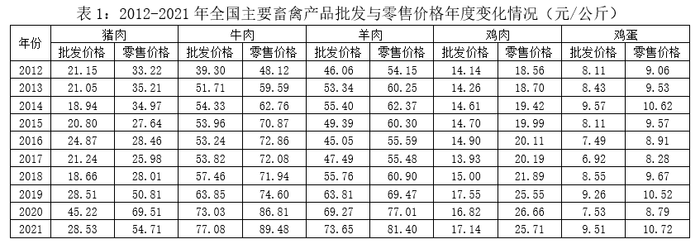

# 增长率计算与比较（增幅超过50%的多主体判定，含临界值精算）

考点：[[20-考点/资料分析/增长/增长率计算与比较（增幅超过50%的多主体判定，含临界值精算）|增长 / 增长率计算与比较（增幅超过50%的多主体判定，含临界值精算）]]
材料：[[15-材料/资料分析/340962 2012～2021年全国羊肉产量年度|340962 2012～2021年全国羊肉产量年度]]

**问法模型**：“相较于2012年，2021年零售价格增长幅度超过50%的是哪些”的多主体组合判定问法 → 逐项套用增长率=(现期-基期)/基期，并将“超过50%”等价转化为“现期>基期×1.5”的乘法比较逐一判定

## 推理链
1. 第1步：定位表1“零售价格”列，取2012年（基期）与2021年（现期）数据：猪肉33.22→54.71、牛肉48.12→89.48、羊肉54.15→81.40、鸡肉18.50→25.71、鸡蛋9.06→10.72（元/公斤）
2. 第2步：增长率>50% 等价于 现期>基期×1.5，将除法判定转为乘法比较
3. 第3步：逐项计算基期×1.5并与现期比较：猪肉33.22×1.5=49.83<54.71（✓，增幅约64.7%）；牛肉48.12×1.5=72.18<89.48（✓，约85.9%）；羊肉54.15×1.5=81.225<81.40（✓，仅高0.18，增幅约50.3%）；鸡肉18.50×1.5=27.75>25.71（✗，约39.0%）；鸡蛋9.06×1.5=13.59>10.72（✗，约18.3%）
4. 第4步：临界项羊肉直除验证：(81.40-54.15)/54.15=27.25/54.15≈50.3%>50%，确认超标；鸡肉7.21/18.50≈39%确认不超标
5. 第5步：增幅超过50%的为猪肉、牛肉、羊肉三项，且B、C、D三选项均含不达标的鸡肉，对照选项只有A符合

**最快解法**：⚡ 排除法+临界精算：先看鸡肉18.50→25.71，18.50×1.5=27.75>25.71（或25.71/18.50≈1.39<1.5），鸡肉增幅约39%未超50%，而B、C、D三选项全部含鸡肉，直接排除锁定A；再精算临界项羊肉54.15×1.5=81.225<81.40（增幅约50.3%）验证A成立，无需逐项直除五组数据

## 易错点
- ⚠ 串列陷阱：表1每种产品分“批发价格/零售价格”两列，本题必须取零售价列，误取批发价（如猪肉批发21.15→28.53仅约34.9%、鸡肉批发14.14→17.14仅约21.2%）会得出完全不同的组合
- ⚠ 临界值误判：羊肉零售价54.15→81.40增幅仅约50.3%，若粗略估算或四舍五入当作“约50%”排除羊肉，会漏掉正确选项而误选其他组合
- ⚠ 跨图表同名指标混淆：图1中“羊肉”是产量（万吨），本题只用表1的价格（元/公斤），勿把产量数据混入价格比较

## 母题抽象
> 🧩 当题干出现“较基期年份，现期年份指标增长幅度超过（低于）X%”且需对多主体逐一判定并按组合选项作答时，将条件转化为“现期 vs 基期×(1+X%)”的乘法比较，先找明显不达标项做选项排除，靠近临界值的项必须精算

**同类特征**：相较于2012年，2021年、零售价格增长幅度超过50%、表1所列主要畜禽产品、多主体组合式选项、批发价/零售价双列结构、临界值（约50%）判定

## 相关题
（暂无）

---

### 题干
表1所列的主要畜禽产品中，相较于2012年，2021年零售价格增长幅度超过50%的是：

### 选项
- A. 猪肉、牛肉、羊肉　✅
- B. 猪肉、羊肉、鸡肉
- C. 牛肉、羊肉、鸡肉
- D. 羊肉、鸡肉、鸡蛋

### 官方解析

根据题干“······增长幅度超过50%······”，可判定本题为一般增长率问题。定位表1可得2012年和2021年全国主要畜禽产品零售价格。根据公式：增长率，可得猪肉零售价格增长率，牛肉零售价格增长率，羊肉零售价格增长率，鸡肉零售价格增长率，鸡蛋零售价格增长率，故相较于2012年，2021年零售价格增长幅度超过50%的有猪肉、牛肉、羊肉。

故正确答案为A。

### 给定材料

> [!warning] 疑点（官方解析可能有误，待人工复核）
> 官方解析中的公式与各产品增长率数值在题面呈现中被略去（仅保留文字框架），但按表1零售价列验算：猪肉约64.7%、牛肉约85.9%、羊肉约50.3%、鸡肉约39.0%、鸡蛋约18.3%，与官方答案A完全一致，无矛盾
