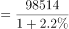
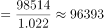

# 基期量计算

考点：[[20-考点/资料分析/增长/基期量计算|增长 / 基期量计算]]
材料：[[15-材料/资料分析/341285 2020年全国规模以上文化及相关产业|341285 2020年全国规模以上文化及相关产业]]

**问法模型**：题干问'2019年……为多少亿元'而材料现期为2020年 → 用基期量=现期量÷(1+增速)直除求解

## 推理链
1. 第1步：从统计表'总计'行提取条件：2020年全国规模以上文化及相关产业企业营业收入98514亿元，全年比上年增长2.2%
2. 第2步：识别题型为基期计算，套用公式：基期量=现期量÷(1+增速)=98514÷(1+2.2%)
3. 第3步：代入计算：98514÷1.022，因选项A(96346)与B(96393)仅差47、差距不足0.5%，不能估算，需精确直除，得96393亿元（验证：96393×1.022≈98513.6≈98514）
4. 第4步：与选项对照：A.96346（=98514×0.978，误用'现期减增长量'）、C.100681（=98514×1.022，误乘不除）、D.100730（=98514÷0.978，公式记成除以1-2.2%），仅B.96393与精算结果吻合，故选B

**最快解法**：⚡ 精确直除（本题不可用速算放缩）：98514÷1.022，先看首两位96，再除到位得96393；因A、B差距仅47（<0.5%），任何百化分/放缩估算都会翻车，必须直除三~四位有效数字

## 易错点
- ⚠ 选项设置全是公式陷阱：A=98514×(1-2.2%)是'现期减增长量'错法，C=98514×(1+2.2%)是把除法做成乘法，D=98514÷(1-2.2%)是公式记反，逐项核对才能确认B
- ⚠ A与B差距极小（约0.5%），用'1/1.022≈0.978'这类百化分估算或截三位直除都可能误选A，官方明示需精确计算
- ⚠ 取数口径：必须用'全年'增速+2.2%，勿误用前三季度增速-0.6%（98514/0.994≈99112，白算且无对应选项）；表中绝对额是2020年值，不是2019年值

## 母题抽象
> 🧩 当题干出现'上一年（基期）总量为多少'而材料只给现期值和同比增速时，套基期量=现期÷(1+增速)；先看选项差距，差距大于5%可放缩估算，差距小于1%必须精确直除，并警惕'乘(1+r)''除(1-r)''减增长量'三类错误选项

**同类特征**：问2019年（基期）数值、材料现期为2020年、绝对额98514亿元、同比增速+2.2%、选项间距极小（约0.5%）、单位为亿元、答案落在9.6万量级

## 相关题
- [[10-真题/资料分析/增长/20303 基期量计算|20303]]（贵州 2010，相关度2）
- [[10-真题/资料分析/增长/1385893 基期量计算|1385893]]（重庆 2015，相关度2）
- [[10-真题/资料分析/增长/13504658 基期量计算|13504658]]（辽宁 2025，相关度2）
- [[10-真题/资料分析/增长/16593086 基期量计算|16593086]]（新疆 2024，相关度2）
- [[10-真题/资料分析/增长/2033794 基期量计算|2033794]]（江苏 2016，相关度2）

---

### 题干
2019年全国规模以上文化及相关产业企业营业收入为多少亿元？

### 选项
- A. 96346
- B. 96393　✅
- C. 100681
- D. 100730

### 官方解析

根据题干“2019年······为多少亿元”，结合材料时间为2020年，可判定本题为基期计算问题。定位统计表可得：2020年全国规模以上文化及相关产业企业营业收入98514亿元，比上年增长2.2%。根据公式：基期量，则所求亿元。

注：本题由于选项差距很小，故需要精确计算。

故正确答案为B。

### 给定材料

