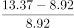
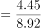
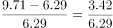
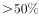
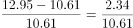

# 环比增速计算与临界值计数比较

考点：[[20-考点/资料分析/增长/环比增速计算与临界值计数比较|增长 / 环比增速计算与临界值计数比较]]
材料：[[15-材料/资料分析/341286 2018~2020年中国动力电池装车|341286 2018~2020年中国动力电池装车]]

**问法模型**：题干问'12月环比增速超过50%的年度有几个'→ 对各年12月相对同年11月计算环比增速，逐个与50%临界值对照后计数

## 推理链
1. 第1步：从图1提取各年11月、12月装车量（单位GWh）：2018年11月8.92、12月13.37；2019年11月6.29、12月9.71；2020年11月10.61、12月12.95
2. 第2步：环比的基期是同年11月，公式为环比增速=12月装车量/11月装车量-1
3. 第3步：代入计算：2018年13.37/8.92-1≈49.9%；2019年9.71/6.29-1≈54.4%；2020年12.95/10.61-1≈22.1%
4. 第4步：与50%临界值对照：2018年49.9%未超过（13.37<8.92×1.5=13.38，仅差0.01），2019年54.4%超过（9.71>6.29×1.5=9.435），2020年22.1%未超过
5. 第5步：超过50%的年度仅有2019年，共1个，与选项B（1个）吻合

**最快解法**：⚡ 临界判定法（避免做除法）：环比>50%等价于12月量>1.5×11月量。逐年代入：2018年8.92×1.5=13.38>13.37（不超，差0.01）；2019年6.29×1.5=9.435<9.71（超）；2020年10.61×1.5=15.915>12.95（不超）。仅2019年满足，共1个，选B

## 易错点
- ⚠ 临界值陷阱：2018年环比49.9%与50%仅差约0.1个百分点，若用除法后四舍五入极易误判为'超过50%'；应改用'12月>1.5×11月'的乘法判定（13.37<13.38）才稳妥
- ⚠ 环比基期口径：12月环比的基期是同年11月，勿跨年误取上年12月或上年11月数据
- ⚠ 看串行陷阱：图1下方数据表2020/2019/2018三行排列，取数时易看错行（如7月2019与2020两年数值接近），须逐行核对年份标签

## 母题抽象
> 🧩 当题干出现'某月环比（或同比）增速超过某临界值的年份/月份有几个'时，把'>r%'改写为'现期>(1+r%)×基期'做乘法比较计数，规避除法舍入在临界值附近的误判

**同类特征**：12月份环比增速、超过50%的临界值、年度个数计数、图1月度装车量取数、相邻两月联动、2018年49.9%临界干扰

## 相关题
（暂无）

---

### 题干
2018~2020年间，12月份动力电池装车量的环比增速超过50%的年度有几个？

### 选项
- A. 0个
- B. 1个　✅
- C. 2个
- D. 3个

### 官方解析

根据题干“······环比增速超过50%的年度有几个”，可判定本题为一般增长率问题。定位图形材料可知2018~2020年各年11月份、12月份的动力电池装车量。根据公式：增长率，则2018~2020年间，12月份动力电池装车量的环比增速分别为：

2018年，；

2019年，；

2020年，。

综上，环比增速超过50%的年度仅有2019年，共1个。

故正确答案为B。

### 给定材料

        2020年1~12月，中国新能源汽车市场共计72家动力电池企业实现装车配套，其中排名前3家、前5家、前10家的企业动力电池装车量分别占总装车量的71.3%、82.1%和91.8%。

