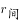

# 间隔增长率逆推（求基期同比增速）

考点：[[20-考点/资料分析/增长/间隔增长率逆推（求基期同比增速）|增长 / 间隔增长率逆推（求基期同比增速）]]
材料：[[15-材料/资料分析/341358 2021年1-2月全国及东部、中部、|341358 2021年1-2月全国及东部、中部、]]

**问法模型**：题干问基期2020年1-2月的同比增长率，而材料只给2021年同比增速（增长1.05倍=105%）和2021年比2019年的两年累计增速（23.3%）→ 用间隔增长率公式 1+r间隔=(1+r1)(1+r基期) 反解r基期

## 推理链
1. 第1步：提取条件——2021年1-2月商品房销售面积17363万平方米，同比增长1.05倍即r1=105%（现期为基期的2.05倍）；比2019年1-2月增长23.3%，即间隔增长率r间隔=23.3%
2. 第2步：确认时间链条——2019年1-2月→2020年1-2月（增速r基期，待求）→2021年1-2月（增速105%），两年累计增速23.3%
3. 第3步：套用间隔增长率公式：1+23.3%=(1+105%)×(1+r基期)
4. 第4步：代入计算：2.05×(1+r基期)=1.233，则1+r基期=1.233÷2.05≈0.60
5. 第5步：解得r基期≈0.60-1=-0.40，即约-40.0%
6. 第6步：与选项对照：A项-40.0%最接近（B项-32.5%、C项+40.0%、D项+17.2%均不符），故选A

**最快解法**：⚡ 间隔增长率公式法+截位直除：1.233÷2.05≈0.60，增速≈-40%，直选A；可用乘法验证2.05×0.60=1.23≈1.233

## 易错点
- ⚠ 把'同比增长1.05倍'误读为增速1.05%或现期为基期的1.05倍，正确换算是增速105%、现期为基期的2.05倍
- ⚠ 问的是基期2020年的同比增速，方向易搞反：误选C（+40.0%漏掉负号）或误认为问的是2021年增速（105%，无对应选项）
- ⚠ 误将23.3%与105%直接相加/相减（得128.3%或81.7%），间隔增长率必须用(1+r)相乘关系而非增速直接加减；且23.3%是两年累计口径，不能与同比混用

## 母题抽象
> 🧩 当题干求'基期年份的同比增长率'且材料给出'现期同比增速r1'与'现期比隔年增速r间隔'时，用间隔增长率公式逆推：1+r基期=(1+r间隔)/(1+r1)，再减1取负号验证选项

**同类特征**：问基期年份（2020年1-2月）的同比增长、材料含'同比增长1.05倍'倍数化增速表述、材料含'比2019年1-2月增长23.3%'的隔年口径、选项为含负号的百分数、间隔增长率逆推模型

## 相关题
（暂无）

---

### 题干
2020年1-2月，全国商品房销售面积同比增长（    ）。

### 选项
- A. -40.0%　✅
- B. -32.5%
- C. 40.0%
- D. 17.2%

### 官方解析

根据题干“2020年1-2月······同比增长”，结合选项为百分数，且材料给出2021年1-2月全国商品房销售面积的同比增长率及比2019年1-2月的增长率，可判定本题为间隔增长率问题。定位文字材料第一段可得，2021年1-2月全国商品房销售面积同比增长1.05倍（即），比2019年1-2月增长23.3%（）。代入间隔增长率公式：，则可得：，解得，与A项最接近。

故正确答案为A。

### 给定材料

        2021年1-2月，全国房地产开发投资13986亿元，同比增长3873亿元，房屋施工面积770629万平方米，同比增长11.0%。其中，住宅542503万平方米，增长11.2%；办公楼31802万平方米，增长7.3%；商业营业用房76346万平方米，增长2.5%；其他类型119978万平方米。房屋新开工面积17037万平方米，增长64.3%，其中，住宅12736万平方米，增长68.5%。商品房销售面积17363万平方米，同比增长1.05倍，比2019年1-2月增长23.3%，商品房销售额19151亿元，同比增长1.33倍，比2019年同期增长49.6%。

        2月末，商品房待售面积比上年末增加2575万平方米，其中，住宅增加2314万平方米，办公楼和商业营业用房分别减少24万平方米和269万平方米。

        2021年1-2月，分地区看，东部地区房地产开发投资8353亿元，同比增长32.4%；中部地区2640亿元，增长52.5%；西部地区2834亿元，增长45.1%；东北地区158亿元，增长28.6%。

        东部地区商品房销售面积7565万平方米，同比增长113.9%；销售额11891亿元，增长148.1%，中部地区商品房销售面积4369万平方米，增长104.3%；销售额3280亿元，增长130.2%，西部地区商品房销售面积5004万平方米，增长95.1%；销售额3620亿元，增长103.6%，东北地区商品房销售面积425万平方米，增长82.0%；销售额359亿元，增长72.7%。

