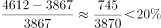
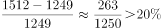
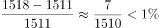
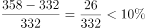

# 同比增长率计算与比较

考点：[[20-考点/资料分析/增长/同比增长率计算与比较|增长 / 同比增长率计算与比较]]
材料：[[15-材料/资料分析/341357 2016~2019年全国众创空间数量|341357 2016~2019年全国众创空间数量]]

**问法模型**：题干问'2019年众创空间数量同比增长率最高的地区' → 对四地区分别套用增长率=(现期-基期)/基期，再比较大小

## 推理链
1. 第1步：从柱状图提取四地区2018年（基期）与2019年（现期）数据：东部3867→4612、中部1249→1512、西部1511→1518、东北332→358（单位：家）
2. 第2步：增长率公式：增长率=（现期-基期）/基期=增长量/基期量
3. 第3步：代入计算：东部745/3867≈19.3%，中部263/1249≈21.1%，西部7/1511≈0.5%，东北26/332≈7.8%
4. 第4步：比较大小：21.1%（中部）＞19.3%（东部）＞7.8%（东北）＞0.5%（西部）
5. 第5步：增长率最高者为中部地区，对应B项，与官方答案一致

**最快解法**：⚡ 截位直除+分子分母交叉比较：西部7/1511与东北26/332量级明显偏小先排除；只比东部745/3867与中部263/1249——交叉相乘745×1249≈93.1万＜263×3867≈101.7万，故中部＞东部，直接锁定B，无需算出精确百分数

## 易错点
- ⚠ 近似数张冠李戴：2019年中部1512、2019年西部1518、2018年西部1511三个数极接近，读错柱子会导致增长率算错
- ⚠ 双轴混淆：地区增长率只能用柱状图数据，误把折线（国家备案）数值当某地区数据即错
- ⚠ 目测误判：西部1511→1518柱子几乎持平（约0.5%），东北约7.8%，凭柱子视觉高度粗排易把西部/东北排位搞反，必须动笔计算

## 母题抽象
> 🧩 当题干出现'某年同比增长率最高/最快的是哪个地区（类别）'且材料为分组柱状图时，提取现期与基期两行数据，用增长量/基期量逐项计算（可先剔除量级明显小的项，再对剩余项交叉相乘比较），验证最大者对应选项

**同类特征**：2019年、同比增长率最高、地区之间比较、分组柱状图取数、基期为上一年2018、一般增长率问题

## 相关题
- [[10-真题/资料分析/增长/17900764 同比增长率计算与比较|17900764]]（江苏 2024，相关度2）
- [[10-真题/资料分析/增长/2376601 增长率计算与两年增速差值（百分点）比较|2376601]]（重庆 2019，相关度1）
- [[10-真题/资料分析/平均数/3019277 现期平均数（分子取自文字、分母取自表格的跨源拼数据）|3019277]]（广东 2021，相关度1）
- [[10-真题/资料分析/增长/3522685 增长率计算（增长倍数=增长量-基期量）|3522685]]（广西 2021，相关度1）
- [[10-真题/资料分析/增长/3523613 增长率计算与阈值比较（同比增速超10%计数）|3523613]]（四川 2021，相关度1）

---

### 题干
下列地区中，2019年众创空间数量同比增长率最高的是（    ）。

### 选项
- A. 东部地区
- B. 中部地区　✅
- C. 西部地区
- D. 东北地区

### 官方解析

根据题干“······2019年······同比增长率最高的是”，可判定本题为一般增长率问题。定位统计图可得：2019年和2018年东部地区、中部地区、西部地区和东北地区众创空间的数量。根据公式：增长率，则2019年四个地区众创空间数量同比增长率分别为：

东部地区：；

中部地区：；

西部地区：；

东北地区：。

比较可知，2019年众创空间数量同比增长率最高的是中部地区。

故正确答案为B。

### 给定材料

