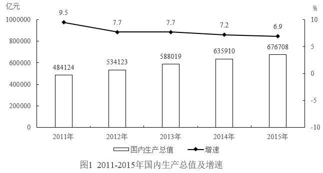
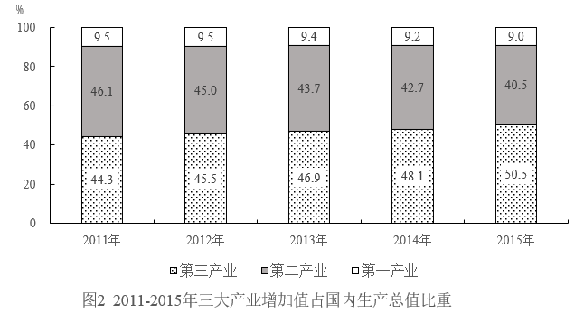

# 增长量计算与比较（相邻年份差值过阈值计数）

考点：[[20-考点/资料分析/增长/增长量计算与比较（相邻年份差值过阈值计数）|增长 / 增长量计算与比较（相邻年份差值过阈值计数）]]
材料：[[15-材料/资料分析/347129 2011—2015年我国国内生产总值|347129 2011—2015年我国国内生产总值]]

**问法模型**：题干'2012-2015年间有几年GDP增长了5万亿元以上'→判定为增长量比较模型，逐年求相邻年份GDP差值，统一单位后与阈值50000亿元比较计数

## 推理链
1. 第1步：题干'增长了5万亿元以上'带绝对单位而非%，锁定增长量模型；单位换算：5万亿元=50000亿元，与图1'亿元'口径对齐
2. 第2步：从图1柱形读取各年GDP（亿元）：2011年484124、2012年534123、2013年588019、2014年635910、2015年676708
3. 第3步：2012—2015各年与上一年做差，基期取相邻前一年：2012年534123-484124=49999亿元
4. 第4步：2013年588019-534123=53896亿元；2014年635910-588019=47891亿元；2015年676708-635910=40798亿元
5. 第5步：与50000亿元阈值比较：仅2013年（53896＞50000）达标，2012年49999＜50000（差1亿元的极端临界），2014、2015年均不足
6. 第6步：满足'增长5万亿元以上'的只有1年，对照选项选A

**最快解法**：⚡ 差值直算法+单位归一：先把5万亿元化成50000亿元，逐年末位对齐相减——534123-484124=49999✗（临界必须精算）、588019-534123=53896✓、635910-588019=47891✗、676708-635910=40798✗，仅2013年过线，选A

## 易错点
- ⚠ 单位口径陷阱：题干问'万亿元'、材料给'亿元'，须换算5万亿元=50000亿元再比较，漏换算会把49999、53896等数直接与'5'比而全盘判错
- ⚠ 2012年增量49999亿元与阈值50000亿元仅差1亿元，属极端临界值，严禁估算/截位粗判，必须精确做差
- ⚠ '增长了5万亿元'指增长量而非增长率，误用图1折线增速（6.9%~7.7%）或误把'最大GDP年份'当答案即错；基期须取相邻上一年，不能拿2011年以前数据

## 母题抽象
> 🧩 当题干出现'某区间内有几年……增长了X（带万亿/亿等绝对单位）以上'时，用增长量=现期量−基期量（逐年与相邻前一年做差），先统一单位，再与阈值逐一比较计数；遇差值贴着阈值（如49999对50000）必须精算

**同类特征**：增长了……（单位为绝对量）以上、有几年（计数型问法）、万亿元/亿元单位混用、相邻年份做差、增长量而非增长率、限定区间2012-2015

## 相关题
- [[10-真题/资料分析/增长/2139532 增长量计算（现期−基期直接做差）|2139532]]（天津 2017，相关度1）
- [[10-真题/资料分析/增长/2261884 同比增长率计算与超阈值年份计数|2261884]]（湖北 2017，相关度1）
- [[10-真题/资料分析/增长/5509972 增长量计算（同比，现期值+增速型）|5509972]]（江西 2023，相关度1）

---

### 题干
2012-2015年间，有        年的国内生产总值增长了5万亿元以上。

### 选项
- A. 1　✅
- B. 2
- C. 3
- D. 4

### 官方解析
根据题干“······增长了5万亿元以上”，可判定本题为增长量计算问题。根据公式：增长量=现期量-基期量，定位统计图1可得2012-2015年各年份国内生产总值同比增长量分别为：2012年，534123-484124=49999亿元&lt;5万亿元；2013年，588019-534123=53896亿元&gt;5万亿元；2014年，635910-588019=47891亿元&lt;5万亿元；2015年，676708-635910=40798亿元&lt;5万亿元。故满足题干要求的只有2013年这一年。
故正确答案为A。

### 给定材料

        2015年全年国内生产总值676708亿元，比上年增长6.9%。全年人均国内生产总值49351元，比上年増加6.3%。

