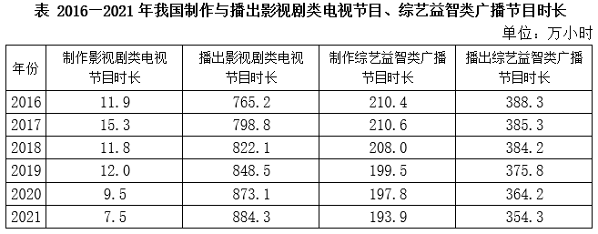

# 增长量比较

考点：[[20-考点/资料分析/增长/增长量比较|增长 / 增长量比较]]
材料：[[15-材料/资料分析/348878 2016—2021年我国广播电视节目|348878 2016—2021年我国广播电视节目]]

**问法模型**：题干问'××年—××年…增加最多的年份'→ 逐年计算同比增长量（现期−上年）并比较大小，锁定最大值对应年份

## 推理链
1. 第1步：定位表格'播出影视剧类电视节目时长'列，读取2016—2021年数据：765.2、798.8、822.1、848.5、873.1、884.3万小时
2. 第2步：增长量比较模型，公式为增长量=现期量−基期量（此处基期为上年）
3. 第3步：逐年代入：2017年=798.8−765.2=33.6万小时；2018年=822.1−798.8=23.3万小时；2019年=848.5−822.1=26.4万小时；2021年=884.3−873.1=11.2万小时（2020年=24.6万小时不在选项中，无需比较）
4. 第4步：比较四个增量33.6＞26.4＞23.3＞11.2，最大为2017年的33.6万小时，对应选项A

**最快解法**：⚡ 逐项作差法：对选项年份用'当年值−上年值'口算（798.8−765.2=33.6、822.1−798.8=23.3、848.5−822.1=26.4、884.3−873.1=11.2），33.6最大直接锁定A；可先算2021年（11.2明显最小）排除D缩小比较范围

## 易错点
- ⚠ 串列陷阱：'制作影视剧类电视'（个位数~15.3）与'播出影视剧类电视'（765.2~884.3）两列并排且量级悬殊，横向读表易看串列，本题必须用'播出'列
- ⚠ 同名混淆：勿与'播出综艺益智类广播节目'列（354.3~388.3）混淆，该列数值小一个量级且变化平缓，若误用会选错年份
- ⚠ 模型混淆：'增加最多'是增长量比较（作差），不是增长率比较（作商），勿错算同比增速；且2017年的同比基期是2016年（765.2），勿误取其他年份

## 母题抽象
> 🧩 当题干出现'某区间内…增加最多/减少最多的年份'且表格逐年数据齐全时，用逐项作差法（现期−上年）口算各年增量，直接比较大小，无需套复杂公式

**同类特征**：'2017-2021年'区间限定、'增加最多'的比较问法、比较对象为年份、单一指标单列表格数据、'播出影视剧类电视节目时长'、增长量比较而非增速比较

## 相关题
- [[10-真题/资料分析/增长/2387627 增长量比较|2387627]]（浙江 2019，相关度3）
- [[10-真题/资料分析/增长/2144598 增长量比较|2144598]]（选调 2018，相关度2）
- [[10-真题/资料分析/增长/465283 增长量比较|465283]]（江苏 2014，相关度2）
- [[10-真题/资料分析/增长/15121335 增长量比较|15121335]]（江苏 2024，相关度2）
- [[10-真题/资料分析/增长/18643862 增长量比较|18643862]]（四川 2026，相关度2）

---

### 题干
2017-2021年我国播出影视剧类电视节目时长增加最多的年份是（    ）。

### 选项
- A. 2017年　✅
- B. 2018年
- C. 2019年
- D. 2021年

### 官方解析

根据题干“2017-2021年······增加最多······”，可以判定本题为增长量比较问题。定位统计表可得：2016-2021年，我国播出影视剧类电视节目时长分别为：765.2万小时、798.8万小时、822.1万小时、848.5万小时、873.1万小时、884.3万小时。根据公式：增长量=现期量-基期量，可得选项中各年份我国播出影视剧类电视节目时长的增长量分别为：

2017年：万小时；

2018年：万小时；

2019年：万小时；

2021年：万小时；

则增长最多的年份是2017年。

故正确答案为A。

### 给定材料

        2021年，我国制作综艺益智类电视节目时长30.0万小时，比上年下降12.2%；播出综艺益智类电视节目时长109.5万小时，下降5.5%。制作广播剧类节目时长22.4万小时，比上年增长2.4%，播出广播剧类节目时长97.8万小时，增长0.4%。

