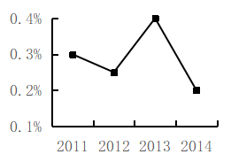
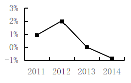
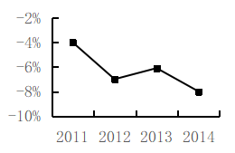
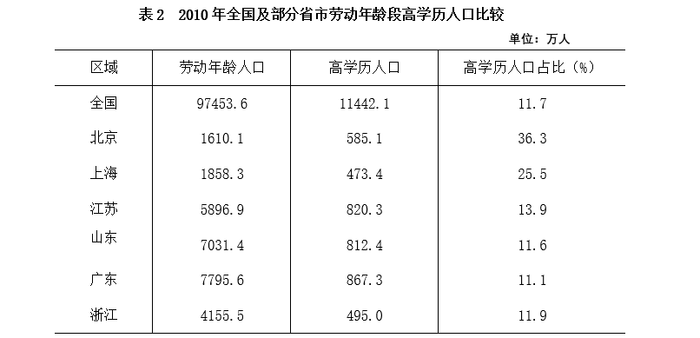

# 同比增长率逐年计算与折线趋势判断

考点：[[20-考点/资料分析/增长/同比增长率逐年计算与折线趋势判断|增长 / 同比增长率逐年计算与折线趋势判断]]
材料：[[15-材料/资料分析/348976 以浙江省为主体的人口材料：表1给出2|348976 以浙江省为主体的人口材料：表1给出2]]

**问法模型**：题干'能准确反映2011-2014年…同比增速的变化趋势'→逐年套用增速=(现期-基期)/基期计算，再匹配折线图走势（重点看峰点、零点、负值点）

## 推理链
1. 第1步：从表1'25-50岁'行提取数据：2010年2495.4、2011年2518.2、2012年2568.8、2013年2568.8、2014年2549.6（万人），基期为2010年表1首列
2. 第2步：增长率公式：同比增速=(现期值-基期值)/基期值，逐年用相邻两年数据计算
3. 第3步：2011年增速=(2518.2-2495.4)/2495.4=22.8/2495.4≈0.9%
4. 第4步：2012年增速=(2568.8-2518.2)/2518.2=50.6/2518.2≈2.0%，为四年最高点（峰）
5. 第5步：2013年增速=(2568.8-2568.8)/2568.8=0，恰在横轴上；2014年增速=(2549.6-2568.8)/2568.8=-19.2/2568.8≈-0.7%，跌破横轴为负
6. 第6步：走势为0.9%→2.0%（升）→0（骤降触零）→-0.7%（转负），与选项对照，仅B的折线呈现'低起点、2012达峰、2013落至零、2014跌破横轴'的特征
7. 第7步：故正确答案为B

**最快解法**：⚡ 特征点排除法（观察法）：不必精算全部四年——抓住三个特征即锁定：①2013年两年数值同为2568.8，增速必为0（折线触横轴）；②2014年2549.6<2568.8，增速必为负（折线破横轴）；③2012年增量50.6远大于2011年增量22.8且基期相近，2012为峰。四选项中仅B同时满足，一步排除

## 易错点
- ⚠ 2013年25-50岁人口与2012年完全相同（均2568.8），同比增速为0，快速读数易忽略这个'零增长'点，误选2013年仍在上升或下降的图
- ⚠ 2014年增速约-0.7%为负值，折线必须跌破横轴，易误选仍在正区间的图
- ⚠ 定位行时易串行：必须用嵌套结构中'其中：25-50岁'一行，而非16-64岁人口或常住人口行；2011年增速的基期是2010年（表1首列），勿漏用

## 母题抽象
> 🧩 当题干出现'能准确反映……同比增速的变化趋势（折线图）'时，逐年用(现期-基期)/基期计算增速，重点核对峰点、零点、负值点三个特征位置即可快速排除选项，无需四点全精算

**同类特征**：能准确反映、同比增速、变化趋势、折线图、2011-2014连续年份区间、需自行逐年计算增速（材料未给增速）

## 相关题
- [[10-真题/资料分析/增长/13504277 同比增速计算与折线趋势匹配（增长率数列比较）|13504277]]（云南 2025，相关度3）
- [[10-真题/资料分析/增长/15833698 环比增速计算与折线趋势图匹配|15833698]]（黑龙江 2026，相关度2）
- [[10-真题/资料分析/增长/2051184 增长量比较（同比增长量趋势折线图判断）|2051184]]（黑龙江 2017，相关度2）
- [[10-真题/资料分析/增长/5509651 环比增长率计算与趋势（折线图匹配）|5509651]]（吉林 2023，相关度2）
- [[10-真题/资料分析/增长/5893795 同比增量计算与折线趋势比对（增长量比较）|5893795]]（国考 2024，相关度2）

---

### 题干
以下        项折线图能准确反映2011-2014年浙江省25-50岁人口同比增速的变化趋势。

### 选项
- A. 

- B. 

　✅
- C. 

- D. 

### 官方解析
根据题干“······能准确反映······同比增速的变化趋势”，可判定本题为一般增长率问题。定位统计表1可得：2010-2014年，浙江省25-50岁人口数量。根据公式：增长率，可得2011年浙江省25-50岁人口数量同比增速为，观察选项，只有B项满足。
故正确答案为B。

### 给定材料

