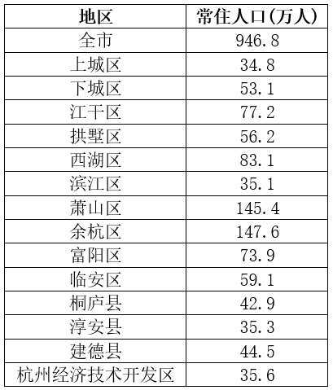

# 基期和差计算（基期总量+性别比切分求两部分差值）

考点：[[20-考点/资料分析/增长/基期和差计算（基期总量+性别比切分求两部分差值）|增长 / 基期和差计算（基期总量+性别比切分求两部分差值）]]
材料：[[15-材料/资料分析/357041 2017年末杭州市常住人口总量、增长|357041 2017年末杭州市常住人口总量、增长]]

**问法模型**：题干时间为2016年末（基期）而材料为2017年末（现期），问'男性比女性多多少万人'→基期和差模型：先求基期总量，再用性别比公式 差=基期总量×(性别比−100)/(性别比+100)

## 推理链
1. 第1步：题干定位2016年末（基期），从材料提取：2017年末常住人口946.8万人、比2016年末增加28.0万人；2017年性别比103.8、比2016年下降0.5个点
2. 第2步：基期量=现期量−增长量，得2016年末总人口=946.8−28.0=918.8万人；'下降0.5个点'说明2016年更高，2016年性别比=103.8+0.5=104.3（以女性为100）
3. 第3步：设女性=100份，男性=104.3份，男女差占总量的(104.3−100)/(104.3+100)=4.3/204.3，故差=918.8×4.3/204.3
4. 第4步：截位直除，4.3/204.3≈2.1%，918.8×2.1%≈19.3万人
5. 第5步：与选项对照，19.3与D项19最接近，故选D

**最快解法**：⚡ 公式法+截位直除：男女差=基期总量×(性别比−100)/(性别比+100)=918.8×4.3/204.3，将4.3/204.3百化分≈2.1%，918.8×2.1%≈19.3≈19，秒选D

## 易错点
- ⚠ 时间混淆：直接把2017年性别比103.8套在2016年总量918.8上，得918.8×3.8/203.8≈17.1，误选C；必须先用'+0.5'回推2016年性别比104.3
- ⚠ 现期差当基期差：直接用2017年男女人数差482.11−464.69=17.4万作答，误选C；性别比下降意味着2016年男女差应更大
- ⚠ 方向搞反：'比2016年下降0.5个点'意为2016年=103.8+0.5=104.3，若误算为103.8−0.5=103.3，得918.8×3.3/203.3≈14.9，误选B

## 母题抽象
> 🧩 当题干出现'基期年份+A比B多（少）多少'且材料以'总量增量+比例及其变化量'埋藏基期数据时，先求基期总量与基期比例，再套'差=总量×(比−100)/(比+100)'一步出差值

**同类特征**：基期时间点（2016年末）与材料现期（2017年末）不一致、求'男性比女性多多少万人'的两部分差值、性别比（以女性为100）型比例条件、基期数据藏在'增加28.0万人''下降0.5个点'的变化量表述中、选项为整数万人且相邻间隔小，需较精确的差值计算

## 相关题
（暂无）

---

### 题干
2016年末，杭州市男性人口约比女性人口多多少万人？

### 选项
- A. 11
- B. 15
- C. 17
- D. 19　✅

### 官方解析
根据题干“2016年末······比······多多少万人”，结合材料时间为2017年末，可判定本题为基期和差问题。定位文字材料可得：2017年末，杭州市常住人口为946.8万人，比2016年末增加28.0万人；性别比（以女性为100，男性对女性的比例）为103.8，比2016年下降0.5个点。根据公式：基期量=现期量-增长量，可得2016年末杭州市常住人口=946.8-28.0=918.8万人，2016年末男性对女性的性别比为103.8+0.5=104.3。则2016年末，杭州市男性人口比女性人口多万人，与D项最接近。
故正确答案为D。

### 给定材料

        2017年末，杭州市常住人口为946.8万人，比2016年末增加28.0万人，增幅3.05%。人口出生率为，比上年提高1.4个千分点，死亡率为，自然增长率达到。其中城镇人口为727.14万人，农村人口为219.66万人，农村人口占总人口的23.8%，与2016年相比，降低0.6个百分点。男性为482.11万人，占总人口的50.9%；女性为464.69万人，占总人口的49.1%。性别比（以女性为100，男性对女性的比例）为103.8，比2016年下降0.5个点。0~14岁的人口为116.64万人，占总人口的12.3%；15~64岁的人口为713.82万人，占总人口的75.4%；65岁及以上的人口为116.34万人，占总人口的12.3%。其中60岁及以上人口为180.2万人，占比为19.0%。

